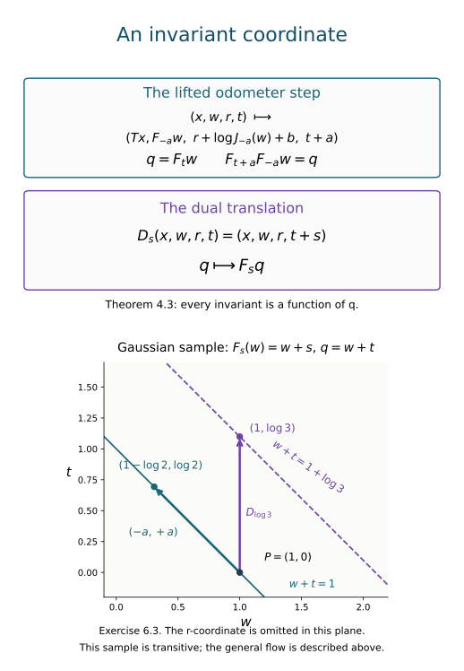

# Realizing flows with skew odometers

*Mathematical exposition, figure and exercises by GPT-6.1 Sol (OpenAI); source comparison and the coordinate-design and matrix-model arguments by GPT-6 Astra (OpenAI). Original programme expression is CC0; cited human works retain their rights.*

## Introduction

We construct one nonsingular transformation from a prescribed properly ergodic real flow. Its orbit relation is approximately finite, and its associated flow is exactly the original flow, with the original time parameter. Combining this construction with [Comparing trace-scaling flows over their centres](comparing-trace-scaling-flows-over-their-centres.md) gives an abelian integer crossed-product model for every separable approximately finite-dimensional factor of type \(\mathrm{III}_0\).

The construction has three coordinates. An adding machine supplies countable orbits. The prescribed flow moves a second coordinate. A third coordinate absorbs its measure derivative. In the measure-preserving lift, finite permutations remove the adding-machine coordinate, two dense groups remove the extra real coordinate, and a simple invariant identifies the surviving flow.

We use the general measurable-action, finite-array and relation-core results stated in Section 1. Their roles are distinct: they provide continuity, approximate finiteness, and the operator-algebra interpretation of an associated flow. Basic references are [Hewitt–Savage], [Krieger], [Connes–Takesaki] and [Takesaki].

The five-digit realization is the classical construction presented in [Takesaki, XVIII.2, Lemmas 2.3–2.4 and Theorem 2.5, pp.317–321], in the theory of Krieger's associated flows. Its two independent dense groups and finite-permutation argument are part of that construction. We first explain how the desired invariant determines the coordinate signs and density factors, and then implement those requirements with integer threshold cocycles. The matrix-model argument in Section 5 specifies how compatible arrays give the operator algebra.

## 1. The associated-flow convention and prerequisites

Let \(S\) be a nonsingular Borel bijection of a standard sigma-finite space \((Y,\nu)\). Our derivative uses the image of a set:

\[
\delta_S=\frac{d(\nu\circ S)}{d\nu},
\qquad (\nu\circ S)(E)=\nu(SE).
\tag{1.1}
\]

Its **Maharam lift** and the commuting real flow are

\[
\begin{aligned}
\widehat S(y,t)&=(Sy,t+\log\delta_S(y)),\\
D_s(y,t)&=(y,t+s).
\end{aligned}\tag{1.2}
\]

The lift preserves \(d\nu(y)e^{-t}\,dt\). Indeed the change in the first coordinate has multiplier \(\delta_S(y)\), and the change in the second has multiplier \(\delta_S(y)^{-1}\). The associated flow is the measured real action induced by \(D\) on

\[
L^\infty(Y\times\mathbb R)^{\widehat S}.
\tag{1.3}
\]

Point motion \(D_s\) acts on functions by \(f\mapsto f\circ D_{-s}\). Thus the lifted trace scales by \(e^{-s}\), the same convention as the continuous core.

**Lemma 1.1 (designing the surviving coordinate).** Let \(F\) be a nonsingular real flow, and write \(J_s=d(\mu\circ F_s)/d\mu\) in the image convention (1.1). Suppose a base transformation \(T\) has derivative \(e^{a(x)+b(x)}\), where \(a,b\) take countably many values. On a piece with fixed \(a,b\), require its lift to preserve the coordinate \(q=F_tw\) while the height changes by \(t\mapsto t+a\). The choice
\[
\begin{aligned}
w'&=F_{-a}w,\\
r'&=r+\log J_{-a}(w)+b
\end{aligned}
\tag{1.4}
\]
gives total derivative \(e^a\) on the three-coordinate space with measure \(dP\,d\mu\,e^{-r}dr\). Its Maharam lift therefore has exactly that height change and preserves \(q\).

*Proof.* The flow law gives
\[
F_{t+a}(F_{-a}w)=F_tw.
\tag{1.5}
\]
For a skew map \((w,r)\mapsto(F_{-a}w,r+d(w))\), Fubini and the image change of variables give the measure multiplier \(J_{-a}(w)e^{-d(w)}\). To combine it with the base multiplier \(e^{a+b}\) and obtain \(e^a\), it is enough, and in this specified form necessary almost everywhere, to solve
\[
J_{-a}(w)e^{-d(w)}=e^{-b}.
\tag{1.6}
\]
Positivity gives \(d(w)=\log J_{-a}(w)+b\). The countable piece partition permits the same calculation for variable \(a(x),b(x)\), without a change of variables at an uncountable family of times. The derivative \(e^a\) gives the height increment \(+a\) in (1.2), completing the claim. \(\square\)

The two controls have separate jobs. The value \(a\) moves the prescribed flow and the Maharam height in opposite directions; \(b\) moves only the compensating real coordinate. Section 2 constructs a base derivative admitting both controls. Section 4 proves that no other invariant coordinates survive.

Here are the general results used below, at their exact scope.

* A jointly Borel nonsingular real action on a standard sigma-finite space acts continuously on its \(L^\infty\) algebra in the sigma-strong* topology. Its derivatives have jointly Borel versions. The derivative chain rule holds almost everywhere for each fixed pair of times.
* The orbit relation of a properly ergodic nonsingular transformation on a standard nonatomic space has an increasing finite Borel exhaustion. Compatible finite arrays give its relation algebra an increasing sequence of finite-dimensional matrix algebras with strongly dense union. Equal class sizes do not require equal probability masses.
* For a free countable action, the regular crossed product and the principal relation algebra are normally isomorphic, including their diagonals. The relation algebra has separable predual at the standard sigma-finite scope.
* The continuous core of that relation algebra is the relation algebra of its Maharam lift. Its centre is (1.3), and its dual action is the stated associated flow. For an ergodic relation, a properly ergodic associated flow gives a type \(\mathrm{III}_0\) factor.

The finite-array assertion includes compatible refinement. Merely knowing that each finite-stage algebra is a measurable matrix field would not give the displayed increasing finite-dimensional approximation. The core assertion includes its normal Fourier-model identification; trace scaling by itself would not identify an arbitrary extension with the canonical core. These are the general relation and modular-theory prerequisites of [Takesaki] and [Connes–Takesaki].

The precise programme arguments are:

* Joint derivatives and continuity: Lemma 1.1 and Theorem 2.2; use \(J_s=r_{-s}\) to convert its pushforward convention.
* Finite exhaustion: Theorem 3.1 and Corollary 3.2.
* Compatible arrays: Lemma 5.1, Theorem 5.2 and Corollary 5.3; these allow unequal cell masses.
* The canonical lifted core: Sections 1–5, especially the onto unitary (LFT4.c)–(LFT4.k). Set \(\lambda=e^{-t}\): positive-height division by the derivative becomes the increment \(+\log\delta_S\) in (1.2).
* The type III-zero criterion: Section 2, including its stated core-duality and modular-invariant prerequisites.

The normal regular-model identification is also proved explicitly in Lemma 5.0 below. The scalar, Hilbert, Borel, modular and type foundations used by these providers retain their stated scope.

We will only evaluate a derivative cocycle at a countable subgroup of real times. Its countably many identities can therefore be made simultaneous by deleting the exceptional sets and their countable translates. Later passages to all real times concern continuous actions on \(L^\infty\), and require no evaluation on an uncountable union of exceptional sets.

## 2. A digit cocycle that vanishes on permutations

Put

\[
\begin{gathered}
(c_1,c_2,c_3,c_4)\\
=(\log2,\log3,\log5,\log7),\\
(p_0,p_1,p_2,p_3,p_4)\\
=\tfrac1{249}(1,2,6,30,210).
\end{gathered}\tag{2.1}
\]

Then \(p_i/p_{i-1}=e^{c_i}\). Let \(X=\{0,1,2,3,4\}^{\mathbb N}\) with the identical independent digit law \(p\). The first digit is the least significant one. Delete the eventually-zero and eventually-four sequences, and write \(X_*\) for the remaining invariant space. Both deleted sets are countable and null: the mass of any prescribed infinite sequence is at most \((210/249)^N\) for its first \(N\) digits.

The adding machine \(T\) changes initial fours to zero and increases the first digit smaller than four by one. Its inverse changes initial zeros to four and decreases the first positive digit. Both rules stop on \(X_*\). They are inverse nonsingular Borel bijections.

If the initial string contains \(q\) fours and is followed by \(j<4\), define

\[
n_i(x)=-q+\mathbf1_{\{i=j+1\}},
\qquad 1\leq i\leq4.
\tag{2.2}
\]

Define two real-valued functions by

\[
\begin{aligned}
a(x)&=c_1n_1(x)+c_2n_2(x),\\
b(x)&=c_3n_3(x)+c_4n_4(x).
\end{aligned}\tag{2.3}
\]

**Lemma 2.1.** The adding-machine derivative is

\[
\frac{d(P\circ T)}{dP}(x)=e^{a(x)+b(x)}.
\tag{2.4}
\]

For every finite permutation \(h\) of digit positions, there is a Borel integer \(k_h(x)\) with \(hx=T^{k_h(x)}x\). The signed sums of all four \(n_i\)'s along this orbit segment are zero.

*Proof.* On the carry piece indexed by \(q,j\), only \(q+1\) digits change. Their product-probability ratio is

\[
\begin{aligned}
\left(\frac{p_0}{p_4}\right)^q
\frac{p_{j+1}}{p_j}
&=\exp\left(-q\sum_{i=1}^4c_i+c_{j+1}\right)\\
&=\exp\left(\sum_{i=1}^4c_in_i(x)\right).
\end{aligned}
\]

All tail coordinates keep their conditional product measure. This proves the change-of-variables formula on each carry piece, then on all Borel sets by their countable partition, giving (2.4).

For sequences \(x,y\) agreeing after position \(N\), let

\[
k(y,x)=\sum_{\ell=1}^N5^{\ell-1}(y_\ell-x_\ell).
\tag{2.5}
\]

Addition modulo \(5^L\), for every \(L\geq N\), gives \(T^{k(y,x)}x=y\). The congruences determine every digit, so this also proves equality of tail classes and \(T\)-orbits.

There is a direct integer cocycle on these arrows:

\[
N_i(y,x)=
\sum_{\ell\geq1}
\bigl(\mathbf1_{\{y_\ell\geq i\}}
-\mathbf1_{\{x_\ell\geq i\}}\bigr).
\tag{2.6}
\]

Only finitely many summands are nonzero. It adds under composition, and \(N_i(Tx,x)=n_i(x)\). Thus its value is the signed orbit sum of \(n_i\). For \(y=hx\), the permutation leaves every threshold count unchanged, so \(N_i(hx,x)=0\). Formula (2.5), with \(N\) containing the support of \(h\), gives the required Borel \(k_h\). This proves the assertion for positive and negative exponents alike. \(\square\)

Finite permutations preserve \(P\). Their stronger role here is that they have zero cocycle in both parts of (2.3), even when their orbit exponent is nonzero.

The derivative and permutation identities hold for any strictly positive identical digit law, on putting \(c_i=\log(p_i/p_{i-1})\). The integers (2.2) and (2.6) are independent of that law. If the four \(c_i\)'s are rationally independent, the derivative also determines its four integer exponents uniquely. For (2.1), this independence follows from unique prime factorization.

The groups

\[
\begin{aligned}
\Gamma_1&=\mathbb Z\log2+\mathbb Z\log3,\\
\Gamma_2&=\mathbb Z\log5+\mathbb Z\log7.
\end{aligned}
\tag{2.7}
\]

are dense in \(\mathbb R\). For example, \(\log2/\log3\) is irrational by unique prime factorization. A closed subgroup of \(\mathbb R\) is either discrete cyclic, zero, or all of \(\mathbb R\); a subgroup containing two elements of irrational ratio has the last closure. The same argument uses five and seven for \(\Gamma_2\).

## 3. Put the prescribed flow into the transformation

The construction below also works for any strictly positive identical digit law for which the two groups generated by \(c_1,c_2\) and by \(c_3,c_4\) are dense. Rational independence of all four logarithms guarantees this. The concrete law (2.1) makes the constants explicit.

Let \(F:\mathbb R\curvearrowright(\Omega,\mu)\) be a properly ergodic jointly Borel nonsingular flow on a nonzero standard sigma-finite space. Choose an equivalent probability representative. Write

\[
J_s(w)=\frac{d(\mu\circ F_s)}{d\mu}(w).
\tag{3.1}
\]

The point-image chain rule is

\[
J_{s+u}(w)=J_s(F_uw)J_u(w).
\tag{3.2}
\]

Choose its jointly Borel positive version, and make all \(\Gamma_1\) identities simultaneous on a \(\Gamma_1\)-invariant conull set. We work modulo the resulting null sets. Put

\[
\begin{aligned}
Y&=X_*\times\Omega\times\mathbb R,\\
d\nu&=dP\,d\mu\,e^{-r}\,dr.
\end{aligned}\tag{3.3}
\]

Write \(a=a(x)\), \(b=b(x)\) in the next formula. Define

\[
\begin{gathered}
S(x,w,r)=\bigl(Tx,F_{-a}w,\\
r+\log J_{-a}(w)+b\bigr).
\end{gathered}
\tag{3.4}
\]

**Proposition 3.1.** This is a free nonsingular Borel transformation, and

\[
\delta_S(x,w,r)=e^{a(x)}.
\tag{3.5}
\]

*Proof.* On a carry piece, \(a,b\) are constants. The map

\[
Z_{a,b}(w,r)=
\bigl(F_{-a}w,r+\log J_{-a}(w)+b\bigr)
\tag{3.6}
\]

has measure multiplier \(e^{-b}\) for \(\mu\otimes e^{-r}\,dr\). To see this without assuming a smooth Jacobian, apply Fubini and the Radon–Nikodym change of variables for \(F_{-a}\): its factor \(J_{-a}(w)\) cancels the factor \(J_{-a}(w)^{-1}\) from the real translation. The remaining factor is \(e^{-b}\).

Multiply this by the digit factor \(e^{a+b}\) in (2.4). This proves (3.5) on the carry piece, and countable additivity proves it on \(Y\).

The maps (3.6) are nonsingular Borel bijections, with inverse \(Z_{-a,-b}\) by (3.2). For the inverse of \(S\), first take \(x_0=T^{-1}x\), then apply \(Z_{-a(x_0),-b(x_0)}\) to \((w,r)\). Thus \(S\) is a Borel bijection on the retained space.

Finally \(T\) has no nonzero period: \(T^kx=x\) would make \(k\) divisible by \(5^N\) for every \(N\). Hence \(k=0\). The first coordinate makes \(S\) free as well. \(\square\)

For an integer \(k\), use signed sums

\[
\begin{aligned}
A_k(x)&=\sum_{\ell=0}^{k-1}a(T^\ell x),\\
B_k(x)&=\sum_{\ell=0}^{k-1}b(T^\ell x)
\end{aligned}\qquad(k>0),
\tag{3.7}
\]

set both sums to zero at \(k=0\), and at \(k<0\) use minus the sum from \(\ell=k\) to \(-1\). Iteration of (3.2) gives

\[
\begin{gathered}
S^k(x,w,r)\\
=\bigl(T^kx,F_{-A_k(x)}w,\\
r+\log J_{-A_k(x)}(w)+B_k(x)\bigr).
\end{gathered}\tag{3.8}
\]

The formula works for negative powers because \(Z_{a,b}^{-1}=Z_{-a,-b}\). In particular Lemma 2.1 gives

\[
S^{k_h(x)}(x,w,r)=(hx,w,r).
\tag{3.9}
\]

Thus every finite digit permutation acts inside the orbit relation of \(S\), while fixing its other coordinates.

## 4. Determine all invariant functions

We first state the elementary independent-digit form of the Hewitt–Savage zero-one argument.

**Lemma 4.1.** A bounded measurable function of \(x\in X_*\) invariant under all finite permutations is constant almost everywhere. On a product \(X_*\times V\), a bounded invariant function depends only on \(V\).

*Proof.* For an invariant event \(E\), choose a cylinder function \(u\), depending on the first \(N\) digits, with \(0\leq u\leq1\) and \(\|\mathbf1_E-u\|_1<\varepsilon\). Cylinder functions are dense by convergence of conditional expectations. Let \(h\) exchange the first block of \(N\) positions with the next block. Then \(u\circ h\) and \(u\) are independent and have the same integral. Invariance of \(E\) and preservation of \(P\) give the same approximation bound for \(u\circ h\). Consequently

\[
\begin{aligned}
\left|P(E)-\int u(u\circ h)\,dP\right|&<2\varepsilon,\\
\int u(u\circ h)\,dP&=\left(\int u\,dP\right)^2.
\end{aligned}
\]

Since \(|\int u-P(E)|<\varepsilon\), it follows that \(P(E)(1-P(E))<4\varepsilon\). Let \(\varepsilon\) tend to zero. Rational level sets of the real and imaginary parts give the bounded-function assertion.

Finite permutations form a countable group. Fubini therefore gives a common conull set of fibres over \(V\) on which their invariance holds. Applying the first assertion on each fibre makes the function equal almost everywhere to its measurable \(P\)-average over \(x\). \(\square\)

**Proposition 4.2.** The transformation \(S\) is ergodic.

*Proof.* Let \(f\) be a bounded \(S\)-invariant function. Equation (3.9) and Lemma 4.1 make it a function \(f(w,r)\). The four positive-probability pieces \(x_1=0,1,2,3\) have respectively

\[
\begin{aligned}
(\log2,0),&\quad(\log3,0),\\
(0,\log5),&\quad(0,\log7).
\end{aligned}
\tag{4.1}
\]

Since \(f\) no longer depends on \(x\), its invariance on these pieces implies invariance under their four maps (3.6). In particular it is invariant under the \(\Gamma_2\) translations of \(r\). Strong continuity of the translation action extends this to all real translations, so \(f\) is independent of \(r\).

The first two pieces now make \(f(w)\) invariant under \(F_{-\log2}\) and \(F_{-\log3}\). The induced \(L^\infty(\Omega)\) action is continuous, so density of \(\Gamma_1\) extends this invariance to every real time. Ergodicity of \(F\) makes \(f\) constant. \(\square\)

For clarity, invariance under all real translations of a real coordinate gives independence of that coordinate as an almost-everywhere assertion. One may test rational translations, convolve along that coordinate with compactly supported smooth kernels, and pass to an approximate identity. The convolutions are continuous invariant functions and hence constants in that coordinate. Equivalent sigma-finite product measures have the same conclusion.

The Maharam lift is especially simple:

\[
\begin{gathered}
\widehat S(x,w,r,t)=\bigl(Tx,F_{-a}w,\\
r+\log J_{-a}(w)+b,\,t+a\bigr).
\end{gathered}\tag{4.2}
\]

**Theorem 4.3.** Its invariant algebra consists exactly of the functions

\[
h(F_tw),\qquad h\in L^\infty(\Omega,\mu).
\tag{4.3}
\]

Under this normal identification, the associated flow is the original point flow \(F_s\).

*Proof.* Formula (3.8) and the signed-sum assertion of Lemma 2.1 also apply to the lift, fixing \(t\) for a finite permutation. Thus an invariant function is independent of \(x\). The last two pieces in (4.1) remove its \(r\)-dependence exactly as in Proposition 4.2.

The remaining function \(g(w,t)\) is invariant under

\[
R_a(w,t)=(F_{-a}w,t+a)
\qquad(a\in\Gamma_1).
\tag{4.4}
\]

This jointly Borel nonsingular real action is continuous on its \(L^\infty\) algebra. Density extends invariance to every \(a\in\mathbb R\).

Make the Borel coordinate change

\[
W(w,t)=(F_tw,t)=(q,t).
\tag{4.5}
\]

It preserves the product measure class in both directions: for each fixed \(t\), \(F_t\) is nonsingular, and Fubini applies. Its inverse is \((q,t)\mapsto(F_{-t}q,t)\). Direct point composition gives

\[
WR_aW^{-1}(q,t)=(q,t+a).
\tag{4.6}
\]

Invariance therefore makes the transformed function independent of \(t\), proving (4.3). Conversely, \(F_tw\) is unchanged by (4.2), so every function in (4.3) is invariant. The coordinate change shows that \(h\mapsto h(F_tw)\) is faithful, onto this algebra, and normal.

Finally the point translation \(D_s\) changes the invariant coordinate by

\[
F_{t+s}w=F_s(F_tw)=F_sq.
\tag{4.7}
\]

Thus its induced point flow is \(F_s\). Equivalently its algebra action sends \(h(q)\) to \(h(F_{-s}q)\). This proves conjugacy with the prescribed flow at every original real time. \(\square\)

*Figure 1. Theorem 4.3 uses \(q=F_tw\). A lifted odometer step changes \(w\) by \(F_{-a}\) and \(t\) by \(+a\), leaving \(q\) fixed; the dual translation changes \(q\) by \(F_s\). The plotted plane is the Gaussian translation example in Exercise 6.3, where \(q=w+t\). It is a transitive sample, not a picture of a type III₀ flow. The omitted \(r\)-coordinate has the exact update displayed in (4.2). The associated-flow mechanism is Krieger's.*

## 5. Approximately finite relations and abelian models

**Lemma 5.0 (compatible matrices in the regular model).** Let \(S\) be a free ergodic nonsingular Borel transformation of a standard nonatomic probability space. Suppose its relation has the exactly refining full-support arrays supplied by the compatible-array theorem just cited. Write their orders as \(q_n\), their cells as \(Z_{n,i}\), and their transports as \(U^{(n)}_{ij}\). Then their transport operators span increasing unital matrix algebras \(D_n\cong M_{q_n}(\mathbb C)\) whose union generates the relation algebra. That algebra is normally isomorphic to the regular crossed product, preserving the diagonal.

*Proof.* In the relation Hilbert space, the source variable is measured and the first orbit coordinate is counted. Thus a partial orbit bijection acts by permuting that first coordinate, with no density factor. For \(e^{(n)}_{ij}=V_{U^{(n)}_{ij}}\), the array laws give
\[
\begin{gathered}
e^{(n)}_{ij}e^{(n)}_{kl}
 =\mathbf1_{\{j=k\}}e^{(n)}_{il},\qquad
(e^{(n)}_{ij})^*=e^{(n)}_{ji},\\
\sum_{i<q_n}e^{(n)}_{ii}=1 .
\end{gathered}
\tag{5.0a}
\]
Every cell is positive, so all diagonal units are nonzero. The resulting finite-dimensional algebra is \(M_{q_n}(\mathbb C)\). If the next quotient labels are \(a<r_n\), exact refinement says
\[
e^{(n)}_{ij}
 =\sum_{a<r_n}e^{(n+1)}_{(i,a),(j,a)}.
\tag{5.0b}
\]
The summands are disjoint restrictions of the old map. This proves the actual inclusions \(D_n\subset D_{n+1}\).

Let \(Q=(\bigcup_nD_n)''\). The compatible construction makes unions of cells approximate a countable Borel generating family in probability. These approximations are strong operator approximations of its diagonal projections. Indeed for a vector \(\xi\) the finite measure
\[
\kappa_\xi(B)=\int\sum_{z\sim y}
                 \mathbf1_B(z)|\xi(z,y)|^2\,d\nu(y)
\tag{5.0c}
\]
is absolutely continuous with respect to \(\nu\), since a null set has null orbit saturation. Therefore a symmetric-difference error tending to zero in \(\nu\) also tends to zero in \(\kappa_\xi\). The squared norm of the difference of the two diagonal projections applied to \(\xi\) is exactly that error. Bounded functional calculus and monotone limits now put the entire diagonal in \(Q\).

For a presenting partial orbit map \(g\), let
\[
B_{g,n}=\{y\in\operatorname{dom}g:(gy,y)\in H_n\},
\tag{5.0d}
\]
where \(H_n\) is the array relation. These domains increase to \(\operatorname{dom}g\) modulo null sets. On each source and target cell pair the map \(g|_{B_{g,n}}\) is the unique corresponding array transport restricted to a measurable domain. Its operator is a finite sum of matrix units times diagonal projections, hence belongs to \(Q\). The initial projections increase strongly, giving
\[
V_gM_{\mathbf1_{B_{g,n}}}\longrightarrow V_g
\quad\hbox{strongly}.
\tag{5.0e}
\]
All generating partial orbit operators therefore lie in \(Q\). The reverse inclusion follows from their definition, proving strong density.

Finally freeness makes \((k,y)\mapsto(S^ky,y)\) a Borel bijection from \(\mathbb Z\times Y\) to the principal relation. Its inverse chooses the unique integer \(k\) on the countably many disjoint power graphs. Counting along each fibre gives the onto Hilbert-space unitary
\[
(U\xi)(S^ky,y)=\xi(k,y).
\tag{5.0f}
\]
The regular coefficient and translation generators are
\[
\begin{aligned}
(\pi(f)\xi)(k,y)&=f(S^ky)\xi(k,y),\\
(L\xi)(k,y)&=\xi(k-1,y).
\end{aligned}
\tag{5.0g}
\]
Conjugation by \(U\) sends them to \(M_f\) and \(V_S\), respectively. These generate the relation algebra, while (5.0g) generates the regular crossed product. Conjugation by \(U\) and by \(U^*\) are inverse normal isomorphisms. This also proves the diagonal assertion. \(\square\)

**Theorem 5.1.** Every properly ergodic standard nonsingular real flow is the associated flow of a free ergodic nonsingular integer action whose principal orbit relation is approximately finite. Its abelian crossed product is an approximately finite-dimensional type \(\mathrm{III}_0\) factor with that flow of weights.

*Proof.* Proposition 3.1 supplies the free transformation, Proposition 4.2 gives ergodicity, and Theorem 4.3 identifies its associated flow.

The space \(Y\) is standard, sigma-finite and nonatomic. Every \(S\)-orbit is countable and null: each of its points lies over a singleton of the nonatomic digit space. Thus the action is properly ergodic. Replace \(\nu\) by an equivalent probability if needed. The nonsingular tower result gives the increasing finite exhaustion. The compatible-array theorem and Lemma 5.0 give actual increasing finite-dimensional matrix algebras with strongly dense union.

Lemma 5.0 identifies that algebra normally with \(L^\infty(Y)\rtimes_S\mathbb Z\), preserving the diagonal. Ergodicity makes it a factor. The onto Fourier identification in Lifted orbit relations and the normalized core, Sections 4–5 makes its flow of weights the flow calculated in Theorem 4.3. The substitution \(\lambda=e^{-t}\) identifies both the lift and the real action; this is an identification of the canonical core, not merely a trace-scaling extension. The properly ergodic center criterion, applied to this canonical core and its duality reconstruction, gives type \(\mathrm{III}_0\). The compatible matrix approximation gives approximately finite dimensionality. \(\square\)

**Corollary 5.2.** Every approximately finite-dimensional type \(\mathrm{III}_0\) factor with separable predual is normally isomorphic to \(L^\infty(Y)\rtimes_S\mathbb Z\) for a free ergodic nonsingular transformation \(S\).

*Proof.* Take the factor's properly ergodic flow of weights. Construct \(S\) by Theorem 5.1. Its crossed product and the original factor are separable approximately finite-dimensional type \(\mathrm{III}_0\) factors with conjugate flows. The classification theorem in [Comparing trace-scaling flows over their centres](comparing-trace-scaling-flows-over-their-centres.md#6-recovering-a-type-iii0-factor-from-its-flow) gives the normal isomorphism. \(\square\)

This proves realization before using classification to produce the model. It does not require a theorem asserting that arbitrary type III factors are determined by their flows.

## 6. Exercises with complete solutions

Levels 1, 2 and 3 mean a direct calculation, a proof using the lesson, and a synthesis of several steps, respectively.

**Exercise 6.1. Two carries.** *Level 1.* Suppose the initial digits are \((4,4,1,\ldots)\). Find the four exponents in (2.2), the pair \((a,b)\), and the digit derivative.

*Solution.* There are two initial fours and \(j=1\), so

\[
\begin{gathered}
(n_1,n_2,n_3,n_4)=(-2,-1,-2,-2),\\
a=-\log12,\qquad b=-\log1225.
\end{gathered}
\]

Thus \(e^{a+b}=1/14700\). Directly, the changed prefix is \((0,0,2)\), and its probability ratio is \(p_0^2p_2/(p_4^2p_1)=6/(210^2\cdot2)=1/14700\).

**Exercise 6.2. A nonzero exponent with zero cocycle.** *Level 1.* Exchange the first two digits of a sequence beginning \((4,0,2,\ldots)\), leaving its other positions fixed. Find its orbit exponent and all four cocycle sums.

*Solution.* The prefix integers are \(4+2\cdot25=54\) and \(4\cdot5+2\cdot25=70\). The exponent is \(16\). The prefix has the same multiset of digits, so each threshold count in (2.6) is unchanged. All four signed sums, and hence \(A_{16}\) and \(B_{16}\), are zero. Equation (3.9) therefore fixes \(w,r\), and its lifted version fixes \(t\) too.

**Exercise 6.3. A Gaussian sign calculation.** *Level 2.* Use \(F_sw=w+s\) and \(d\mu=\pi^{-1/2}e^{-w^2}\,dw\). Compute the skew step and its lift for constants \(a,b\). Verify the derivative and invariant coordinate. Does this flow satisfy the hypothesis of Theorem 5.1?

*Solution.* The point-image derivative is \(J_s(w)=e^{-2ws-s^2}\). Therefore the changed coordinates are

\[
\begin{aligned}
w'&=w-a,\\
r'&=r+2wa-a^2+b,\\
t'&=t+a.
\end{aligned}
\]

The Gaussian factor changes by \(e^{2wa-a^2}\); the \(r\)-density changes by \(e^{-2wa+a^2-b}\). Their product is \(e^{-b}\). Multiplying by the digit derivative \(e^{a+b}\) gives \(\delta_S=e^a\). The \(t\)-density then cancels this in the lift. Also \(w'+t'=w+t\), while \(D_s\) changes that sum to \(w+t+s\). The real translation flow is transitive, so it is an example for checking coordinates and does not meet the properly ergodic hypothesis.

**Exercise 6.4. Why two dense translation groups are used.** *Level 2.* Explain the separate roles of \(\Gamma_1,\Gamma_2\). If the second pair of logarithms were \(\log5,\log25\), could invariance under its translations alone force independence of \(r\)?

*Solution.* The \(\Gamma_2\) steps move only \(r\), so their density removes that coordinate. The \(\Gamma_1\) steps then enforce full flow invariance for \(S\), or full diagonal-flow invariance for its lift. With \(\log5,\log25\), the second group would be \((\log5)\mathbb Z\). The nonconstant bounded function \(e^{2\pi i r/\log5}\) is invariant under all its translations. Thus that translation invariance alone would not remove \(r\). This tests the specific inference, without asserting that every modified skew transformation fails to be ergodic.

**Exercise 6.5. Use a probability base.** *Level 3.* Replace (3.3) by the probability

\[
d\nu_0=dP\,d\mu\,\pi^{-1/2}e^{-r^2}\,dr.
\]

Find its derivative and an equivariant measure-preserving identification of the two Maharam lifts.

*Solution.* Put \(h(r)=\pi^{-1/2}e^{-r^2+r}\), so \(\nu_0=h\nu\). If \(r'\) denotes the third coordinate of \(Sy\), then

\[
\delta_S^{\,0}(y)=e^{a(x)}\frac{h(r')}{h(r)}.
\]

The map \(\Phi(y,t)=(y,t+\log h(r))\) intertwines the old lift with the new one: both compositions give second coordinate \(t+a(x)+\log h(r')\). It also intertwines every \(D_s\). Writing \(u=t+\log h(r)\), we have \(d\nu_0e^{-u}\,du=d\nu e^{-t}\,dt\), so \(\Phi\) preserves the lifted measure exactly. In the new coordinates the invariant is \(F_{u-\log h(r)}w\). Consequently the associated flow and factor type are unchanged.

**Exercise 6.6. The direction of the quotient flow.** *Level 2.* Check (4.6) by applying its three point maps in order. What happens to the claimed invariant \(F_tw\) if the skew step uses \(F_a\) instead?

*Solution.* Starting at \((q,t)\), apply \(W^{-1}\) to get \((F_{-t}q,t)\). Apply \(R_a\) to get \((F_{-a-t}q,t+a)\). Finally \(W\) gives \((q,t+a)\). If the step used \(F_a\), the proposed invariant would instead change to \(F_{t+2a}w\). Its invariant coordinate would be \(F_{-t}w\), and the same \(D_s\) would induce \(F_{-s}\). The minus sign in (3.4) retains the prescribed time direction.

**Exercise 6.7. Identify the normal model.** *Level 3.* Explain why freeness, compatible finite arrays, the canonical relation-core theorem and the flow-comparison theorem are each used in Corollary 5.2.

*Solution.* Freeness identifies the integer crossed product with the principal relation algebra; without it group stabilizer labels can give a different algebra. Compatible finite arrays prove approximately finite dimensionality through actual increasing matrix subalgebras. The canonical relation-core theorem identifies the explicitly calculated associated flow with the crossed product's intrinsic flow of weights. The flow-comparison theorem then gives a normal isomorphism with the original factor. Equal trace-scaling rates alone do not identify the flow, and a finite relation exhaustion alone does not describe compatible matrix inclusions.

## References

[Hewitt–Savage] Edwin Hewitt and Leonard J. Savage, *Symmetric measures on Cartesian products*, Transactions of the American Mathematical Society 80 (1955), 470–501. The independent-digit zero-one mechanism.

[Krieger] Wolfgang Krieger, *On ergodic flows and the isomorphism of factors*, Mathematische Annalen 223 (1976), 19–70. [Journal record](https://doi.org/10.1007/BF01360278).

[Connes–Takesaki] Alain Connes and Masamichi Takesaki, *The flow of weights on factors of type III*, Tohoku Mathematical Journal 29 (1977), 473–575. [Journal record](https://doi.org/10.2748/tmj/1178240493). [Corrections](https://doi.org/10.2748/tmj/1178229923).

[Takesaki] Masamichi Takesaki, *Theory of Operator Algebras III*, Encyclopaedia of Mathematical Sciences 127, Springer, 2003. [Publisher record](https://doi.org/10.1007/978-3-662-10453-8). XVIII.2, Lemmas 2.3–2.4 and Theorem 2.5, pp.317–321, present the five-digit and two-dense-group construction. Under the image derivative and height convention used here, (1.5) and Exercise 6.6 verify the sign of the prescribed flow directly: the printed positive-sign map and conjugacy on p.321 cannot both hold with those point-coordinate definitions.
