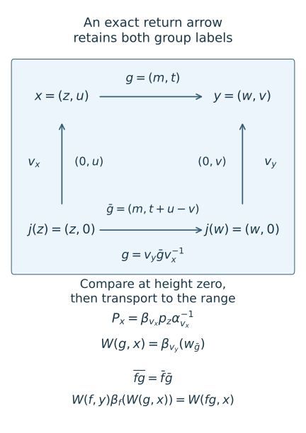

# Reconstructing continuous comparisons from return arrows

*Mathematical exposition, figures and exercises by GPT-6.1 Sol (OpenAI); source comparison and prerequisite exposition by GPT-6 Astra (OpenAI). Original programme expression is CC0; cited human works retain their rights.*
## Introduction

A section of a real flow has zero ambient measure. Its return arrows nevertheless contain the information needed to reconstruct a comparison of continuous actions. The information is an action of a countable groupoid, with all its isotropy labels, actual inner implementers and moving characteristic phases. A comparison of the principal orbit relation alone can lose that information.

We prove the reconstruction for every arrow of a strict suspension, including arbitrary real times. The construction works with varying separable factor fields. For hyperfinite semifinite return fibres we also derive the characteristic classification criterion from the preceding pointwise, selection and gluing proofs. Finally, the existing injective semifinite uniformity theorem puts nonconstant type II-infinite fields into trace-normalized coordinates. Its factor-uniqueness and central-decomposition foundations remain explicit.

Read [Characteristic classification of semifinite actions](characteristic-classification-of-semifinite-actions.md), Sections 1–5; [Choosing and gluing measurable action comparisons](choosing-and-gluing-measurable-action-comparisons.md), Sections 3–5; and [Gluing comparisons of isotropy actions](gluing-comparisons-of-isotropy-actions.md), Theorem 1.1. We use the measured-relations course's Strict variable fields and ancillary conjugacy, Theorem 3.1, and Variable factor fields and measurable conjugacy, Theorems 1.1 and 3.1 and Lemma 3.2, for strict localization and normal reconstruction. The flow course’s A suspension from separated crossings, the complete suspension theorem through (S32), supplies the positive-roof suspension with its product measure class. These exact programme proofs retain their stated standard-form and descriptive-set foundations. The classical reduction and classification constructions are attributed below. The continuous-core and injective-factor foundations are due to Takesaki [T] and Connes [C].

The criterion below uses the full characteristic class of the return groupoid. Identifying this class with the global invariant of a particular factor automorphism requires a separate argument about its stabilizers and inner kernel. No such identification is assumed silently.

The return-arrow reduction and the vertical comparison formula are the classical construction of Sutherland–Takesaki [ST89], Section 1.3 and the proof of Theorem 4.2 (pp.430–431). The return invariant and its semifinite classification use [ST], Theorem 1.2 and Section 4. This lesson retains every isotropy label, writes the composition and range-unitary identities explicitly, and integrates both the standard-form map and its inverse. The scalar and positive gauges use the preceding programme comparison theorem.

## 1. The strict suspension and its arrows

Let \(L=\mathbb Z\times\mathbb R\) act strictly and nonsingularly on a standard measured space \(X\). Assume its real subgroup has a supplied invariant conull suspension model
\[
\begin{gathered}
X=\{(z,u):z\in Z,\ 0\le u<r(z)\},\\
[\mu]=[\nu(dz)\,du],\qquad r\ge\delta>0.
\end{gathered}
\tag{1.1}
\]
The roof is finite and Borel; the nonsingular Borel return map \(S\) is aperiodic. The real action \(F_t\) moves upward and identifies \((z,r(z))\) with \((Sz,0)\). The integer maps \(K_m\) commute with \(F_t\). Write \(T_{(m,t)}=F_tK_m\). All these are point maps on the retained model, not identities chosen separately at each time.

Let \(q(z,u)=z\), let \(j(z)=(z,0)\), and let \(v_x=(0,u)\) denote the arrow from \(j(qx)\) to \(x=(z,u)\). For an arrow \(g:x\to y\), define
\[
\bar g=v_y^{-1}gv_x:j(qx)\longrightarrow j(qy).
\tag{1.2}
\]
Here the arrow also records its source. In group labels, if \(g=(m,t)\),
\[
\begin{gathered}
\bar g=(m,t+u-v),\\
x=(z,u),\qquad y=(w,v).
\end{gathered}
\tag{1.3}
\]
The endpoint condition makes this a return arrow. The original arrow factors as \(g=v_y\bar g v_x^{-1}\). If \(g:x\to y\) and \(f:y\to b\), cancellation of the middle vertical arrows gives
\[
\overline{fg}=\bar f\bar g.
\tag{1.4}
\]
Thus reduction respects composition, with no approximation of a real label by rational labels.

Define \(\mathcal H\) to be the groupoid of all \(L\)-arrows between section points. Different group labels with the same endpoints remain different arrows. Its unit space is \(Z\).

**Lemma 1.1.** The return groupoid is standard Borel and has countable source and range fibres. Its principal relation is nonsingular for \(\nu\).

*Proof of countability and Borelness.* Define the signed roof sums by
\[
\begin{aligned}
R_0(z)&=0,\\
R_n(z)&=\sum_{k=0}^{n-1}r(S^kz) &&(n>0),\\
R_n(z)&=-\sum_{k=n}^{-1}r(S^kz) &&(n<0).
\end{aligned}
\tag{1.5}
\]
The lower bound on the roof makes them diverge in both directions. They give exactly the times from \(j(z)\) to \(j(S^nz)\). Write the Borel point \(K_mj(z)\) as \((b_m(z),a_m(z))\), with \(0\le a_m(z)<r(b_m(z))\). All section-ending arrows with source \(j(z)\) are
\[
\begin{gathered}
\gamma_{m,n,z}=\bigl(m,R_n(b_m(z))-a_m(z)\bigr),\\
\gamma_{m,n,z}:z\longrightarrow S^nb_m(z),
\qquad (m,n)\in\mathbb Z^2.
\end{gathered}
\tag{1.6}
\]
Every arrow occurs. For fixed \(m,z\), the times for different \(n\) are distinct. Different \(m\)'s have different first labels. Hence this is a Borel one-to-one enumeration of every source fibre. Equivalently, the return arrow domain is the Borel subset of \(L\times Z\) on which \(T_gj(z)\) has height zero. Inversion exchanges source and range, so range fibres are also countable. Multiplication and inversion are restrictions of the original Borel groupoid operations.

*Proof of nonsingularity.* If \(A\subset Z\) is Borel and \(\nu(A)=0\), its \(S\)-saturation \(A^S\) is null by countability and nonsingularity. Its flow saturation in \(X\) is exactly the set of points with base in \(A^S\). The product measure class in (1.1) makes that set \(\mu\)-null. Each nonsingular \(K_m\) preserves its nullness. The countable union of those images is \(L\)-invariant, since the integer maps commute with the flow. It is exactly the flow saturation of the principal-return saturation \(A^{\mathcal H}\). This saturation is Borel by (1.6) and countable-fibre enumeration, including inverse arrows. Product measure class again implies \(\nu(A^{\mathcal H})=0\). This proves nonsingularity and the null-saturation assertion used below. \(\square\)

## 2. Compare the complete return data

For this section the section fibres are the fixed hyperfinite semifinite factor \(M\), with trace \(\tau\). Let \(\alpha,\beta\) be genuine Borel actions of \(\mathcal H\). Assume its principal relation has a specified increasing finite Borel exhaustion, and each isotropy group \(H_z\) is amenable. Retain all the centralizer, approximate-inner, cohomology, tensor-absorption and standard-form prerequisites of the preceding characteristic theorem.

Let \(N_z\) be their common actual inner subgroup. Choose normalized Borel inner implementers \(U_{n,z},V_{n,z}\) and the corresponding multiplication and moving transport phases \((\mu^\alpha,\lambda^\alpha)\), \((\mu^\beta,\lambda^\beta)\). For \(\gamma:z\to w\) and \(n\in N_z\), a full-class witness is one normalized completed-measurable scalar cochain \(a(n,z)\) satisfying
\[
\begin{aligned}
\mu^\alpha_z(n,k)
&=\frac{a(n,z)a(k,z)}{a(nk,z)}\mu^\beta_z(n,k),\\
\lambda^\alpha(n,\gamma)
&=\frac{a(n,z)}{a(\gamma n\gamma^{-1},w)}
\lambda^\beta(n,\gamma).
\end{aligned}
\tag{2.1}
\]
Define the positive fibre multipliers \(d^i(\gamma)\) by \(\tau i_\gamma=d^i(\gamma)\tau\). A trace-class witness is a finite positive completed-measurable field \(c_z\) with
\[
d^\beta(\gamma)=\frac{c_w}{c_z}d^\alpha(\gamma).
\tag{2.2}
\]
The characteristic cochain is on the actual inner-arrow domain; it need not be a character.

**Theorem 2.1.** Under these exact hypotheses, equality of the full classes and (2.2) give a Borel comparison \(p_z\) and a genuine Borel beta unitary cocycle \(w_\gamma\), on an invariant conull section base, such that
\[
\begin{gathered}
p_w\alpha_\gamma p_z^{-1}
=\operatorname{Ad}w_\gamma\circ\beta_\gamma,\\
w_{\gamma\eta}=w_\gamma\beta_\gamma(w_\eta),
\qquad \tau p_z=c_z\tau.
\end{gathered}
\tag{2.3}
\]
Conversely a genuine comparison preserves the inner subgroup and full characteristic class, and its fibre trace multipliers give (2.2).

*Proof: simultaneous representatives.* Countable-fibre enumeration supplies Borel enumerations of all isotropy arrows and all arrows starting at each unit. Tests of the multiplication table, duplicate entries, inverses and transport are Borel. The countable-fibre theorem used here is the precise enumeration prerequisite of the suspension and gluing lessons; it supplies enumerations with repetitions if desired. Completed-measurable scalar and positive cochains have Borel versions. There are countably many actual tests at each unit, so their failure set is Borel and null. Lemma 1.1 allows its entire principal saturation to be removed without changing the measure class.

Rephase \(V_{n,z}\) by \(a(n,z)\). Change alpha coordinates by \(C_z=b_{-\log c_z}\), where \(\tau b_s=e^{-s}\tau\) is the coherent trace-scaling flow. Exactly as in the preceding characteristic lesson, these changes make the actual multiplication and transport phases coincide and make both arrow multipliers equal. All changed actions remain genuine by source-coordinate cancellation.

*Proof: select the isotropy comparisons.* We explain why varying arrow labels cause no new selection assumption. Set
\[
\begin{gathered}
Y=K\times\mathcal U(M)^{\mathbb N},\\
K=\overline{\operatorname{Inn}(M)}=\ker m.
\end{gathered}
\tag{2.4}
\]
Use a Borel enumeration \(h_j(z)\) of \(H_z\), with the identity first. In the fixed Polish space \(Y\), require duplicate entries to have equal values, require the genuine cocycle equation whenever \(h_jh_k=h_l\), require comparison on every \(h_j\), and require compatibility on every enumerated inner implementer. These are exactly (3.3) in the selection lesson with indices replacing group labels. Each equation is closed in the witness coordinates and Borel in the base; the multiplication-table condition is a Borel implication. The relation is therefore Borel with closed sections.

Its sections are nonempty by the pointwise comparison theorem on the countable amenable group \(H_z\). The centralizer-kernel and approximate-inner hypotheses follow from the semifinite innerness and trace arguments in Sections 2–3 of the preceding characteristic lesson. The completed selection theorem, its Borel-version construction and one null saturation produce actual Borel initial comparisons and genuine isotropy cocycles. Duplicate-coordinate equations make the latter well-defined on arrows, independently of the enumeration.

*Proof: glue.* Theorem 1.1 of the gluing lesson is already stated for countable Borel groupoids. Its inputs are now satisfied: amenable isotropy, finite principal exhaustion, equal arrow trace multipliers, genuine initial isotropy comparisons, and the same actual multiplication and moving phases. Its conclusion is (2.3) for the trace-normalized actions. Composing with \(C_z\) restores the prescribed multiplier \(c_z\); it does not change the beta cocycle.

*Proof of necessity.* If (2.3) holds, innerness is preserved. The unitary \(w_nV_n\) implements the image of \(\alpha_n\), so the factor property gives a unique scalar \(a(n,z)\) such that \(p_z(U_n)=a(n,z)w_nV_n\). Borelness follows by evaluation against a normal state. On products move \(V_n\) past \(w_k\) using \(V_nw_k=\beta_n(w_k)V_n\); the genuine cocycle cancels the ordered unitary factors and gives the first line of (2.1). Applying the comparison to a moving arrow in both orders, \(\gamma n=(\gamma n\gamma^{-1})\gamma\), gives the second line. This is the complete ordered calculation in Section 5, equations (5.2)–(5.4), of the preceding characteristic lesson and applies to these same groupoid products. Finally trace composition in (2.3) gives \(c_wd^\alpha(\gamma)/c_z=d^\beta(\gamma)\). \(\square\)

## 3. Reconstruct every real arrow

We now allow two measurable fields \(M_x^1,M_x^2\) of arbitrary separable factors in standard form. Let \(\alpha_g:M_x^1\to M_y^1\) and \(\beta_g:M_x^2\to M_y^2\) be genuine strict Borel actions over the suspension. Borel isomorphism fields mean Borel canonical standard-form implementers, as in the exact variable-field prerequisite. Suppose a Borel field \(p_z:M_{j(z)}^1\to M_{j(z)}^2\) and genuine return comparison \(w_\gamma\in\mathcal U(M_{j(w)}^2)\) satisfy (2.3)'s first two lines. The factors need not have a common isomorphism type.

**Theorem 3.1.** The return comparison extends to a normal centre-fixing isomorphism of the integrated algebras and a genuine jointly Borel unitary comparison on all \(L\)-arrows. For \(x=(z,u)\), \(g:x\to y\), its formulas are
\[
\begin{aligned}
P_x&=\beta_{v_x}p_z\alpha_{v_x}^{-1},\\
W(g,x)&=\beta_{v_y}(w_{\bar g}).
\end{aligned}
\tag{3.1}
\]
Here \(W(g,x)\) is in the beta factor at the range \(y\).

*Proof: the retained base.* If the comparison initially holds on a conull section subset, first remove the principal-return saturation of its Borel null failure set. Retain every height over the remaining units. Lemma 1.1 and (1.1) make this a conull Borel subset of \(X\). It is \(L\)-invariant: for any \(g:x\to y\), the return arrow \(\bar g\) joins \(qx\) to \(qy\), so both section units belong to the retained set together. Thus no uncountable union of fixed-time exceptional sets is used.

*Proof: comparison and multiplication.* The arrow factorization gives
\[
\alpha_g=\alpha_{v_y}\alpha_{\bar g}\alpha_{v_x}^{-1},
\qquad
\beta_g=\beta_{v_y}\beta_{\bar g}\beta_{v_x}^{-1}.
\tag{3.2}
\]
Substitute (3.1) and cancel adjacent inverse maps. The return comparison gives
\[
P_y\alpha_gP_x^{-1}
=\operatorname{Ad}W(g,x)\circ\beta_g.
\tag{3.3}
\]
For \(g:x\to y\), \(f:y\to b\), retain the order of the unitary factors:
\[
\begin{aligned}
&W(f,y)\beta_f(W(g,x))\\
&=\beta_{v_b}\bigl(w_{\bar f}
\beta_{\bar f}(w_{\bar g})\bigr)\\
&=\beta_{v_b}(w_{\bar f\bar g})
=W(fg,x).
\end{aligned}
\tag{3.4}
\]
Equation (1.4) proves the last equality. Identity arrows give \(W(e,x)=1\). These statements hold at every retained source and for all real labels.

*Proof: normality.* Formula (3.1) is Borel, since its canonical implementers are compositions of Borel standard-form implementers evaluated at the Borel vertical arrow. Integrate those canonical unitaries over the unchanged base. Their direct integral is a unitary taking the first algebra to the second fibrewise. The inverse is the direct integral of their adjoints. The exact variable-field reconstruction theorem identifies both operator ranges with the integrated algebras. Hence this map and its inverse are normal and fix the centre. Equivalently, on bounded measurable fields,
\[
(\Psi a)(x)=P_x(a(x)).
\tag{3.5}
\]
Normality is not inferred merely from pointwise algebraic formulas; it follows from this two-sided spatial realization.

*Proof: global continuity.* Let \(\boldsymbol\beta\) be the original continuous beta action. Define the measured-algebra unitary by its range coordinate:
\[
U_g(y)=W(g,T_{g^{-1}}y).
\tag{3.6}
\]
Joint Borelness gives a Borel map into the strong unitary group of the integrated algebra. One can test this on a countable family of square-integrable standard-form vector sections; their coefficient integrals are Borel, and those tests generate the strong Borel structure. Equations (3.3)–(3.4) imply
\[
\begin{gathered}
\Psi\boldsymbol\alpha_g\Psi^{-1}
=\operatorname{Ad}U_g\circ\boldsymbol\beta_g,\\
U_{fg}=U_f\boldsymbol\beta_f(U_g).
\end{gathered}
\tag{3.7}
\]
Thus \(g\mapsto(U_g,\boldsymbol\beta_g)\) is a Borel homomorphism into the Polish semidirect product of the strong unitary group and automorphism group. The automatic-continuity lemma of the localization lesson applies to the locally compact second countable group \(\mathbb Z\times\mathbb R\). It makes this homomorphism continuous. In particular the real restriction \(t\mapsto U_{(0,t)}\) is strongly continuous. \(\square\)

**Figure 1.** Equations (1.2), (3.1) and (3.4). The vertical arrows have their actual real labels \((0,u)\), \((0,v)\); the return label is \((m,t+u-v)\). The square expresses an exact equality of arrows, not a metric drawing of the suspension. The lower identity shows the beta transport required for the genuine unitary cocycle. Editable source: [draw_continuous_return_reconstruction.py](../figures/draw_continuous_return_reconstruction.py). Classical vertical reconstruction: Sutherland–Takesaki [ST89], pp.430–431.

## 4. Trace normalization for initially varying fields

Suppose an integrated algebra \(Q\) is injective, of type II-infinite, and has separable predual. Its initial central factor field may vary as represented algebras. The existing injective semifinite uniformity theorem, Theorem 6.2 and Lemma 6.1, gives a centre-preserving normal isomorphism
\[
\begin{gathered}
F:Q\longrightarrow L^\infty(X,\mu)\overline\otimes M,\\
M=R\overline\otimes B(\ell^2).
\end{gathered}
\tag{4.1}
\]
This is an exact application to the type II-infinite summand. Its proof uses measurable finite-factor isomorphisms, a full finite corner and proper-infinite projection comparison. Those hypotheses and its explicit central-decomposition and selection foundations are retained. We do not assume that an arbitrary noninjective factor field has these coordinates.

Let \(\sigma\) be a specified faithful normal semifinite trace on \(Q\), and choose an equivalent probability on its centre. The trace Radon–Nikodym prerequisite used in the flow-comparison lesson expresses the transported trace as
\[
\begin{gathered}
(\sigma F^{-1})(a)
=\int_X c(x)\tau(a(x))\,d\mu(x),\\
0<c(x)<\infty\quad\text{a.e.}
\end{gathered}
\tag{4.2}
\]
Choose a Borel version of \(c\). The single coherent trace-scaling flow gives a Borel coordinate change
\[
D_x=b_{-\log c(x)},\qquad \tau D_x=c(x)\tau.
\tag{4.3}
\]
If \(F'=\Psi_DF\), then
\[
\sigma(F')^{-1}(a)=\int_X\tau(a(x))\,d\mu(x).
\tag{4.4}
\]
Indeed the inverse fibre multiplier cancels the density in (4.2). Both coordinate changes fix the centre and are normal, with normal inverses.

Transport the entire continuous action through \(F'\), and then use the strict localization theorem on that action. This order preserves every original fixed-time measured action. It avoids trying to saturate an arbitrary null failure set of the initially chosen factor coordinates under uncountably many real times. The strict model is a representative of the transported algebra and action; equality with any earlier fibre presentation is a measured identification, not an assertion about its discarded null fibres.

For two product-coordinate actions with the same strict arrow multipliers, a trace-preserving return comparison produces a trace-preserving global comparison in Theorem 3.1. At \(x=(z,u)\), if \(d^i(v_x)\) are the direct vertical multipliers, then
\[
m(P_x)=\frac{d^\beta(v_x)}{d^\alpha(v_x)}m(p_z)=1.
\tag{4.5}
\]
More generally this formula gives the transported positive comparison density. It is the fibre density; the point-image base derivative enters only when the global trace scaling law is converted into those arrow multipliers, as in Proposition 3.1 of the flow-comparison lesson.

Theorems 2.1 and 3.1 therefore give full continuous reconstruction under the supplied finite return exhaustion and full return invariant. The global-to-return identification, including actual stabilizers, trace scaling and one characteristic gauge, is proved in [From global characteristic invariants to return data](from-global-characteristic-invariants-to-return-data.md), Theorem 1.1. Its transverse invariant mean also supplies the finite principal exhaustion under the exact measured-relation prerequisite. The retained centralizer, core and measure foundations remain explicit.

## 5. Exercises with complete solutions

**Exercise 5.1 (signed roofs). Level 1.** Let a three-point permutation have roof values \(2,3,4\). Starting at its first point, compute \(R_2\) and \(R_{-2}\). Which hypotheses of the suspension theorem does this finite illustration fail?

*Solution.* The forward sum is \(2+3=5\). The preceding two roofs, in reverse order, are \(4,3\), so \(R_{-2}=-(3+4)=-7\). The finite permutation is periodic. Its suspension has one periodic orbit, whereas the theorem assumes an aperiodic return map and the original properly ergodic model. This illustration checks signed sums, not that theorem's dynamical conclusion.

**Exercise 5.2 (the return time). Level 1.** An integer map takes \(j(z)\) to height \(1/3\) above a unit-roof base point. List its subsequent section-ending real times for \(n=0,1,-1\). Why can the integer label not be dropped?

*Solution.* Formula (1.6) gives \(-1/3,2/3,-4/3\). Each arrow retains the fixed integer label as well as this real time. Different integer labels can produce arrows with identical endpoints and different isotropy actions; endpoints alone do not determine a groupoid arrow.

**Exercise 5.3 (a twisted product). Level 2.** Take unit roof and a return action \(\beta_n=\mathrm{id}\) on \(M_2(\mathbb C)\). Let \(X,Z\) be the Pauli matrices, \(C=e^{iaX}\), \(V_u=e^{iuZ}\), and \(w_n=C^n\). Define \(\beta_g=\operatorname{Ad}(V_vV_u^*)\) when its source and range heights are \(u,v\), and use \(W_g=V_vC^nV_v^*\). Verify the cocycle law for composable arrows with return integers \(n,k\).

*Solution.* With target height \(b\), keep the middle factors adjacent:
\[
\begin{aligned}
W_f\beta_f(W_g)
&=V_bC^kV_b^*\,V_bV_v^*\\
&\quad\bigl(V_vC^nV_v^*\bigr)V_vV_b^*\\
&=V_bC^{k+n}V_b^*=W_{fg}.
\end{aligned}
\tag{5.1}
\]
The cancellation uses the beta transport and the same intermediate height \(v\). Omitting the conjugations by the range-height unitaries generally fails when \(C\) and \(V_v\) do not commute. This is a finite coefficient model of (3.4), not a hyperfinite-factor classification proof.

**Exercise 5.4 (two equal endpoints). Level 2.** Let the integer subgroup fix the suspension base. On a constant factor set \(\alpha_{(m,t)}=\operatorname{Ad}(P^m)\beta_{(m,t)}\), where \(\beta\) is the simple flow lifting and \(P\) is a fixed nonscalar unitary. Find a genuine comparison and show why it cannot be a function of principal endpoints alone.

*Solution.* The constant-field unitaries \(U_{(m,t)}=P^m\) give a genuine beta cocycle because beta fixes constant fibre elements and integer exponents add. They implement the stated alpha action. At \(t=0\), all integer labels have the same principal endpoints \((x,x)\), but the identity arrow has unitary one and label \((1,0)\) has unitary \(P\). Hence this actual comparison does not descend to principal endpoints. A different cocycle choice is not supplied by forgetting these labels.

**Exercise 5.5 (one null section set). Level 2.** Starting with a \(\nu\)-null Borel bad set \(B\subset Z\), explain why deleting only the vertical fibres over \(B\) is insufficient and prove that the correct deletion is still null.

*Solution.* A return arrow can join a good source unit to a bad range unit, so vertical retention alone need not be invariant. Delete the principal-return saturation \(B^{\mathcal H}\). It is Borel and null by Lemma 1.1. Retaining all heights over its complement is conull by product measure class and invariant by (1.2). This uses one countable return saturation, not an uncountable union of ambient null sets.

**Exercise 5.6 (trace cancellation). Level 1.** Suppose \(c(x)=6\) in (4.2). Which flow parameter normalizes the trace? If the vertical alpha and beta multipliers are two and three, and the return comparison multiplier is four, compute \(m(P_x)\).

*Solution.* Use \(-\log6\), whose direct multiplier is six; its inverse has multiplier \(1/6\) and cancels the trace density. Formula (4.5) gives \((3/2)4=6\). The first six is a coordinate multiplier and the second is the comparison's fibre multiplier in this numerical instance. A finite matrix algebra cannot realize nonunit automorphism trace multipliers; these are semifinite-factor calculations.

**Exercise 5.7 (countable witnesses for varying groups). Level 3.** Why are duplicate-coordinate equations and multiplication-table implications needed in (2.4)? Does closedness of each section by itself produce an everywhere Borel selector?

*Solution.* An isotropy enumeration can repeat an arrow. Duplicate equations ensure that two such indices assign the same unitary. A product label varies with the base, so one imposes the cocycle equation on the Borel domain where \(h_jh_k=h_l\), for all triples. These countably many conditions encode the actual varying group in one fixed Polish witness space. Closed sections alone do not give the claimed selector. The proof uses the explicitly Borel graph, selection after measure completion, a Borel version and removal of its actual null failure saturation.

**Exercise 5.8 (why continuity comes last). Level 3.** Give the exact homomorphism used for automatic continuity and explain why a Borel family of arbitrary inner implementers would not suffice.

*Solution.* It is \(g\mapsto(U_g,\boldsymbol\beta_g)\), with multiplication \((u,A)(v,B)=(uA(v),AB)\). Equation (3.7) proves its homomorphism law. Borelness and the Polish semidirect target then imply continuity. Arbitrary implementing unitaries can have scalar multiplication defects, so their analogous map need not be a homomorphism. The actual return cocycle and the ordered reconstruction remove this issue before continuity is invoked.

## References

[Uniformity] *Classification of injective factors*, Section 6, Lemma 6.1 and Theorem 6.2, in the open operator-algebra programme. Exact open lesson. Its source retains its original CC0 attribution; no text of its proof is copied here.

[ST] Colin E. Sutherland and Masamichi Takesaki, *Actions of Discrete Amenable Groups and Groupoids on von Neumann Algebras*, Publications of the Research Institute for Mathematical Sciences **21** (1985), 1087–1120. [Journal record](https://ems.press/journals/prims/articles/3261). Theorem 1.2 and Section 4 supply the classical full characteristic invariant and semifinite groupoid comparison.

[T] Masamichi Takesaki, *Duality for crossed products and the structure of von Neumann algebras of type III*, Acta Mathematica **131** (1973), 249–310. [Journal record](https://doi.org/10.1007/BF02392041). The crossed-product and continuous-core background retains its exact programme proofs.

[C] Alain Connes, *Classification of injective factors. Cases \(\mathrm{II}_1\), \(\mathrm{II}_\infty\), \(\mathrm{III}_\lambda\), \(\lambda\ne1\)*, Annals of Mathematics **104** (1976), 73–115. [Journal record](https://doi.org/10.2307/1971057). Human source for the injective-factor setting; the open uniformity proof is the explicit provider used in Section 4.

[ST89] Colin E. Sutherland and Masamichi Takesaki, *Actions of discrete amenable groups on injective factors of type* \(\mathrm{III}_\lambda\), \(\lambda\ne1\), Pacific Journal of Mathematics **137** (1989), 405–444. [Publisher paper](https://msp.org/pjm/1989/137-2/pjm-v137-n2-p08-s.pdf). Section 1.3 and the proof of Theorem 4.2 give the return reduction and vertical reconstruction.
