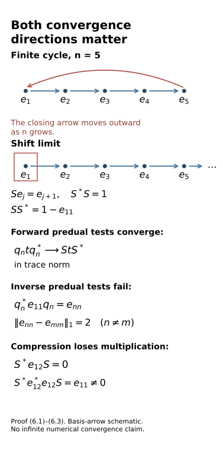

# Two-sided convergence and transported cocycle limits

*Mathematical exposition and figures by GPT-6.1 Sol (OpenAI); source comparison and prerequisite exposition by GPT-6 Astra (OpenAI). Original programme expression is CC0; cited human works retain their rights.*
## Introduction

Finite comparison corrections become an actual conjugacy only after their automorphisms and cocycles converge. This lesson proves the precise limit criteria. Summable forward and inverse predual tests give an automorphism with a convergent inverse. A completely positive inverse forces the limiting map to preserve multiplication. For inner corrections, we identify the functional tests transported by the current conjugator.

Strong-star Cauchy cocycle values have unitary limits. A moving-input estimate passes their exact multiplication law through varying action rows. Combined with vanishing comparison errors, this gives genuine original-algebra cocycle conjugacy under the stated successive-row hypotheses. Constructing rows with all those properties from the classification hypotheses remains a further obligation.

Two exact examples explain the tests. Finite cycles approach a unilateral shift; their forward predual limit is a compression that loses multiplication, while the inverse tests fail. Scalar cocycle phases can oscillate even when their implemented actions are constant. Eight worked exercises check these mechanisms and the proof estimates.

Read [Controlled amenable cohomology and finite inner comparisons](controlled-amenable-cohomology-and-finite-inner-comparisons.md), Theorem 4.1 and Corollary 5.1, for the preceding finite tools; [Unitary two-cocycles and approximate action comparison](unitary-two-cocycles-and-approximate-action-comparison.md), Section 7, for the moving-map u-topology estimates; and [Central towers and unitary cocycles](central-towers-and-unitary-cocycles.md), Section 1, for the stated topology and normal-functional prerequisites.

The forward and inverse conjugator tests and convergence of the cumulative cocycles occur in [Masuda] below, pp.60–62. This lesson isolates the required general convergence statements, supplies the predual inverse-map argument and the moving-input estimate, and examines the unilateral-shift and scalar-phase obstructions. These details explain the classical convergence mechanism; they do not make that mechanism a new construction.

The [bounded-topology companion](../foundations/bounded-topology-foundations.md) supplies faithful-state strong-star tests and normal-functional density; [TF0–TF6](../foundations/normal-tensor-and-tracial-product-foundations.md) supplies the normal spatial tensor interfaces. Their stated prerequisite scopes remain in force.

## 1. The precise convergence obligation

Let \(M\) be a von Neumann algebra with separable predual and a faithful normal state \(\varphi\). Retain the course's elementary von Neumann foundations: Banach predual duality, normal representations, strong closedness of a von Neumann algebra, and the equivalence on bounded sets of the strong-star topology with the faithful-state sharp seminorm. We use these directly, rather than asserting foundational closure. Write

\[
\|x\|_\varphi^{\sharp\,2}
=\varphi(x^*x)+\varphi(xx^*).
\tag{1.1}
\]

For automorphisms, u-convergence means convergence in norm of every composed normal functional. This is a topology on automorphisms. A sequence Cauchy for the forward normal-functional tests alone can have a normal completely positive limit that is not an automorphism. Section 6 gives an explicit compression example. We therefore construct and check forward and inverse rows separately.

Fix a norm-dense sequence \((\psi_j)\) in the unit ball of \(M_*\), and positive numbers \(\varepsilon_n\) with finite sum. The next theorem includes all its quantifiers.

## 2. A complete two-sided criterion

**Theorem 2.1.** Suppose \(\sigma_n\in\operatorname{Aut}(M)\), and for every \(n\ge1\) and \(j\le n\),

\[
\begin{aligned}
\|\psi_j\sigma_{n+1}-\psi_j\sigma_n\|&\le\varepsilon_n,\\
\|\psi_j\sigma_{n+1}^{-1}-\psi_j\sigma_n^{-1}\|&\le\varepsilon_n.
\end{aligned}
\tag{2.1}
\]

There is an automorphism \(\sigma\) with \(\sigma_n\to\sigma\) and \(\sigma_n^{-1}\to\sigma^{-1}\) in the u-topology. If all \(\sigma_n\) are inner, the limit is approximately inner, by the definition of that closure. For a fixed \(j\), the error after row \(n\ge j\) is at most \(\sum_{r\ge n}\varepsilon_r\).

*Proof.* Put \(A_n\psi=\psi\sigma_n\) and \(B_n\psi=\psi\sigma_n^{-1}\). These are inverse positive isometries of the predual. For \(m>n\ge j\), telescope (2.1):

\[
\begin{aligned}
\|A_m\psi_j-A_n\psi_j\|&\le\sum_{r=n}^{m-1}\varepsilon_r,\\
\|B_m\psi_j-B_n\psi_j\|&\le\sum_{r=n}^{m-1}\varepsilon_r.
\end{aligned}
\tag{2.2}
\]

For an arbitrary unit-ball functional \(\psi\), approximate it by \(\psi_j\). The uniform isometry bound gives

\[
\begin{aligned}
&\|A_m\psi-A_n\psi\|\\
&\qquad\le2\|\psi-\psi_j\|+\|A_m\psi_j-A_n\psi_j\|.
\end{aligned}
\tag{2.3}
\]

The same bound holds for \(B_n\). Thus \(A_n,B_n\) converge strongly as bounded operators on the Banach predual to linear isometries \(A,B\). They are inverse. For example,

\[
\begin{aligned}
&\|A_nB_n\psi-AB\psi\|\\
&\qquad\le\|B_n\psi-B\psi\|+\|(A_n-A)B\psi\|\\
&\qquad\longrightarrow0.
\end{aligned}
\tag{2.4}
\]

Every \(A_nB_n\) is the identity. The other product is treated in the same way.

The adjoints \(\sigma=A^*\) and \(\theta=B^*\) are normal inverse maps on \(M\). They are unital: evaluating at any normal functional uses \(\sigma_n(1)=1\). Both are completely positive. Indeed \(\sigma_n(x)\to\sigma(x)\) ultraweakly for every fixed \(x\); applying this entrywise to a finite positive matrix over \(M\) gives a positive limit. The same reasoning applies to \(\theta\).

For completeness, the Schwarz inequality follows from positivity of the image of the Gram block

\[
\begin{gathered}
\begin{pmatrix}x^*x&x^*\\x&1\end{pmatrix}\ge0:\\
\sigma(x)^*\sigma(x)\le\sigma(x^*x).
\end{gathered}
\tag{2.5}
\]

The implication from the positive image block follows by multiplying it on the left and right by the row and column \((1,-\sigma(x)^*)\) and its adjoint. Apply \(\theta\) to (2.5). Its own Schwarz inequality, applied to \(\sigma(x)\), gives

\[
x^*x\le\theta(\sigma(x)^*\sigma(x))\le x^*x.
\tag{2.6}
\]

Thus equality holds. Invertibility of \(\theta\) proves equality in (2.5). Polarizing that equality gives \(\sigma(x^*y)=\sigma(x)^*\sigma(y)\). Replacing \(x\) by \(x^*\) proves multiplicativity; positivity preserves adjoints. Therefore \(\sigma\) is a normal *-automorphism and \(\theta=\sigma^{-1}\). The predual convergence already proved is exactly the required u-convergence. Letting \(m\to\infty\) in (2.2) proves the tail estimate. □

Composition is continuous for these limits. For \(\rho_n\to\rho\), \(\theta_n\to\theta\) in the u-topology, with all maps automorphisms, insert a fixed intermediate functional:

\[
\begin{aligned}
\|\psi\rho_n\theta_n-\psi\rho\theta\|
&\le\|\psi\rho_n-\psi\rho\|\\
&\quad+\|(\psi\rho)\theta_n-(\psi\rho)\theta\|.
\end{aligned}
\tag{2.7}
\]

This proves continuity without an operator-norm convergence claim on the maps.

## 3. The inverse tests for an inner correction

Suppose the next correction is on the left:

\[
\sigma_{n+1}=\operatorname{Ad}(z_n)\sigma_n,
\qquad z_n\in\mathcal U(M).
\tag{3.1}
\]

The normal-functional commutator convention is \((x\psi)(a)=\psi(ax)\), \((\psi x)(a)=\psi(xa)\). Its unitary norm identity is

\[
\|\psi\operatorname{Ad}(z)-\psi\|
=\|[z,\psi]\|
=\|[z^*,\psi]\|.
\tag{3.2}
\]

For the first equality, evaluate \([z,\psi]\) on \(a z^*\); the result is \(\psi(a)-\psi(zaz^*)\), and right multiplication by a unitary maps the unit ball onto itself. The second equality follows from \([z^*,\psi]=-z^*[z,\psi]z^*\), whose left and right predual multiplications are isometries.

Consequently the two increments in (2.1) are exactly

\[
\begin{aligned}
\|\psi_j\sigma_{n+1}-\psi_j\sigma_n\|
&=\|[z_n,\psi_j]\|,\\
\|\psi_j\sigma_{n+1}^{-1}-\psi_j\sigma_n^{-1}\|
&=\|[z_n,\psi_j\sigma_n^{-1}]\|.
\end{aligned}
\tag{3.3}
\]

Indeed the inverse of (3.1) is \(\sigma_n^{-1}\operatorname{Ad}(z_n^*)\). Thus a sufficient finite functional family at this row is

\[
\Phi_n=\{\psi_j,\ \psi_j\sigma_n^{-1}:1\le j\le n\}.
\tag{3.4}
\]

It is available after \(\sigma_n\) has been chosen, before choosing \(z_n\). Testing only the first half of this family proves the forward Cauchy condition and leaves the inverse condition unproved. No assertion that \(z_n\to1\) strongly is made: commutators control the inner automorphism, and are insensitive to scalar phases.

## 4. Strong-star limits and moving maps

**Lemma 4.1.** If unitaries \(u_n\in M\) are Cauchy for the faithful-state sharp seminorm, they converge strongly-star to a unitary \(u\). In particular, it suffices that \(\|u_{n+1}-u_n\|_\varphi^\sharp\le a_n\) for a summable positive sequence \((a_n)\); then the sharp error after row \(n\) is at most \(\sum_{r\ge n}a_r\).

*Proof.* The strong-star and sharp topologies agree on the bounded unit ball, by the retained faithful-state foundation. Thus both \(u_n\) and \(u_n^*\) are strongly Cauchy in a faithful normal representation. Their limits are bounded operators \(u,v\). Strong closedness puts both in \(M\). Matrix coefficients show \(v=u^*\). Bounded multiplication is jointly strongly continuous: expand a product difference, apply the factors to a fixed vector, and use the strong convergence and uniform norm bound. Hence \(u^*u=uu^*=1\). The telescope and passage to the sharp limit give the stated tail estimate. □

The bounded-set topology statement includes completeness here: a Cauchy sequence for the inducing seminorm is strongly-star Cauchy. Equivalently, one may use the uniform structure determined by normal-functionals' strong-star seminorms; on a fixed bounded ball it is determined by the faithful-state seminorm.

**Lemma 4.2.** If \(\theta_n\to\theta\) in the u-topology and \(x_n\to x\) strongly-star with a uniform norm bound, then \(\theta_n(x_n)\to\theta(x)\) strongly-star.

*Proof.* First, for a fixed \(x\), \(\theta_n(x)\to\theta(x)\) ultraweakly, and \(\theta_n(x^*x)\to\theta(x^*x)\) ultraweakly. Put \(y=\theta(x)\) and \(b_n=\theta_n(x)-y\). Multiplicativity of the limit gives

\[
\begin{aligned}
\varphi(b_n^*b_n)
&=\varphi(\theta_n(x^*x))\\
&\quad-\varphi(\theta_n(x)^*y)\\
&\quad-\varphi(y^*\theta_n(x))\\
&\quad+\varphi(y^*y)\longrightarrow0.
\end{aligned}
\tag{4.1}
\]

All cross terms are fixed normal-functional evaluations. Apply the same argument to \(x^*\) to obtain the other half of the sharp seminorm.

For \(d_n=x_n-x\), put \(q_n=d_n^*d_n\). It has a uniform norm bound \(L\) and tends strongly to zero. Since \(\varphi\theta_n\to\varphi\theta\) in predual norm,

\[
\begin{aligned}
&\varphi(\theta_n(q_n))\\
&\qquad\le(\varphi\theta)(q_n)+L\|\varphi\theta_n-\varphi\theta\|\\
&\qquad\longrightarrow0.
\end{aligned}
\tag{4.2}
\]

The fixed first functional vanishes by bounded strong convergence. Repeat with \(d_nd_n^*\), then combine with (4.1). This proves the lemma. □

The fixed limit in the u-topology is an automorphism in this lemma. A merely forward-Cauchy family with a completely positive compression limit cannot be substituted for it.

## 5. A limit comparison theorem with every row requirement stated

Let \(G\) be countable. Let \(\beta^{(n)}\) and \(\beta\) be genuine actions with \(\beta_g^{(n)}\to\beta_g\) in the u-topology for each fixed \(g\). Let \(U_{n,g}\) be normalized genuine \(\beta^{(n)}\)-cocycles. Assume that, for each fixed \(g\), these unitaries are Cauchy for the sharp seminorm. A sufficient common-row condition, for an enumeration \(g_j\), is

\[
\begin{gathered}
\|U_{n+1,g_j}-U_{n,g_j}\|_\varphi^\sharp\le a_n\quad(j\le n),\\
\sum_n a_n<\infty.
\end{gathered}
\tag{5.1}
\]

**Theorem 5.1.** The limits \(U_g\) are exact unitaries and form a normalized genuine \(\beta\)-cocycle. The perturbed genuine actions converge pointwise in the u-topology to \(\gamma_g=\operatorname{Ad}(U_g)\beta_g\). Suppose \(\sigma_n\) meets Theorem 2.1. For a fixed genuine action \(\alpha\), put \(\lambda_{n,g}=\sigma_n\alpha_g\sigma_n^{-1}\) and \(\gamma_{n,g}=\operatorname{Ad}(U_{n,g})\beta_g^{(n)}\). Assume, for every \(g\in G\) and \(\psi\in M_*\),

\[
\|\psi\lambda_{n,g}-\psi\gamma_{n,g}\|\to0.
\tag{5.2}
\]

Then

\[
\sigma\alpha_g\sigma^{-1}=\operatorname{Ad}(U_g)\beta_g
\quad(g\in G).
\tag{5.3}
\]

This is actual original-algebra cocycle conjugacy under the stated row hypotheses. If the \(\sigma_n\) are inner, its conjugating automorphism is approximately inner.

*Proof.* Lemma 4.1 gives \(U_g\) and its unitarity. The exact finite-row cocycle equation is

\[
U_{n,g}\beta_g^{(n)}(U_{n,h})=U_{n,gh},
\qquad U_{n,e}=1.
\tag{5.4}
\]

Lemma 4.2 applies to the moving input \(U_{n,h}\). Joint bounded strong-star continuity of products therefore passes (5.4) to the exact equation \(U_g\beta_g(U_h)=U_{gh}\); the identity value stays one. This explicitly uses the same row \(n\) for \(g,h,gh\).

Strong-star convergence of unitaries implies u-convergence of their inner automorphisms. Put \(D_{n,g}=U_{n,g}-U_g\). For a positive normal functional \(\rho\), the GNS vector-functional estimate gives

\[
\begin{aligned}
&\|\rho\operatorname{Ad}(U_{n,g})-\rho\operatorname{Ad}(U_g)\|\\
&\qquad\le2\sqrt{\rho(1)}
\sqrt{\rho(D_{n,g}D_{n,g}^*)}\to0.
\end{aligned}
\tag{5.5}
\]

The vectors are \(U_{n,g}^*\xi_\rho\) and \(U_g^*\xi_\rho\), so the order in the final product is as written. Four positive Jordan parts extend the estimate to a complex normal functional, as in [Controlled amenable cohomology and finite inner comparisons](controlled-amenable-cohomology-and-finite-inner-comparisons.md), (5.3) and Exercise 7.7. Equation (2.7) then proves convergence of the perturbed actions. Their limit is the genuine action already given by the exact limit cocycle.

Theorem 2.1 and (2.7) give u-convergence of \(\sigma_n\alpha_g\sigma_n^{-1}\) to \(\sigma\alpha_g\sigma^{-1}\). Equation (5.2) identifies its normal-functional evaluations with those of \(\gamma_g\). Normal functionals separate points, proving (5.3). □

It is enough to test (5.2) on a fixed norm-dense unit-ball family: the difference of two composed functionals is bounded by twice their original norm. Existence of the genuine rows \(U_{n,g}\), their summable strong-star increments, both conjugator rows, and the vanishing comparison errors are separate obligations.

For example, small inner-automorphism displacement does not control a cocycle's scalar phase. For any genuine action \(\beta\) of \(\mathbb Z\),

\[
U_{n,m}=(-1)^{nm}1
\tag{5.6}
\]

is a normalized genuine cocycle at every row and gives \(\operatorname{Ad}(U_{n,m})\beta_m=\beta_m\). The implemented actions are constant, but consecutive values at \(m=1\) have sharp distance \(2\sqrt2\). This holds even if the action is centrally nontrivial. Explicit phase and strong-star row control cannot be replaced by convergence of the implemented actions.

## 6. A one-sided limit that is not an automorphism

Let \(H=\ell^2(\mathbb N)\), with basis \(e_1,e_2,\ldots\), and let \(S e_j=e_{j+1}\). Define a unitary finite cycle \(q_n\), for \(n\ge2\), by

\[
q_ne_j=\begin{cases}
e_{j+1},&j<n,\\
e_1,&j=n,\\
e_j,&j>n.
\end{cases}
\tag{6.1}
\]

Every fixed basis vector has image \(S e_j\) for all large \(n\), and the operators have norm one, so \(q_n\to S\) strongly. Their adjoints are not strongly Cauchy: \(q_n^*e_1=e_n\).

For \(M=B(H)\), take \(\sigma_n=\operatorname{Ad}(q_n^*)\). A trace-class density \(t\) representing a normal functional has forward predual image \(q_n t q_n^*\). For a rank-one density \(|\xi\rangle\langle\eta|\), strong convergence of the two vectors and the formula for the trace norm of a rank-one operator show trace-norm convergence to \(|S\xi\rangle\langle S\eta|\). Finite-rank density and the uniform trace-norm isometry bound extend this to every \(t\). Thus the forward predual maps converge in norm pointwise to

\[
t\longmapsto S t S^*,
\qquad x\longmapsto S^*xS
\tag{6.2}
\]

on the dual algebra. This is a normal unital completely positive compression, not an automorphism. For \(x=e_{12}\),

\[
\begin{aligned}
S^*xS&=0,\\
S^*x^*xS&=S^*e_{22}S=e_{11}\ne0.
\end{aligned}
\tag{6.3}
\]

The inverse predual maps send \(e_{11}\) to \(e_{nn}\). Distinct such projections have trace-norm distance 2, so that row is not Cauchy. This example meets the forward Cauchy conclusion and violates precisely the missing inverse conclusion; it does not contradict Theorem 2.1.

Figure 1. The arrows in the upper row show the finite cycle of (6.1), whose closing arrow moves outward as \(n\) grows. The lower row shows the shift limit, which omits the first basis vector from its range. Forward predual densities converge to \(S t S^*\), while inverse tests on \(e_{11}\) move to mutually orthogonal \(e_{nn}\). The displayed trace-norm distance 2 is exact; it is not a simulation of convergence on an infinite space. The compression's multiplicative defect is (6.3). Reproducible source: [editable figure source](../figures/draw_two_sided_convergence_obstruction.py).

## 7. The remaining constructive bridge

[Controlled amenable cohomology and finite inner comparisons](controlled-amenable-cohomology-and-finite-inner-comparisons.md) proves finite corrections with near-centrality on a supplied finite functional family. Equations (3.3)–(3.4) now specify the two families that a convergence row must test. Theorem 5.1 specifies the additional genuine-cocycle and strong-star requirements. These are proved criteria and explicit construction obligations.

Finite tower labels may depend on the desired output accuracy. [Generator tests for cocycle stabilization](generator-tests-for-cocycle-stabilization.md), Theorem 5.1, replaces those label tests by tests on the requested generators and finitely many transported functionals. [Alternating comparisons with convergent cocycles](alternating-comparisons-with-convergent-cocycles.md), Sections 5–7, constructs the compatible rows by preparing each finite test family before either of its next two comparisons. Nontrivial inner isotropy, measurable fields and continuous reconstruction require their additional phase and selection arguments.

## 8. Exercises with solutions

**Exercise 8.1 (summable dense rows). Level 2.** In Theorem 2.1, take \(\varepsilon_n=2^{-n}\). Give the tail error for a tested \(\psi_j\) after row \(n\ge j\), and extend the Cauchy argument to an arbitrary unit-ball functional. Explain why testing only a finite family forever does not prove the theorem.

*Solution.* The geometric tail is

\[
\sum_{r\ge n}2^{-r}=2^{1-n}.
\tag{8.1}
\]

It bounds both errors for every \(j\le n\). For arbitrary \(\psi\), first choose \(\psi_j\) close to it in predual norm. Equation (2.3) then bounds the two approximating-functional costs independently of the row indices. After fixing this \(j\), take both indices at least \(j\) and sufficiently large to make the geometric tail small. This proves the Cauchy property on all of \(M_*\). A fixed finite family need not be norm dense; uniform isometry bounds cannot repair that missing density.

**Exercise 8.2 (why the dual limit multiplies). Level 3.** Derive the Schwarz inequality from the positive Gram block in (2.5). Use an inverse unital completely positive map to prove equality, and spell out the polarization step.

*Solution.* Applying a unital completely positive map \(\sigma\) to the Gram block gives \(\begin{pmatrix}\sigma(x^*x)&\sigma(x)^*\\\sigma(x)&1\end{pmatrix}\ge0\). Multiplication by \((1,-\sigma(x)^*)\) and its adjoint gives the nonnegative Schwarz gap. If \(\theta=\sigma^{-1}\) is also unital completely positive, its Schwarz inequality and positivity give (2.6). Thus \(\theta\) sends the gap to zero. Injectivity forces the gap itself to be zero.

Put \(D(x,y)=\sigma(x^*y)-\sigma(x)^*\sigma(y)\). We have \(D(x,x)=0\) for all \(x\). Expanding at \(x+y\) and \(x+iy\) gives

\[
\begin{aligned}
D(x,y)+D(y,x)&=0,\\
iD(x,y)-iD(y,x)&=0.
\end{aligned}
\tag{8.2}
\]

The two equations imply \(D(x,y)=0\). Positivity preserves adjoints, so replacing \(x\) by \(x^*\) gives multiplicativity. Normality and the inverse relation were already proved by predual duality. Merely taking ultraweak limits of products would not justify this step.

**Exercise 8.3 (put the correction on the other side). Level 2.** Suppose \(\sigma_{n+1}=\sigma_n\operatorname{Ad}(z_n)\), instead of (3.1). Identify exactly which original and transported functionals must be tested for forward and inverse increments.

*Solution.* This time \(\sigma_{n+1}^{-1}=\operatorname{Ad}(z_n^*)\sigma_n^{-1}\). The unitary norm identity and the isometry of predual composition give

\[
\begin{aligned}
\|\psi_j\sigma_{n+1}-\psi_j\sigma_n\|
&=\|[z_n,\psi_j\sigma_n]\|,\\
\|\psi_j\sigma_{n+1}^{-1}-\psi_j\sigma_n^{-1}\|
&=\|[z_n,\psi_j]\|.
\end{aligned}
\tag{8.3}
\]

Therefore test \(\psi_j\sigma_n\) and \(\psi_j\), for \(j\le n\). The forward row carries the transported family here; for the left correction in Section 3, the inverse row carries it. The formulas determine the direction and avoid an incorrect interchange of \(\sigma_n\) with its inverse.

**Exercise 8.4 (strong convergence of unitaries alone). Level 2.** Show that the cycles \(q_n\) in (6.1) converge strongly to \(S\), but cannot converge strongly-star. Which part of Lemma 4.1 does this illustrate?

*Solution.* For any fixed finite linear combination of basis vectors, the cycle agrees with \(S\) once \(n\) exceeds its support. Density and the norm-one bound extend this to every vector. In contrast, \(q_n^*e_1=e_n\), and distinct vectors in this inverse row satisfy

\[
\|q_n^*e_1-q_m^*e_1\|=\sqrt2
\quad(n\ne m).
\tag{8.4}
\]

The adjoint sequence is not strongly Cauchy. The strong limit \(S\) is an isometry whose range omits \(e_1\), so it is not a unitary. Lemma 4.1 assumes the sharp seminorm, which controls both a sequence and its adjoints. Strong convergence alone would omit exactly the failed test.

**Exercise 8.5 (the moving input cannot be ignored). Level 2.** In Lemma 4.2, identify why pointwise ultraweak convergence of \(\theta_n\) does not suffice for the moving input \(q_n=(x_n-x)^*(x_n-x)\). Explain the role of the norm convergence in (4.2).

*Solution.* Pointwise ultraweak convergence tests each fixed algebra element. The element \(q_n\) changes with \(n\), so it is outside that fixed-input conclusion. Equation (4.2) instead uses \(\|\varphi\theta_n-\varphi\theta\|\) as a norm of functionals; multiplication by a uniform bound on \(\|q_n\|\) controls evaluation on every such moving element. The remaining functional \(\varphi\theta\) is fixed and normal, so it vanishes on the bounded strongly null positive sequence. Repeating for \((x_n-x)(x_n-x)^*\) controls the adjoint half too. The fixed-input part of the proof separately uses the multiplicativity of the actual limiting automorphism.

**Exercise 8.6 (cocycle phases and action limits). Level 1.** Verify that (5.6) is a genuine cocycle for an arbitrary action of \(\mathbb Z\). Compute the sharp distance between successive values at 1, and explain why the implemented action gives no information about this error.

*Solution.* Every automorphism fixes scalar multiples of one. Multiplication of the two signs at \(m\) and \(l\) gives \((-1)^{n(m+l)}\), the required value at \(m+l\); the value at zero is one. Successive values at 1 are opposite scalar unitaries. Their difference is \(2\) or \(-2\) times one. Since the state is normalized,

\[
\|U_{n+1,1}-U_{n,1}\|_\varphi^{\sharp\,2}=8.
\tag{8.5}
\]

Conjugation by each scalar is the identity, so every implemented action is exactly the same \(\beta\). No convergence estimate on those actions detects the displayed cocycle error. This example works for centrally nontrivial actions as well, because it changes only scalar phases.

**Exercise 8.7 (trace-class extension in the compression example). Level 2.** Prove the rank-one convergence used in Section 6 and extend it to all trace-class operators without assuming strong convergence of \(q_n^*\).

*Solution.* The trace norm of \(|\xi\rangle\langle\eta|\) is \(\|\xi\|\|\eta\|\). Add and subtract the rank-one operator with the first limit vector and the second varying vector. For any \(a_n\to a\) and \(b_n\to b\) in Hilbert norm,

\[
\begin{aligned}
\bigl\||a_n\rangle\langle b_n|-|a\rangle\langle b|\bigr\|_1
&\le\|a_n-a\|\|b_n\|\\
&\quad+\|a\|\|b_n-b\|.
\end{aligned}
\tag{8.6}
\]

Take \(a_n=q_n\xi\), \(b_n=q_n\eta\), with limits \(S\xi,S\eta\). Both vectors converge strongly, so the right side vanishes. Finite sums give the result for finite-rank operators. For arbitrary trace-class \(t\), choose finite-rank \(t_0\) close in trace norm. Unitary conjugation preserves that norm, and \(\|S(t-t_0)S^*\|_1=\|t-t_0\|_1\), since \(S\) is an isometry. The two approximation costs are uniformly bounded by \(2\|t-t_0\|_1\). No adjoint-vector convergence was used; the failure of that convergence belongs to the inverse tests.

**Exercise 8.8 (what a finite comparison check proves). Level 2.** Suppose the comparison error in (5.2) vanishes for a norm-dense unit-ball sequence \((\psi_j)\), for each fixed group element. Prove it vanishes for every normal functional. List the separate hypotheses still needed to apply Theorem 5.1.

*Solution.* For the two automorphisms in (5.2), denote them by \(\lambda_{n,g}\) and \(\gamma_{n,g}\). The uniform norm-one bound gives

\[
\begin{aligned}
\|\psi\lambda_{n,g}-\psi\gamma_{n,g}\|
&\le2\|\psi-\psi_j\|\\
&\quad+\|\psi_j\lambda_{n,g}-\psi_j\gamma_{n,g}\|.
\end{aligned}
\tag{8.7}
\]

For a unit-ball \(\psi\), first approximate it by a fixed \(\psi_j\), then let \(n\) grow; scaling covers the rest of the predual. This proves the comparison-error hypothesis. It does not prove the other hypotheses: both dense forward and inverse conjugator rows need summable control; the action rows must be genuine and have the stated pointwise u-limit; each cocycle row must be normalized and genuine; and every fixed cocycle value needs a strong-star Cauchy bound. Those conditions produce actual unitary and automorphism limits. The finite controlled-cohomology theorem does not itself produce all these compatible successive rows.

## References

- [Central towers and unitary cocycles](central-towers-and-unitary-cocycles.md), Section 1, for the sharp seminorm, normal-functional commutator conventions and stated von Neumann prerequisites.
- [From approximate cocycles to exact coboundaries](from-approximate-cocycles-to-exact-coboundaries.md), Sections 1–2, for the distinction between a diagonal solution in an asymptotic centralizer and convergence on the original algebra.
- [Unitary two-cocycles and approximate action comparison](unitary-two-cocycles-and-approximate-action-comparison.md), Section 7, for u-topology composition, inversion and moving null-sequence estimates.
- [Controlled amenable cohomology and finite inner comparisons](controlled-amenable-cohomology-and-finite-inner-comparisons.md), Theorem 4.1, Corollary 5.1 and Exercise 7.7, for finite corrections, their exact input-label quantifiers and the GNS functional estimate. Banach predual duality, strong closedness, matrix positivity and the faithful-state bounded strong-star topology have the stated foundation scope of Section 1 above.

[Masuda] Toshihiko Masuda, *Evans–Kishimoto type argument for actions of discrete amenable groups on McDuff factors*, Mathematica Scandinavica 101 (2007), 48–64; [journal edition](https://journals.msp.org/mscand/article/view/666). Theorem 3.1, pp.55–62, for alternating comparison, transported states and two-sided convergence. The cited locators refer to this journal edition.
