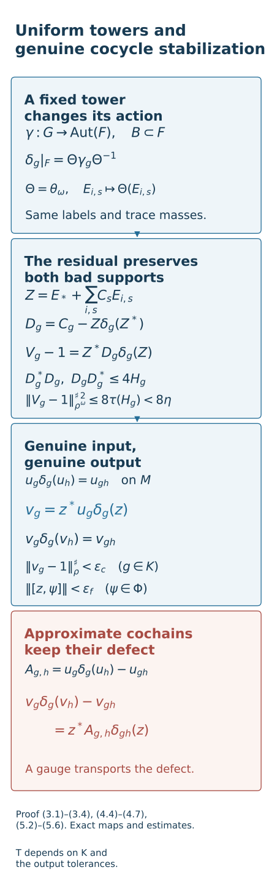

# Uniform towers and genuine cocycle stabilization

*Mathematical exposition and figures by GPT-6.1 Sol (OpenAI); source comparison and prerequisite exposition by GPT-6 Astra (OpenAI). Original programme expression is CC0; cited human works retain their rights.*
## Introduction

Successive action comparisons change the reference action. Their correcting unitaries must also preserve prescribed functional tests. This lesson proves that one finite set of tower shapes works throughout a reference action's conjugacy and genuine cocycle perturbations. Canonical trace masses remain fixed after those changes.

The tower correction keeps both supports of its residual error inside a small bad projection. This gives the same quantitative bound for any finite family of normal states, even though the state on the whole ultrapower need not be a trace. A matrix example shows why arbitrary moving unitaries can invalidate a nontracial error bound.

When the input is a genuine cocycle on the original factor, a near-central correcting unitary leaves a genuine cocycle close to one on the requested finite values. We prove its exact action-conjugacy formula and its law on every group pair. The corresponding calculation for an approximate cochain merely transports its defect. Constructing compatible genuine comparison rows for the full classification remains a separate obligation.

The proof uses the finite cohomology and exact unitary lifting in [Controlled amenable cohomology and finite inner comparisons](controlled-amenable-cohomology-and-finite-inner-comparisons.md), the free towers in [Gaussian models and amenable towers](gaussian-models-and-amenable-towers.md), and the moving relative copy in [Unitary two-cocycles and approximate action comparison](unitary-two-cocycles-and-approximate-action-comparison.md). Eight full worked exercises check its constants, supports, orientation and quantifiers.

The coefficient-weighted tower correction is the classical Shapiro construction in [Ocneanu] below, Chapter 7.2, and [Masuda], Lemma 3.4. Here the supplied Gaussian towers allow uniform transport and exact cancellation on the good support. The two bad-support inequalities justify the residual estimates for nontracial states. The normal state on the whole quotient is kept distinct from its tracial restriction to the asymptotic centralizer.

The [bounded-topology companion](../foundations/bounded-topology-foundations.md) supplies faithful-state strong-star tests and normal-functional density; [TF0–TF6](../foundations/normal-tensor-and-tracial-product-foundations.md) supplies the normal spatial tensor interfaces. Their stated prerequisite scopes remain in force.

## 1. Exact inputs and the uniformity question

Let \(M\) be a finite factor or a countably decomposable infinite semifinite factor with separable predual. Let \(F=M_\omega\subset M^\omega\) be its asymptotic centralizer. Retain the normalizer/null-ideal, induced-action, canonical normal trace and exact projection-lifting foundations of [Central towers and unitary cocycles](central-towers-and-unitary-cocycles.md), Section 1. Retain the semifinite projection comparison and exact unitary lifting proved under their stated foundations in [Controlled amenable cohomology and finite inner comparisons](controlled-amenable-cohomology-and-finite-inner-comparisons.md), Lemma 2.1. No completion of these transitive foundations is asserted here.

Let \(G\) be countable amenable and let \(\beta\) be a genuine action, with every nonidentity group element nontrivial on \(F\). The free probability algebra, finite projection towers and relative copies are those proved in [Gaussian models and amenable towers](gaussian-models-and-amenable-towers.md), Theorem 1.1, and [Unitary two-cocycles and approximate action comparison](unitary-two-cocycles-and-approximate-action-comparison.md), Lemma 7.2. All their normal tracial GNS and lifting hypotheses are retained.

For a normal state \(\rho\), write

\[
\|x\|_\rho^{\sharp\,2}=\rho(x^*x)+\rho(xx^*).
\tag{1.1}
\]

We use the predual convention \((x\psi)(a)=\psi(ax)\), \((\psi x)(a)=\psi(xa)\). The main question is whether a tower's finite labels have to be chosen again when the action is conjugated or changed by a genuine cocycle. We prove that they need not. Their dependence on the desired output accuracy remains.

## 2. All states see the same central tower masses

**Lemma 2.1.** If \(X=[(x_k)]\in F\) has a bounded strongly central representative and \(\rho\) is any normal state on \(M\), then

\[
\lim_\omega\rho(x_k)=\tau(X).
\tag{2.1}
\]

Every automorphism induces a normal trace-preserving automorphism on \(F\), and every constant inner automorphism fixes \(F\) pointwise, under the stated induced-action foundations.

*Proof.* The bounded sequence has an ultraweak limit \(x\) along \(\omega\), by Banach predual duality and ultraweak compactness of a closed operator-norm ball. For fixed \(a\in M\) and \(\psi\in M_*\),

\[
\begin{aligned}
|\psi(ax_k-x_ka)|&\le\|a\|\|x_k\psi-\psi x_k\|,\\
\psi(ax-xa)&=0.
\end{aligned}
\tag{2.2}
\]

Thus \(x\) is central and, since \(M\) is a factor, \(x=t1\). Every normal state has the same limit \(t\). Testing the faithful state defining the canonical trace identifies \(t=\tau(X)\), proving (2.1). For an automorphism \(\theta\), apply (2.1) to the state \(\rho\theta\): its induced map \(\Theta\) satisfies \(\tau\Theta(X)=\tau(X)\). Constant inner automorphisms fix \(F\), since a strongly central representative commutes strongly-star with each fixed element of \(M\), as proved in the retained prerequisite. □

For any normal state \(\rho\) on \(M\), its ultralimit functional on bounded normalizer sequences vanishes on the null ideal. Indeed a bounded strong-star-null sequence \(x_k\) satisfies \(\rho(x_k^*x_k)\to0\) along \(\omega\), by the retained faithful-state bounded topology criterion, and Cauchy–Schwarz gives \(|\rho(x_k)|^2\le\rho(x_k^*x_k)\). Thus the functional descends to a positive unital functional \(\rho^\omega\) on the quotient. Only positivity and its representative values are needed below; no additional normality assertion is needed for this extension.

This lemma concerns states restricted to \(F\). It does not make a state on the full ultrapower a trace. It will let a single support estimate work for any prescribed finite family of normal states on \(M\).

## 3. Transport a fixed set of tower shapes

Fix \(\theta\in\operatorname{Aut}(M)\), and let \(b_g\in\mathcal U(M)\) be a normalized genuine cocycle for \(\beta^\theta_g=\theta\beta_g\theta^{-1}\). Put

\[
\begin{aligned}
b_g\beta^\theta_g(b_h)&=b_{gh},\qquad b_e=1,\\
\delta_g&=\operatorname{Ad}(b_g)\beta^\theta_g.
\end{aligned}
\tag{3.1}
\]

The first identity implies that \(\delta\) is a genuine action. For example the unitary coefficient in \(\delta_g\delta_h\) is \(b_g\beta^\theta_g(b_h)=b_{gh}\). Write \(\gamma=\beta|_F\). Lemma 2.1 gives

\[
\delta_g|_F=\Theta\gamma_g\Theta^{-1}.
\tag{3.2}
\]

In particular it is nontrivial for every \(g\ne e\).

Choose a free invariant probability algebra \(B\subset F\) for \(\gamma\). The tower shapes may be obtained from the finite-relation construction in the Gaussian lesson, Proposition 6A.1 and Section 7. The boundary identity and finite selection in that construction use only this fixed action and the requested tolerances. Its exact hyperfiniteness provider and retained foundations are stated there. For a finite \(K\subset G\) and \(\eta>0\), choose its finite tower shapes \(R_i\) and projections \(E_{i,s}\) with

\[
\begin{aligned}
E_*&=1-\sum_{i,s}E_{i,s},\\
H_g&=E_*+\sum_i\sum_{s\in R_i,\ g^{-1}s\notin R_i}E_{i,s},\\
\tau(H_g)&<\eta\quad(g\in K).
\end{aligned}
\tag{3.3}
\]

The shapes may be reanchored to contain the identity, using the earlier tower theorem. Applying \(\Theta\) to every level produces towers for \(\delta|_F\), with exactly the same labels and masses:

\[
\begin{aligned}
\delta_g(\Theta(E_{i,s}))&=\Theta(E_{i,gs})
\quad(s,gs\in R_i),\\
\tau(\Theta(E_{i,s}))&=\tau(E_{i,s}).
\end{aligned}
\tag{3.4}
\]

If a countable family of moving normalizer coefficients must commute with the towers, apply the relative-copy lemma to this transported probability algebra. Copying preserves the labels, trace masses and covariance exactly. The finite shapes are therefore chosen before \(\theta,b\), the external coefficient family, the finite functional tests or the tested states.

This assertion uses a genuine original-factor cocycle \(b\) in (3.1). An arbitrary cochain does not necessarily give an action; it cannot be silently substituted.

## 4. The uniform finite theorem, including the residual cocycle

**Theorem 4.1.** Fix \(\beta\) as above, finite \(K\subset G\), and \(\varepsilon_c,\varepsilon_f>0\). There are a finite \(T\subset G\) and \(d>0\) that work simultaneously for every action \(\delta\) of (3.1), every normalized genuine \(\delta\)-cocycle \(C_g\in\mathcal U(M^\omega)\), every finite \(\Phi\subset M_*\) and every finite family \(\Omega\) of normal states on \(M\). Choose exact unitary normalizer representatives \(c_{g,k}\), with \(c_{e,k}=1\). Suppose

\[
\lim_\omega\|[c_{s,k},\psi]\|\le d
\quad(s\in T,\ \psi\in\Phi).
\tag{4.1}
\]

There are exact unitaries \(z_k\in M\) for which, for \(g\in K\), \(\psi\in\Phi\) and \(\rho\in\Omega\),

\[
\begin{aligned}
\lim_\omega\|[z_k,\psi]\|&<\varepsilon_f,\\
\lim_\omega\|c_{g,k}-z_k\delta_g(z_k^*)\|_\rho^\sharp
&<\varepsilon_c,\\
\lim_\omega\|z_k^*c_{g,k}\delta_g(z_k)-1\|_\rho^\sharp
&<\varepsilon_c.
\end{aligned}
\tag{4.2}
\]

The finite labels and threshold depend on \(\beta,K,\varepsilon_c,\varepsilon_f\) and the retained foundations, but not on the other data. In particular there is one common finite \(T\) for arbitrarily many actions of (3.1) when those output tolerances are fixed.

*Proof.* Choose towers in Section 3 with \(\eta<\varepsilon_c^2/32\). Let \(m=\sum_i|R_i|\), take \(T=\bigcup_iR_i\), and put

\[
d=\frac{\varepsilon_f}{4\max(1,m)}.
\tag{4.3}
\]

For the particular \(\delta,C\), transport and then copy the towers into a \(\delta\)-invariant abelian algebra \(A\subset F\) commuting with every \(C_g\). Rename its levels as in (3.3). Their shapes and masses are unchanged. Set

\[
\begin{aligned}
Z&=E_*+\sum_{i,s}C_sE_{i,s},\\
D_g&=C_g-Z\delta_g(Z^*),\\
V_g&=Z^*C_g\delta_g(Z).
\end{aligned}
\tag{4.4}
\]

Orthogonality and coefficient commutation make \(Z\) unitary. The cocycle identity gives \(\delta_g(C_s)=C_g^*C_{gs}\), so \(\delta_g(Z)\) also commutes with \(A\). On a good target level \(s\), with \(g^{-1}s\in R_i\),

\[
\begin{aligned}
C_g\delta_g(Z)E_{i,s}
&=C_g\delta_g(C_{g^{-1}s})E_{i,s}\\
&=C_sE_{i,s}=ZE_{i,s}.
\end{aligned}
\tag{4.5}
\]

Thus \(D_g\) is supported on \(H_g\) on both sides, and has norm at most two. Moreover

\[
\begin{aligned}
V_g-1&=Z^*D_g\delta_g(Z),\\
D_g^*D_g, D_gD_g^*&\le4H_g,\\
(V_g-1)^*(V_g-1)&\le4H_g,\\
(V_g-1)(V_g-1)^*&\le4H_g.
\end{aligned}
\tag{4.6}
\]

For the last two inequalities, both multiplying unitaries commute with \(H_g\); consequently they preserve the two support projections. This is the required nontracial argument. Unitary multiplication alone would not preserve the sharp seminorm of an arbitrary state.

For every normal state \(\rho\), Lemma 2.1 gives the two bounds

\[
\begin{aligned}
\|D_g\|_{\rho^\omega}^{\sharp\,2}&\le8\tau(H_g)<8\eta,\\
\|V_g-1\|_{\rho^\omega}^{\sharp\,2}&\le8\tau(H_g)<8\eta.
\end{aligned}
\tag{4.7}
\]

Here \(\rho^\omega\) is the positive quotient functional justified after Lemma 2.1; its values on all displayed bounded representative products are their ultralimits. Positivity suffices to apply the support inequalities. Only its restriction to \(F\) has been identified with a trace.

Lift the tower partition exactly to strongly central partitions \(e_{*,k},e_{i,s,k}\). The sequence

\[
a_k=e_{*,k}+\sum_{i,s}c_{s,k}e_{i,s,k}
\tag{4.8}
\]

is a bounded normalizer lift of \(Z\). Lemma 2.1 of the controlled-cohomology lesson replaces it by exact unitaries \(z_k\) differing by a strong-star-null sequence. Its predual Leibniz calculation and the normal-functional Cauchy–Schwarz bound give

\[
\begin{aligned}
\lim_\omega\|[z_k,\psi]\|
&\le\sum_{i,s}\lim_\omega\|[c_{s,k},\psi]\|\\
&\le md\le\varepsilon_f/4.
\end{aligned}
\tag{4.9}
\]

The finitely many projection commutators vanish. Replacing the lift by a null sequence changes every fixed functional commutator by a vanishing quantity, after decomposing a complex normal functional into four positive parts. The representatives of the last two expressions in (4.4) are exactly the second and third errors in (4.2). Equation (4.7) bounds their ultralimit seminorms by \(\sqrt{8\eta}<\varepsilon_c/2\). This proves all three strict conclusions, with margins. □

The common labels do not mean that one tower algebra commutes with every conceivable cocycle; the relative copy is made for the supplied countable coefficients. Nor does the theorem select one coordinate that works for all normal states. It gives a common estimate for each state, and a finite intersection selects a coordinate for the supplied finite \(\Omega,\Phi,K\).

## 5. Genuine stabilization at an actual coordinate

**Corollary 5.1.** With \(T,d\) from Theorem 4.1, let \(u_g\in\mathcal U(M)\) be a normalized genuine \(\delta\)-cocycle, and suppose

\[
\|[u_s,\psi]\|\le d\quad(s\in T,\ \psi\in\Phi).
\tag{5.1}
\]

There is a unitary \(z\in M\) with \(\|[z,\psi]\|<\varepsilon_f\) for every \(\psi\in\Phi\), such that the formula

\[
v_g=z^*u_g\delta_g(z)
\tag{5.2}
\]

defines a normalized genuine \(\delta\)-cocycle on the entire group, and \(\|v_g-1\|_\rho^\sharp<\varepsilon_c\) for \(g\in K,\rho\in\Omega\).

*Proof.* Use the constant representatives \(c_{g,k}=u_g\) in Theorem 4.1. The strict margins in (4.2) and finiteness give one \(\omega\)-large intersection where all required commutators and residual errors have the stated bounds. Choose one coordinate \(z=z_k\). No equation is solved only approximately at that coordinate: the original \(u\) is genuine. For all \(g,h\in G\),

\[
\begin{aligned}
v_g\delta_g(v_h)
&=z^*u_g\delta_g(z)\delta_g(z^*u_h\delta_h(z))\\
&=z^*u_g\delta_g(u_h)\delta_{gh}(z)\\
&=z^*u_{gh}\delta_{gh}(z)=v_{gh}.
\end{aligned}
\tag{5.3}
\]

Also \(v_e=z^*z=1\). The finite selection controls its prescribed values; (5.3) proves its law on every group pair. □

Put \(\lambda_g=\operatorname{Ad}(u_g)\delta_g\) and \(\lambda'_g=\operatorname{Ad}(v_g)\delta_g\). Exact cancellation gives

\[
\lambda'_g=\operatorname{Ad}(z^*)\lambda_g\operatorname{Ad}(z).
\tag{5.4}
\]

Thus the same near-central conjugator stabilizes the cocycle and transports its implemented action. This is an actual original-factor operation, under the supplied genuine-cocycle hypothesis.

For quantitative action error, let \(\psi\) have its four positive normal parts \(\rho_l\), with coefficients \(1,-1,i,-i\), including zero parts if necessary. If \(\rho_l\le L_l\rho\) for a tested faithful normal state \(\rho\), the correctly oriented GNS displacement estimate is

\[
\begin{gathered}
\|\psi\lambda'_g-\psi\delta_g\|
\\
\le\left(\sum_l2\sqrt{\rho_l(1)L_l}\right)
\|v_g-1\|_\rho^\sharp.
\end{gathered}
\tag{5.5}
\]

Indeed precomposition with \(\delta_g\) is an isometry on the predual; for a positive part the defining vectors are \(v_g^*\xi_l,\xi_l\). Their difference has squared norm \(\rho_l((v_g-1)(v_g-1)^*)\). The two-vector-functional estimate and domination prove (5.5). A normalized sum of a faithful state and these positive parts supplies a suitable \(\rho\).

An approximate cocycle cochain cannot replace \(u\) in this corollary. Its transformed multiplication defect is

\[
\begin{aligned}
&v_g\delta_g(v_h)-v_{gh}\\
&=z^*\bigl(u_g\delta_g(u_h)-u_{gh}\bigr)\delta_{gh}(z).
\end{aligned}
\tag{5.6}
\]

The identity follows by the same cancellations. It does not make a nonzero defect vanish. The approximate comparison in the preceding lessons has a genuine quotient cocycle, but its coordinate cochains are not automatically genuine cocycles on \(M\).

**Example 5.2 (why the support argument is necessary).** In \(M_2(\mathbb C)\), let \(\rho\) have density \(\operatorname{diag}(99/100,1/100)\), let \(D=2e_{22}=1-\operatorname{diag}(1,-1)\), and let \(f\) interchange the two basis vectors. Then

\[
\begin{aligned}
\|D\|_\rho^{\sharp\,2}&=2/25,\\
\|fDf\|_\rho^{\sharp\,2}&=198/25
=99\|D\|_\rho^{\sharp\,2}.
\end{aligned}
\tag{5.7}
\]

The support \(e_{22}\) is moved to \(e_{11}\), and its state mass changes. In (4.6), by contrast, both multiplying unitaries commute with the bad support and preserve it. That specific fact, together with (2.1), proves the two residual bounds; tracial unitary invariance is unavailable on the whole ultrapower.

Figure 1. The top box records the action on the domain algebra F and the exact tower map of (3.2)–(3.4). The middle box preserves both bad supports in (4.6), giving the nontracial bound (4.7). Corollary 5.1 then selects an actual coordinate and proves the genuine original-factor law on every group pair, (5.3); only the displayed values on K have the prescribed finite error. The final box is the exact cochain-defect identity (5.6), which prevents extending that conclusion to arbitrary approximate cochains. This is an algebraic proof diagram, rather than a numerical model of the centralizer. Reproducible [figure source](../figures/draw_genuine_cocycle_stabilization.py). The tower input is the course's Gaussian-model theorem, Sections 5–7, whose finite packing argument is compared with [Conley et al.] below.

## 6. Uniform finite action comparisons and the remaining step

**Corollary 6.1.** Fix finite \(K\), finite output functionals \(\Psi\), \(\varepsilon>0\) and \(\varepsilon_f>0\). There are finite \(T\) and \(d>0\), independent of \(\theta,b\), with this property. Suppose \(\delta\) has the form (3.1), and \(\alpha\) is a genuine action admitting the pointwise approximate implementers for \(\alpha_g\delta_g^{-1}\) required by the approximate-comparison theorem. If

\[
\|\psi\alpha_s\delta_s^{-1}-\psi\|\le d
\quad(s\in T,\ \psi\in\Phi),
\tag{6.1}
\]

then an actual unitary \(z\in M\) satisfies, for \(\psi\in\Phi\), \(g\in K\) and \(\xi\in\Psi\),

\[
\begin{gathered}
\|[z,\psi]\|<\varepsilon_f,\\
\|\xi\alpha_g-\xi\operatorname{Ad}(z)\delta_g
\operatorname{Ad}(z^*)\|<\varepsilon.
\end{gathered}
\tag{6.2}
\]

*Proof.* Choose a faithful state dominating the four positive parts of the finitely many \(\xi\in\Psi\), and choose a finite \(A>0\) bounding their sums in (5.5). Use Theorem 4.1 with \(\varepsilon_c<\varepsilon/(2A)\), obtaining common \(T,d\). By (3.2), \(\delta\) is centrally nontrivial, so the earlier approximate-comparison theorem supplies an exact quotient \(\delta\)-cocycle \(C\) with unitary representatives and \(\operatorname{Ad}(c_{g,k})\delta_g\to\alpha_g\) in the u-topology along \(\omega\). Its inner-displacement identity gives

\[
\lim_\omega\|[c_{s,k},\psi]\|
=\|\psi\alpha_s\delta_s^{-1}-\psi\|.
\tag{6.3}
\]

Apply Theorem 4.1. Replacing \(c_{g,k}\) by \(z_k\delta_g(z_k^*)\) costs less than \(\varepsilon/2\) in each output functional, by the two-unitary version of (5.5). The approximate-comparison error tends to zero. One finite \(\omega\)-large intersection selects an actual coordinate satisfying (6.2). The domination constant and chosen state were fixed from \(\Psi\), before \(\theta,b\), so their dependence does not spoil the stated uniformity. □

For a left conjugator correction \(\sigma'=\operatorname{Ad}(z^*)\sigma\), the two predual increments are bounded by the commutator tests on

\[
\Phi=\{\psi_j:j\le n\}\cup
\{\psi_j\sigma^{-1}:j\le n\}.
\tag{6.4}
\]

These are the exact transported tests proved in [Two-sided convergence and transported cocycle limits](two-sided-convergence-and-transported-cocycle-limits.md), Section 3. Theorems 4.1 and Corollary 6.1 allow the whole supplied finite family; their common \(T,d\) do not change when \(\sigma,\theta,b\) change at that stage. They still depend on the desired output accuracy. Nothing here proves that one fixed input neighborhood suffices for all arbitrarily fine later stages.

Theorem 4.1 and Corollaries 5.1–6.1 provide uniform finite corrections. [Near-identity two-cocycle correction](near-identity-two-cocycle-correction-on-the-original-factor.md), Corollary 8.1, supplies genuine original-factor comparison cocycles. [Generator tests](generator-tests-for-cocycle-stabilization.md), Theorem 5.1, and [Alternating comparisons](alternating-comparisons-with-convergent-cocycles.md), Sections 3–7, then construct the summable cocycle and two-sided conjugator rows. The defect identity (5.6) remains essential: a gauge of an approximate cochain alone cannot provide the genuine input. Nontrivial inner isotropy and measured or continuous fields require their additional arguments.

## 7. Exercises with solutions

**Exercise 7.1 (why the base algebra is a factor). Level 2.** Prove Lemma 2.1 directly using the ultraweak limit of a bounded strongly central representative. Give a nonfactor example with two faithful states whose values on a central projection disagree.

*Solution.* The limit exists in an operator-norm ball by ultraweak compactness. Equation (2.2) shows that it commutes with every element, since every normal functional annihilates each commutator. Factoriality makes it a scalar multiple of one, so all normal states have the same value. The state defining the canonical trace identifies that scalar with the trace of the quotient class. For the nonfactor example, take the commutative algebra of pairs of complex numbers, the constant central projection with value one in the first summand and zero in the second, and two faithful states:

\[
\begin{aligned}
\rho_t(a,b)&=ta+(1-t)b,\quad 0<t<1,\\
\rho_{1/4}(1,0)&=1/4,\qquad
\rho_{3/4}(1,0)=3/4.
\end{aligned}
\tag{7.1}
\]

The constant projection is strongly central. Its ultraweak limit is central but nonscalar. Thus the state-independence conclusion for factors cannot be asserted on an arbitrary nonfactor base algebra.

**Exercise 7.2 (labels and tolerances). Level 1.** Suppose the chosen towers have twelve levels in total. Find a valid commutator threshold from (4.3). Choose a positive bad-support tolerance ensuring the sharp errors are less than half the requested cocycle error. Explain which choices may depend on that error and which are independent of the changed action.

*Solution.* The total count is the sum of the sizes of the shapes, including repeated group labels in distinct shapes. Equation (4.9) sums over levels, so it is this count that enters the threshold. With the notation of the theorem, one valid choice is

\[
\begin{aligned}
d&=\varepsilon_f/48,\qquad
\eta=\varepsilon_c^2/64,\\
12d&=\varepsilon_f/4,\qquad
\sqrt{8\eta}=\varepsilon_c/\sqrt8
<\varepsilon_c/2.
\end{aligned}
\tag{7.2}
\]

The tower theorem permits the strict bad-mass bound with this positive choice of eta. Shapes, their labels and the count can depend on the finite output group set and the cocycle tolerance. Once chosen, conjugacy and the supplied genuine original-factor cocycle perturbation preserve them. The functional tolerance determines d; the functional family and the tested states do not change this count or threshold. There may be fewer than twelve distinct labels in the union T.

**Exercise 7.3 (the second residual support). Level 2.** Prove both support inequalities for the residual in (4.6). Identify the exact fact permitting the multiplying unitaries to preserve the bad projection. Does equality of their operator norms alone suffice?

*Solution.* Set R to be the residual V minus one for the fixed group element. It equals the product of the adjoint of Z, the error D, and the unitary obtained by applying the action to Z. Taking the two positive squares cancels one adjacent unitary pair in each case:

\[
\begin{aligned}
R^*R&=\delta_g(Z)^*D_g^*D_g\delta_g(Z)\le4H_g,\\
RR^*&=Z^*D_gD_g^*Z\le4H_g.
\end{aligned}
\tag{7.3}
\]

Both multiplying unitaries commute with the tower algebra and hence with H. Conjugation by them therefore fixes that projection. Positivity then gives each displayed inequality, without any trace identity on the whole ultrapower. Their norms being one would only give an operator-norm bound of four; it would not fix the small support or its state mass.

**Exercise 7.4 (the inverse value of the genuine cocycle). Level 2.** For the cocycle supplied by Corollary 5.1, derive its value at the inverse of a group element. Verify that the formula is compatible with both orders of the cocycle law and with normalization.

*Solution.* The law for the pair consisting of a group element and its inverse has value one. Multiplying by the adjoint of its first coefficient and applying the inverse action gives

\[
v_{g^{-1}}=\delta_g^{-1}(v_g^*).
\tag{7.4}
\]

For the opposite order, multiply this unitary by the image of the original coefficient under the inverse action. The two factors cancel to one. At the identity, normalization gives one in this formula as well. The proof uses the genuine law on every group pair, not just the finite set where the seminorm estimates were selected.

**Exercise 7.5 (a defect no gauge can erase). Level 2.** Let a genuine action of the two-element group act on a unital algebra. Define a normalized cochain whose nonidentity value is the scalar i. Compute its multiplication defect for the pair of nonidentity elements. Show that every gauge of the form (5.2) retains that defect.

*Solution.* Automorphisms fix scalars. The product of the two nonidentity values is negative one, whereas the identity cochain value is one. Its defect is negative two times one. Since the product group label is the identity, (5.6) becomes

\[
\begin{aligned}
A_{g,g}&=-2\,1,\qquad g^2=e,\\
v_g\delta_g(v_g)-1&=z^*(-2\,1)z=-2\,1.
\end{aligned}
\tag{7.5}
\]

Thus every such gauge preserves the displayed nonzero defect exactly. More generally multiplication on the left and right by unitaries preserves its operator norm. This example applies to any genuine action of that group, including one satisfying the theorem's central-nontriviality hypothesis; it does not rely on a finite space being a model of the centralizer. A gauge can stabilize an already genuine cocycle. This cancellation formula cannot strictify this approximate cochain.

**Exercise 7.6 (the nontracial factor-99 example). Level 1.** Compute both sharp seminorms in Example 5.2 directly. Identify the two state masses that cause their ratio. Explain why the bad-support argument excludes this movement.

*Solution.* The error is self-adjoint, and its square is four times the second coordinate projection. The sharp square counts that square twice. The flip moves it onto the first coordinate projection. Thus

\[
\begin{aligned}
\|D\|_\rho^{\sharp\,2}&=8\rho(e_{22})=8/100=2/25,\\
\|fDf\|_\rho^{\sharp\,2}&=8\rho(e_{11})=792/100=198/25.
\end{aligned}
\tag{7.6}
\]

The ratio is 99, the ratio of the first and second state masses. The multiplying flip does not commute with the error's support. In the tower proof both multiplying unitaries commute with H, so they leave its state mass fixed; the quotient state sees the common trace mass on that centralizer projection. No uniform unitary invariance of a nontracial sharp seminorm was used.

**Exercise 7.7 (which GNS square). Level 2.** For a positive normal functional, prove the action-displacement bound used in (5.5). Identify the square measuring the vector difference. Then extend the result to a complex normal functional dominated through its four positive parts.

*Solution.* Let the GNS vector represent the positive functional. The functional composed with the inner automorphism of v is represented by the vector obtained by applying the adjoint of v. Subtract the two vector functionals, separating the difference in their first and second slots. Their vector norms are both the square root of the mass of the functional. Cauchy–Schwarz gives

\[
\begin{gathered}
\|\rho_l\operatorname{Ad}(v)-\rho_l\|
\\
\le2\sqrt{\rho_l(1)}\,
\sqrt{\rho_l((v-1)(v-1)^*)}.
\end{gathered}
\tag{7.7}
\]

The displayed right square is the squared norm of the difference of the adjoint-transformed vector and the original vector. Domination by the chosen faithful state bounds that square by the domination constant times the state's sharp square. Summing the four positive parts with coefficients one, negative one, i and negative i gives (5.5). Precomposition with the reference automorphism preserves the functional norm, so it adds no further factor. The sharp seminorm controls both squares, but the oriented GNS calculation identifies the one actually used.

**Exercise 7.8 (what the uniform theorem does and does not select). Level 3.** State the order of choices in Theorem 4.1. Explain why its finite labels are common throughout (3.1), why the relative coefficient algebra is still chosen separately, and why one actual coordinate need only handle a finite state family. Identify the missing step in the full classification argument.

*Solution.* First fix the reference action, output group labels and the two positive tolerances. Construct the free probability algebra and select finite tower shapes with the required small bad masses. Their total count determines T and d. Next supply the conjugacy, the genuine cocycle changing the reference action, the quotient cocycle, and the finite functional and state families. Transport the towers and make a relative copy commuting with the supplied countable quotient coefficients. Its labels and masses remain those chosen first, while its algebra need not be the same relative copy for another coefficient family. Lift the partition and its coefficient sum, then use the strict ultralimit margins to select a coordinate for the finitely many prescribed errors. State independence on centralizer supports bounds each normal state separately; it does not put an uncountable collection of coordinate inequalities into a finite ultrafilter intersection. Finally, common labels at fixed tolerances do not make them independent of all future tolerances. The classification still needs compatible genuine original-factor comparison rows, summable unitary errors and phase control, both transported conjugator families, and a construction resolving the accuracy-dependent input-label recursion. The theorem supplies a stabilization operation for a genuine input; it does not supply those rows by itself.

## References

The finite tower construction used here is proved in [Gaussian models and amenable towers](gaussian-models-and-amenable-towers.md), Theorem 1.1 and Sections 2–7. Its relative copy is [Unitary two-cocycles and approximate action comparison](unitary-two-cocycles-and-approximate-action-comparison.md), Lemma 7.2. Exact unitary lifting and the predual commutator estimate are [Controlled amenable cohomology and finite inner comparisons](controlled-amenable-cohomology-and-finite-inner-comparisons.md), Lemma 2.1 and Section 4. The canonical-trace and centralizer conventions are [Central towers and unitary cocycles](central-towers-and-unitary-cocycles.md), Section 1. The two transported conjugator families are [Two-sided convergence and transported cocycle limits](two-sided-convergence-and-transported-cocycle-limits.md), Section 3. All these prerequisites retain their stated hypotheses.

[Conley et al.] Clinton T. Conley, Steve C. Jackson, David Kerr, Andrew S. Marks, Brandon Seward and Robin D. Tucker-Drob, *Følner tilings for actions of amenable groups*, Mathematische Annalen 371 (2018), 663–683; [author preprint, arXiv:1704.00699v2](https://arxiv.org/abs/1704.00699v2), Lemmas 2.3, 3.3 and 3.4. Their descending hierarchy develops the classical Ornstein–Weiss packing method. The Gaussian-model lesson, Sections 5–6, supplies the particular probability-measure recurrence and both oriented boundary estimates used here; the proof of this stabilization theorem then uses those established towers.

[Masuda] Toshihiko Masuda, *Evans–Kishimoto type argument for actions of discrete amenable groups on McDuff factors*, Mathematica Scandinavica 101 (2007), 48–64; [journal edition](https://journals.msp.org/mscand/article/view/666). Lemma 3.4, pp.52–55, for tower correction and generator-prefix tests. The cited locators refer to this journal edition.

[Ocneanu] Adrian Ocneanu, *Actions of discrete amenable groups on factors*, Warwick doctoral thesis (1982), Chapter 7.1–7.2; [institutional thesis](https://wrap.warwick.ac.uk/id/eprint/110062/1/WRAP_Theses_Ocneanu_1982.pdf).
