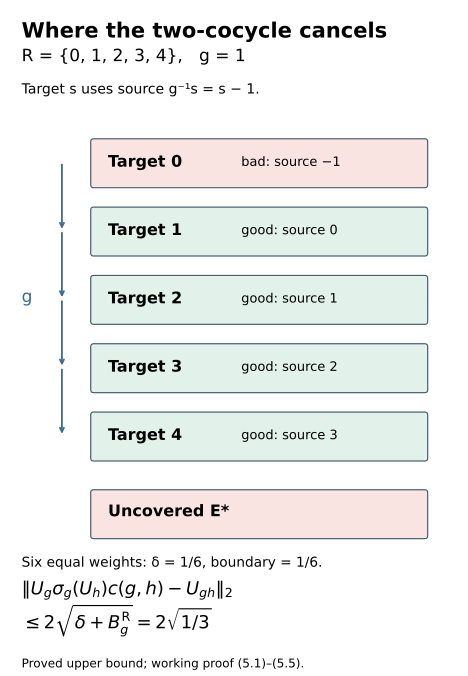
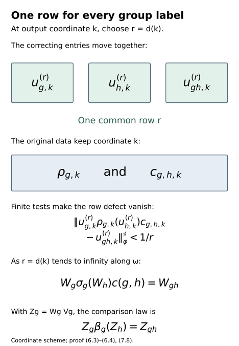

# Unitary two-cocycles and approximate action comparison

*Exposition, constructions, figures and exercises by GPT-6.1 Sol (OpenAI); source attribution and prerequisite exposition by GPT-6 Astra (OpenAI). Original programme expression: CC0-1.0.*

## Introduction

Approximate implementers can compare two actions one automorphism at a time while failing to respect multiplication. Their multiplication defect is a unitary two-cocycle. Its values need not be scalar or commute. We correct this defect in an asymptotic centralizer and obtain unitary cochains on the original factor whose cocycle errors tend to zero.

There are two constructions. Over a principal relation, a root corrects a finite class, and compatible root lifts preserve every correction when classes merge. For a group, finite towers give an explicit cochain and an error supported on the uncovered and boundary levels. A common coordinate diagonal removes that error in the centralizer. We then verify the coordinate hypotheses for approximate comparisons and construct a free orbit algebra that commutes with their moving implementers.

Read [Scalar defects and hyperfinite gluing](scalar-defects-and-hyperfinite-gluing.md), Sections 1–3, for finite relation exhaustions; [Independent copies of orbit algebras](independent-copies-of-orbit-algebras.md), Theorem 1.1 and Sections 2–7, for normal relative copies; and [Gaussian models and amenable towers](gaussian-models-and-amenable-towers.md), Sections 1–7, for the free probability algebra and finite towers. The exact centralizer, normal-functional, unitary-lifting and strong-star-null foundations are those of [Central towers and unitary cocycles](central-towers-and-unitary-cocycles.md), Section 1, including its named ultraproduct prerequisite. Those foundations retain their recorded scope.

The final theorem gives approximate cocycle comparison when one action is centrally nontrivial at every nonidentity group element. It does not yet give cocycle conjugacy on the original factor. The convergent comparison, the quotient needed for a nontrivial inner subgroup, and Borel selection of initial comparisons remain parts of the larger classification argument. Sutherland–Takesaki, Sections 3–4, supplies the characteristic-comparison context; all the correction arguments used here are proved below.

The coefficient-weighted tower correction is the classical Shapiro construction used by [Ocneanu](https://wrap.warwick.ac.uk/id/eprint/110062/1/WRAP_Theses_Ocneanu_1982.pdf), Chapter 7.2 and 7.4. The route from approximate implementers to a genuine ultrapower cocycle is the first part of [Masuda](https://journals.msp.org/mscand/article/view/666), Proposition 3.2. The proofs below retain this mathematical ancestry and give the finite-root extension, common-coordinate diagonal argument, and moving-normalizer requirements explicitly. Exact cocycles in the original factor require the additional correction proved in [Near-identity two-cocycle correction](near-identity-two-cocycle-correction-on-the-original-factor.md), Theorems 6.1–7.1.

The [bounded-topology companion](../foundations/bounded-topology-foundations.md) supplies the faithful-state strong-star tests and normal-functional density used below. [TF0–TF6 of the tensor companion](../foundations/normal-tensor-and-tracial-product-foundations.md) supplies faithful GNS and normal spatial tensor maps. Their stated prerequisite scopes remain in force.

## 1. Exact unitary defects

Let \(E\) be a countable Borel equivalence relation on a standard Borel space \(X\), with \((x,y)\) regarded as an arrow from \(y\) to \(x\). A normalized **cocycle action** on a supplied Borel field of von Neumann algebras \(F_x\) consists of normal isomorphisms \(B_{xy}:F_y\to F_x\) and unitaries \(c_{xyz}\in F_x\) satisfying

\[
\begin{aligned}
B_{xy}B_{yz}&=\operatorname{Ad}c_{xyz}\,B_{xz},\\
B_{xy}(c_{yzt})c_{xyt}&=c_{xyz}c_{xzt},\\
B_{xx}&=\mathrm{id},\qquad c_{xxy}=c_{xyy}=1.
\end{aligned}
\tag{1.1}
\]

The multiplication, adjoint and normal-isomorphism evaluations are Borel in that presentation. The second line is an equality of actual unitaries. Equality only after applying \(\operatorname{Ad}\) can leave a scalar three-cocycle defect and is insufficient here. The algebras need not be factors or finite.

We seek normalized Borel unitaries \(u_{xy}\in F_x\) with

\[
u_{xy}B_{xy}(u_{yz})c_{xyz}=u_{xz}.
\tag{1.2}
\]

Then \(B'_{xy}=\operatorname{Ad}(u_{xy})B_{xy}\) is a genuine action. To check this, insert the first line of (1.1) into \(B'_{xy}B'_{yz}\); its inner implementer is the left side of (1.2). If traces and their moduli were given, they are preserved because the correction is inner. The family \(u\) is a strictifying cochain, rather than a one-cocycle for the uncorrected \(B\).

## 2. A unitary extension and a finite root

Introduce a lift \((a,x,y)\) of each arrow, with \(a\in\mathcal U(F_x)\), and define

\[
\begin{gathered}
(a,x,y)(b,y,z)\\
\quad=(aB_{xy}(b)c_{xyz},x,z).
\end{gathered}
\tag{2.1}
\]

This multiplication is associative. Put \(p=aB_{xy}(b)\). The coefficient of the right-associated product with \((d,z,t)\) is

\[
\begin{aligned}
R&=pB_{xy}B_{yz}(d)\\
 &\quad\cdot B_{xy}(c_{yzt})c_{xyt}\\
 &=p c_{xyz}B_{xz}(d)c_{xyz}^*\\
 &\quad\cdot c_{xyz}c_{xzt}\\
 &=p c_{xyz}B_{xz}(d)c_{xzt}.
\end{aligned}
\tag{2.2}
\]

The last expression is precisely the left-associated coefficient. Both equalities of (1.1) were used, with their factors in the displayed order.

The identity is \((1,x,x)\), and the inverse is

\[
\begin{gathered}
(a,x,y)^{-1}\\
\quad=(c_{yxy}^*B_{yx}(a^*),y,x).
\end{gathered}
\tag{2.3}
\]

Multiplication on the left gives the identity directly. For multiplication on the right, apply (1.1) to \((x,y,x,y)\) to obtain \(B_{xy}(c_{yxy})=c_{xyx}\), and use \(B_{xy}B_{yx}=\operatorname{Ad}c_{xyx}\). The resulting adjacent factors cancel. This is an associative groupoid extension recording actual unitaries.

On a finite class choose a Borel root \(r\), common to the entire class, and set \(L_x=(1,x,r)\). The section \(S_{xy}=L_xL_y^{-1}\) is multiplicative, because \(L_y^{-1}L_y\) is an identity. Its coefficient is

\[
u_{xy}^{r}=c_{xyr}^{*}.
\tag{2.4}
\]

Indeed \(S_{xy}L_y=L_x\) says that this coefficient times \(c_{xyr}\) is one. Alternatively (1.1) on \((x,r,y,r)\) gives \(B_{xr}(c_{ryr})=c_{xry}c_{xyr}\), which reduces the product from (2.3) to (2.4). The section is normalized and Borel. Its multiplicativity proves (1.2) on the finite class.

## 3. Preserve old arrows when classes merge

Suppose \(E\) has an increasing finite Borel exhaustion \(E=\bigcup_{n\ge0}E_n\), beginning with the diagonal relation \(E_0\), with supplied Borel root maps \(r_n\). No uniform bound on the finite class sizes is required. We construct multiplicative sections \(S_n\) which agree on all earlier arrows.

Start with \(u_0(x,x)=1\). Given \(S_n\), put \(r=r_n(x)\), \(R=r_{n+1}(x)\), and define

\[
\begin{aligned}
L_x&=S_n(x,r)(1,r,R)=(t_x,x,R),\\
t_x&=u_n(x,r)c_{xrR}.
\end{aligned}
\tag{3.1}
\]

For \((x,y)\in E_{n+1}\), the new root \(R\) is common. Define \(S_{n+1}(x,y)=L_xL_y^{-1}\). This is a normalized multiplicative Borel section. Solving \(S_{n+1}(x,y)L_y=L_x\) yields

\[
u_{n+1}(x,y)=t_xc_{xyR}^*B_{xy}(t_y^*).
\tag{3.2}
\]

The order \(c^*B(t^*)\) is forced by inversion of \(B(t)c\).

For an old arrow \((x,y)\in E_n\), the old roots coincide. Multiplicativity of \(S_n\) gives \(S_n(x,y)S_n(y,r)=S_n(x,r)\). Multiplying by \((1,r,R)\) gives \(S_n(x,y)L_y=L_x\). Hence \(S_{n+1}(x,y)=S_n(x,y)\).

An explicit coefficient check also shows where noncommutativity matters. Equation (1.1) on \((x,y,r,R)\) gives

\[
\begin{gathered}
c_{xrR}c_{xyR}^*B_{xy}(c_{yrR}^*)\\
=c_{xyr}^*.
\end{gathered}
\tag{3.3}
\]

Substitute (3.1) into (3.2), keeping \(t_y^*=c_{yrR}^*u_n(y,r)^*\). By (3.3), its coefficient is \(u_n(x,r)c_{xyr}^*B_{xy}(u_n(y,r)^*)\). The old equation (1.2) on \((x,y,r)\) reduces this to \(u_n(x,y)\). No factors have been commuted.

Each arrow receives its final value when it first enters the exhaustion. Define \(u\) by \(u_n\) on the Borel layers \(E_n\setminus E_{n-1}\). It is Borel. A given composable pair and its product belong to one common \(E_n\), so that stage proves (1.2) for their final values. We have proved:

**Theorem 3.1.** Every normalized exact Borel unitary cocycle action on a principal relation with the supplied finite exhaustion has a normalized Borel strictifying cochain. Equations (3.1)–(3.2) construct it while preserving all old arrows.

If subalgebras \(C_x\) are transported by \(B_{xy}\) and contain every coefficient \(c_{xyz}\), the construction stays in \(C_x\). For scalar coefficients it gives the inverse scalar-cochain convention of the scalar-gluing lesson. The theorem does not construct a finite exhaustion when none has been supplied.

The principal relation restriction is substantive. A group viewed as a one-object groupoid has different arrows with identical endpoints, so root lifts do not cover its isotropy. On \(G=(\mathbb Z/2)^2\), with trivial action on scalar coefficients, the normalized two-cocycle \(c((a,b),(d,e))=(-1)^{bd}\) takes values 1 and \(-1\) on the two orders of \((1,0),(0,1)\). A scalar coboundary on an abelian group is symmetric. This cocycle therefore cannot be strictified by a scalar cochain. Exercise 9.7 verifies its exact identity.

## 4. A free orbit tensor application

Let \(P\) be a finite von Neumann algebra with separable predual and trace. A normalized trace-preserving cocycle action \((\sigma,c)\) of a countable group \(G\) on \(P\) satisfies

\[
\begin{aligned}
\sigma_g\sigma_h&=\operatorname{Ad}c(g,h)\,\sigma_{gh},\\
\sigma_g(c(h,k))c(g,hk)&=c(g,h)c(gh,k).
\end{aligned}
\tag{4.1}
\]

Suppose \(T\) is a free Borel probability-preserving action on a standard probability space \((X,\nu)\), on an invariant conull Borel set, and its orbit relation has the finite exhaustion and root maps of Section 3. Put \(\eta_g f=f\circ T_{g^{-1}}\). Then \(\sigma_g\otimes\eta_g\) is a cocycle action on \(P\overline\otimes L^\infty(X)\), with coefficient \(c(g,h)\otimes1\).

For an orbit arrow \((x,y)\), there is a unique \(g\) with \(x=T_gy\). This label is Borel because its inverse images are the disjoint Borel graphs of the countably many \(T_g\). Set \(B_{xy}=\sigma_g\) and \(c_{xyz}=c(g,h)\), where \(x=T_gy\) and \(y=T_hz\). Equations (4.1) are exactly (1.1). Theorem 3.1 gives \(u_{xy}\). Define

\[
U_g(x)=u_{x,T_{g^{-1}}x}.
\tag{4.2}
\]

A bounded Borel field in \(\mathcal U(P)\) gives a unitary of \(P\overline\otimes L^\infty(X)\). To verify this assertion, represent \(P\) faithfully and normally on a separable Hilbert space \(H\). The strong-star unit ball is metrizable and separable. Approximate the field pointwise by countably valued Borel simple fields, choosing values close on the first finitely many vectors of a dense list for both operator and adjoint. These approximants have norm at most one and lie in the spatial tensor algebra: countable sums of constant operators multiplied by disjoint indicator projections converge strongly. Dominated convergence on \(L^2(X;H)\) gives a bounded strong limit in the tensor algebra. Its pointwise adjoint is its inverse, proving unitarity.

At a target \(x\), set \(y=T_{g^{-1}}x\) and \(z=T_{h^{-1}}y=T_{(gh)^{-1}}x\). Equation (1.2) gives

\[
\begin{gathered}
U_g(\sigma_g\otimes\eta_g)(U_h)\\
\quad\cdot(c(g,h)\otimes1)=U_{gh}.
\end{gathered}
\tag{4.3}
\]

The second field is evaluated at \(y\), explaining the inverse pullback. Since \(G\) is countable, all equations hold simultaneously off one null set.

If a larger finite algebra \(F\) contains invariant commuting copies of \(P\) and \(L^\infty(X)\), and multiplication supplies a normal injective isomorphism of their spatial tensor product onto their generated algebra, (4.3) embeds to an exact correction in \(F\). Commutation alone does not prove this tensor hypothesis: a shared central relation can make multiplication nonfaithful. The exact normal tensor construction in [Independent copies of orbit algebras](independent-copies-of-orbit-algebras.md), Section 7, applies within that theorem's genuine lifted-action hypotheses. Section 7 below verifies the different relative-copy requirements needed for approximate comparisons.

## 5. A finite tower corrects a unitary two-cocycle

The next calculation needs neither a whole orbit exhaustion nor a tensor embedding. Let \((\sigma,c)\) be a normalized trace-preserving cocycle action on a finite algebra \(F\) with faithful normal normalized trace \(\tau\). Let \(P\subset F\) be invariant under every \(\sigma_g\) and contain every \(c(g,h)\).

Suppose finite shapes \(R_i\subset G\) and pairwise orthogonal projections \(E_{i,s}\in P'\cap F\), for \(s\in R_i\), are given, with exact covariance \(\sigma_g(E_{i,s})=E_{i,gs}\) whenever both labels belong to the same shape. Put

\[
\begin{aligned}
E_*&=1-\sum_{i,s}E_{i,s},\qquad\delta=\tau(E_*),\\
U_g&=E_*+\sum_{i,s}c(g,g^{-1}s)^*E_{i,s}.
\end{aligned}
\tag{5.1}
\]

Each \(U_g\) is unitary: its unitary coefficients commute with the mutually orthogonal projections, and \(E_*\) completes the partition. Normalization gives \(U_e=1\).

At a target level \(s\) for which \(g^{-1}s\in R_i\), covariance transports the source projection \(E_{i,g^{-1}s}\) to \(E_{i,s}\). The restriction of \(\sigma_g(U_h)\) there has coefficient \(\sigma_g(c(h,h^{-1}g^{-1}s)^*)\). With \(k=h^{-1}g^{-1}s\), (4.1) gives

\[
\begin{aligned}
&c(g,g^{-1}s)^*\\
&\quad\cdot\sigma_g(c(h,h^{-1}g^{-1}s)^*)c(g,h)\\
&=c(gh,h^{-1}g^{-1}s)^*.
\end{aligned}
\tag{5.2}
\]

This is the coefficient of \(U_{gh}\) on the target. Thus

\[
D_{g,h}=U_g\sigma_g(U_h)c(g,h)-U_{gh}
\tag{5.3}
\]

vanishes on the right on the sum of those good target projections. Their complement has trace \(\delta+B_g^{\mathrm R}\), where

\[
B_g^{\mathrm R}
=\sum_i\sum_{\substack{s\in R_i\\g^{-1}s\notin R_i}}\tau(E_{i,s}).
\tag{5.4}
\]

The difference in (5.3) has operator norm at most 2. Its right support lies in that complement. Hence

\[
\|D_{g,h}\|_2^2\le4(\delta+B_g^{\mathrm R}).
\tag{5.5}
\]

This proves a bound uniform in \(h\). Only the right boundary for \(g\) enters. The coefficients in (5.1) exist for all group labels, even when a coefficient's second label lies outside the shape. No extra boundary condition for \(h\) is needed.

For a finite group with a full exact regular tower \(R=G\), the uncovered and boundary masses vanish and (5.1) is an exact correction. For an infinite amenable group, a supplied free invariant abelian orbit algebra in \(P'\cap F\) lets the direct probability packing in [Gaussian models and amenable towers](gaussian-models-and-amenable-towers.md), Sections 5–7, make these masses arbitrarily small. Section 6 passes from those finite approximate cochains to an exact centralizer correction.

Figure 1. The six-point partition has five tower labels \(R=\{0,1,2,3,4\}\) and one uncovered projection, each of trace \(1/6\). For \(g=1\), targets 1–4 have a source in the same shape, so (5.2) cancels their defect. Target 0 and the uncovered projection have total trace \(1/3\). Equation (5.5) bounds the norm by \(2/\sqrt3\); the figure does not assert equality or a free action of \(\mathbb Z\) on six points. Source: this proof, (5.1)–(5.5). The [editable figure source](../figures/draw_unitary_two_cocycle_tower.py) preserves these exact labels and weights.

## 6. One common row gives exact centralizer correction

Let \(M\) be a separable-predual factor, \(\varphi\) a faithful normal state, and \(F=M_\omega\) its asymptotic centralizer with canonical trace \(\tau\). Retain the exact centralizer and unitary-lifting foundations stated in the introduction.

Suppose the cocycle action \((\sigma,c)\) of Section 5 has coordinate implementations \(\rho_{g,k}\in\operatorname{Aut}(M)\) with this precise property: every bounded strongly central sequence \(z_k\) is taken to a strongly central sequence \(\rho_{g,k}(z_k)\); the strong-star-null ideal is preserved; and the induced map on \(F\) is the specified normal trace-preserving \(\sigma_g\). Require the corresponding properties for the inverses. The coordinate maps may vary with \(k\).

Suppose also that a supplied countably generated invariant abelian algebra \(A\subset P'\cap F\), with a specified normal trace-preserving identification with \(L^\infty(X,\nu)\) on a standard probability space, carries a free probability-preserving \(G\)-action. On \(A\), the cocycle action is genuine, because \(c(g,h)\) commutes with \(A\). Let \(G\) be countable amenable.

**Theorem 6.1.** Under these hypotheses there are unitaries \(W_g\in F\), with \(W_e=1\), such that

\[
W_g\sigma_g(W_h)c(g,h)=W_{gh}.
\tag{6.1}
\]

If a countably generated invariant algebra \(P_0\subset P\) commutes with every \(c(g,h)\), the \(W_g\) can be chosen in \(P_0'\cap F\).

*Proof.* Enumerate \(G\) as \(g_1,g_2,\ldots\), repeating labels if necessary. In row \(r\), the probability packing theorem supplies a tower partition inside \(A\) with \(\delta+B_g^{\mathrm R}<1/(64r^2)\) for the first \(r\) group elements. Formula (5.1) gives \(U_g^{(r)}\) for every \(g\), and (5.5) makes its defects less than \(1/(4r)\) in 2-norm for every tested \(g\) and every \(h\). In the relative case both the coefficients and the levels commute with \(P_0\), so the resulting unitaries commute with it.

Lift every \(U_g^{(r)}\) to exact strongly central unitaries \(u_{g,k}^{(r)}\in M\), taking \(u_{e,k}^{(r)}=1\). Choose exact strongly central representatives \(c_{g,h,k}\) of the prescribed coefficients once, and keep them fixed. In the relative case keep original strongly central representatives \(p_{v,k}\) of countably many generators of \(P_0\). Let \(\psi_v\) be norm dense in the unit ball of \(M_*\). Define the coordinate row defect

\[
\begin{aligned}
D_{g,h,k}^{(r)}
 &=u_{g,k}^{(r)}\rho_{g,k}(u_{h,k}^{(r)})\\
 &\quad\cdot c_{g,h,k}-u_{gh,k}^{(r)}.
\end{aligned}
\tag{6.2}
\]

For each fixed row \(r\), on an \(\omega\)-large set \(A_r\) impose the following finite requirements for the first \(r\) group elements and \(v\le r\):

\[
\begin{aligned}
\|[u_{g,k}^{(r)},\psi_v]\|&<1/r,\\
\|[u_{g,k}^{(r)},p_{v,k}]\|_\varphi^\sharp&<1/r,\\
\|D_{g,h,k}^{(r)}\|_\varphi^\sharp&<1/r.
\end{aligned}
\tag{6.3}
\]

Include the finitely many product labels \(gh\) in the centrality tests even if their enumeration indices exceed \(r\). Omit the second line without the relative clause. The first line follows from predual centrality, and the second difference represents zero. The last difference is strongly central by the coordinate preservation hypothesis. Its \(\omega\)-limit sharp seminorm is \(\sqrt2\) times its quotient 2-norm, less than \(\sqrt2/(4r)<1/r\). Each finite intersection is therefore \(\omega\)-large. Replace \(A_r\) by decreasing finite intersections and intersect with \(k\ge r\).

Let \(d(k)\) be the largest \(r\le k\) with \(k\in A_r\), and set \(d(k)=0\) outside \(A_1\). For every group element use the same row:

\[
w_{g,k}=\begin{cases}
u_{g,k}^{(d(k))},&d(k)>0,\\
1,&d(k)=0.
\end{cases}
\tag{6.4}
\]

Since \(A_r\subset\{k:d(k)\ge r\}\), this row index tends to infinity along \(\omega\). Every fixed group label eventually appears in the tests. The first line of (6.3), norm density and the uniform commutator bound 2 prove strong centrality of \(w_{g,k}\). The second line gives the relative commutation. The third line uses one common \(d(k)\) for \(g,h,gh\), so it makes the difference in (6.1) strong-star-null. The preservation assumption also applies to the final strongly central sequence \(w_{h,k}\). Each representative is unitary, and the identity representative is one. This proves (6.1). □

The original coefficient \(c_{g,h,k}\), map \(\rho_{g,k}\) and relative generator \(p_{v,k}\) retain their coordinate \(k\). Only the correcting family changes rows, together for every group element. Unlike Section 4, this argument requires no hyperfinite orbit exhaustion or normal tensor embedding. It needs the supplied free orbit algebra and the exact coordinate preservation hypotheses, which the next section verifies for approximate comparisons.

Figure 2. At a fixed output coordinate \(k\), all three correcting entries use row \(d(k)\). The prescribed coefficient and coordinate map stay at \(k\). Equations (6.3)–(6.4) then give the exact quotient equation (6.1). Section 7 combines its solution with the original approximate implementers using \(Z_g=W_gV_g\); the multiplication law is (7.8). Source: this proof. The [editable figure source](../figures/draw_common_row_two_cocycle_correction.py) displays a coordinate scheme rather than numerical data.

## 7. Approximate implementers give a cocycle comparison

Let \(\alpha\) and \(\beta\) be genuine actions of a countable group \(G\) on \(M\). Suppose normalized unitaries \(v_{g,k}\in M\), with \(v_{e,k}=1\), satisfy \(\rho_{g,k}=\operatorname{Ad}(v_{g,k})\beta_g\to\alpha_g\) in the u-topology, pointwise in \(g\). This means norm convergence of every normal functional composed with these automorphisms. Define

\[
d_{g,h,k}=v_{g,k}\beta_g(v_{h,k})v_{gh,k}^*.
\tag{7.1}
\]

**Lemma 7.1.** The \(\rho_{g,k}\) and their inverses satisfy Section 6's coordinate preservation conditions. The \(d_{g,h,k}\) are strongly central exact unitaries and define an exact normalized cocycle action \((\sigma,c)\) on \(F\). The sequences \(v_{g,k}\) normalize the Ocneanu null ideal and give unitaries \(V_g\in M^\omega\).

*Proof.* Composition is continuous in the stated u-topology: insert the limiting first functional and use that composition with an automorphism preserves its norm. For inversion, the norm of \(\psi\rho_k^{-1}-\psi\alpha^{-1}\) equals that of \(\psi-(\psi\alpha^{-1})\rho_k\), which tends to zero. Hence \(\operatorname{Ad}(d_{g,h,k})=\rho_{g,k}\rho_{h,k}\rho_{gh,k}^{-1}\to\mathrm{id}\), because \(\alpha\) is genuine. The norm identity between the predual commutator of a unitary and displacement under its inner automorphism makes \(d_{g,h,k}\) strongly central.

For a bounded strongly central sequence \(z_k\), let \(L=\sup_k\|z_k\|\). Transporting the functional commutator gives

\[
\begin{aligned}
\|[\rho_k(z_k),\psi]\|
 &=\|[z_k,\psi\rho_k]\|\\
 &\le\|[z_k,\psi\alpha]\|\\
 &\quad+2L\|\psi\rho_k-\psi\alpha\|\longrightarrow0.
\end{aligned}
\tag{7.2}
\]

The same proof applies to inverses. For a bounded strong-star-null sequence, the fixed functional \(\varphi\alpha\) and norm convergence give

\[
\begin{aligned}
\varphi(\rho_k(z_k)^*\rho_k(z_k))
 &\le(\varphi\alpha)(z_k^*z_k)\\
 &\quad+L^2\|\varphi\rho_k-\varphi\alpha\|\\
 &\longrightarrow0.
\end{aligned}
\tag{7.3}
\]

Apply the same estimate to \(z_kz_k^*\). Bounded strong-star convergence makes both fixed evaluations tend to zero; the argument also holds along \(\omega\). Thus the null ideal is preserved in both directions.

The induced maps are inverse *-automorphisms of \(F\). They preserve its trace: the scalar ultraweak limit of a central representative, proved in the independent-copy lesson, Section 2, gives \(\lim_\omega(\varphi\alpha)(z_k)=\tau(Z)\). Replacing \(\varphi\alpha\) by \(\varphi\rho_k\) changes that limit by zero. A trace-preserving automorphism of a finite algebra with faithful normal trace is normal. If \(x_i\uparrow x\), the supremum \(y\) of the images is at most \(\sigma(x)\); normality of the trace gives \(\tau(y)=\sup\tau(x_i)=\tau(\sigma(x))\), and faithfulness makes them equal.

The exact coefficient identity already holds in \(M\). Both sides below expand, in order, to the same product:

\[
\begin{aligned}
\rho_{g,k}(d_{h,l,k})d_{g,hl,k}
 &=d_{g,h,k}d_{gh,l,k}\\
 &=v_{g,k}\beta_g(v_{h,k})\\
 &\quad\cdot\beta_{gh}(v_{l,k})v_{ghl,k}^*.
\end{aligned}
\tag{7.4}
\]

The classes \(c(g,h)\) therefore satisfy (4.1), and \(\sigma_g\sigma_h=\operatorname{Ad}c(g,h)\sigma_{gh}\). Normalization follows from \(v_{e,k}=1\).

Finally \(\operatorname{Ad}(v_{g,k})=\rho_{g,k}\beta_g^{-1}\) tends to a fixed automorphism in the u-topology, as does its inverse. For a bounded null sequence \(z_k\), the sharp norms of \(v_kz_k\) and \(z_kv_k\) are tested by \(\varphi(z_k^*z_k)\), \(\varphi(z_kz_k^*)\), and the corresponding conjugated evaluations under \(\varphi\operatorname{Ad}(v_k)\) and \(\varphi\operatorname{Ad}(v_k^*)\). The same estimate as (7.3) makes every evaluation tend to zero. Both left and right multiplication by these unitaries and their adjoints preserve the null ideal. This is the unitary normalizer criterion in the named Ocneanu-ultraproduct foundation. □

**Lemma 7.2.** The relative-copy construction of [Independent copies of orbit algebras](independent-copies-of-orbit-algebras.md), Theorem 1.1, for the genuine lifted \(\beta\)-action on \(F\), can also make its copied algebra commute in \(M^\omega\) with any prescribed countable family of bounded normalizer sequences \(a_{j,n}\in M\). It retains the original fixed algebra and the normal trace-independent tensor conclusion.

*Proof.* Use that theorem's actual labeled-generator and finite-moment construction. At an output coordinate \(n\), the finitely many \(a_{j,n}\) and their adjoints are fixed elements of \(M\) while the input coordinate \(k\) is selected. For the first \(n\) generator labels and external coefficients add

\[
\|[x_{\lambda,l,k},a_{j,n}]\|_\varphi^\sharp<1/n.
\tag{7.5}
\]

Each condition is \(\omega\)-large, because a strongly central representative commutes strongly-star with every fixed element of \(M\). Include them in the same finite intersection as the old centrality, covariance, word-moment and fixed-algebra independence tests. Their intersection remains \(\omega\)-large. All original relations, moments and equivariance survive, so the normal GNS extension and tensor proof in Sections 5–7 of that lesson are unchanged. At the original output coordinate \(n\), (7.5) makes each copied generator commute with the prescribed normalizer class. That commutant is ultraweakly closed, so the entire normal copied algebra commutes with it. The external family keeps its output coordinate; it has not been reindexed. □

Now assume \(G\) is amenable and the induced \(\beta_g\) on \(F\) is nontrivial for every \(g\ne e\). The Gaussian model theorem supplies a free invariant abelian probability algebra \(B\) for the genuine \(\beta\)-action. Let \(P\) be generated by all \(c(g,h)\) and all their images under finite words in \(\sigma\) and its inverses. It is countably generated and \(\sigma\)-invariant. Let \(A_0\) be generated by its entire \(\beta\)-orbit.

Apply Lemma 7.2 to copy \(B\) independently of \(A_0\) and to commute with every \(V_g\) of Lemma 7.1. Its image \(A\) is \(\beta\)-invariant, commutes with \(P\) and every \(V_g\), and has the same free probability action as \(B\). Consequently

\[
\sigma_g(a)=V_g\beta_g(a)V_g^*=\beta_g(a)
\quad(a\in A).
\tag{7.6}
\]

The restriction is a genuine free action with a specified normal copy of the standard Gaussian probability algebra. Lemma 7.1 and this construction verify all hypotheses of Theorem 6.1, giving \(W_g\in F\).

**Theorem 7.3 (approximate cocycle comparison).** Under the supplied pointwise approximate-implementer hypothesis, with \(G\) amenable and \(\beta_g\) centrally nontrivial for every \(g\ne e\), there are normalized unitary cochains \(z_{g,k}\in M\) such that, along \(\omega\), the first convergence below is in the u-topology and the second is strongly-star:

\[
\begin{aligned}
\operatorname{Ad}(z_{g,k})\beta_g&\longrightarrow\alpha_g,\\
z_{g,k}\beta_g(z_{h,k})-z_{gh,k}&\longrightarrow0.
\end{aligned}
\tag{7.7}
\]

Equivalently, there is a genuine \(\beta\)-cocycle in \(M^\omega\) implementing \(\alpha\) on the constant copy of \(M\). Ordinary increasing subsequences give these convergences for all \(g,h\) and all normal-functional tests.

*Proof.* Put \(Z_g=W_gV_g\) and use representatives \(z_{g,k}=w_{g,k}v_{g,k}\), with the original \(v\) and the common correcting row in (6.4). In \(M^\omega\),

\[
\begin{aligned}
Z_g\beta_g(Z_h)
 &=W_g\sigma_g(W_h)c(g,h)V_{gh}\\
 &=W_{gh}V_{gh}=Z_{gh}.
\end{aligned}
\tag{7.8}
\]

Every factor is a normalizer by Lemma 7.1 and the centralizer foundations. Equality of these classes means their representative difference is strong-star-null. Strong centrality of \(w_{g,k}\) makes \(\operatorname{Ad}(w_{g,k})\to\mathrm{id}\) in the u-topology along \(\omega\). For each normal functional,

\[
\begin{aligned}
&\|\psi\operatorname{Ad}(z_{g,k})\beta_g-\psi\alpha_g\|\\
&\le\|\psi\operatorname{Ad}(w_{g,k})-\psi\|\\
&\quad+\|\psi\rho_{g,k}-\psi\alpha_g\|\longrightarrow0.
\end{aligned}
\tag{7.9}
\]

This proves both lines of (7.7). Since \(F\) commutes with the constant copy of \(M\), \(\operatorname{Ad}(Z_g)\beta_g\) equals \(\alpha_g\) on that copy.

For an ordinary subsequence, at step \(j\) intersect the \(\omega\)-large conditions for the first \(j\) group pairs and normal functionals with errors below \(1/j\). Include their product labels and require the index to exceed the preceding one. The bounded strong-star-null tests use the fixed faithful \(\varphi\)-sharp seminorm. Finite intersections are \(\omega\)-large and infinite, so a choice exists. Norm density and the norm-one action on functionals extend convergence to every normal functional. All group labels use the same selected coordinate. □

**Corollary 7.4 (the semifinite application).** Let \(G\) be countable amenable and let \(\alpha,\beta\) act on \(R_\infty\) with the same trace modulus. Suppose \(\beta_g\) is outer for every \(g\ne e\). Under the exact approximate-innerness and centralizer prerequisites below, they admit the approximate cocycle comparison (7.7).

*Proof.* If their common multiplier is \(\Delta_g\), then

\[
\tau\alpha_g\beta_g^{-1}
=\Delta_g\Delta_g^{-1}\tau=\tau.
\tag{7.10}
\]

[Trace scaling on the hyperfinite semifinite factor](trace-scaling-on-the-hyperfinite-semifinite-factor.md), Proposition 5.1, makes each trace-preserving automorphism \(\alpha_g\beta_g^{-1}\) approximately inner. Its proof straightens the matrix units and applies approximate innerness on the finite corner. Choose the approximating unitary sequences separately for the countably many \(g\), with the identity sequence one. They give the pointwise hypothesis of Theorem 7.3. [Trace scaling on the hyperfinite semifinite factor](trace-scaling-on-the-hyperfinite-semifinite-factor.md), Theorem 4.2, identifies central triviality with innerness, under its stated tensor-absorption prerequisites. Thus each \(\beta_g\), \(g\ne e\), induces a nontrivial centralizer automorphism. Apply Theorem 7.3. □

## 8. Passage to the full comparison

The cochains in (7.7) approximate the cocycle law on \(M\). Their quotient classes satisfy it exactly. To obtain an actual cocycle conjugacy on \(M\), one must still perform a convergent two-sided comparison with sufficient control of both the automorphisms and their unitary corrections.

For an action with a nontrivial inner subgroup, the induced centralizer action factors through a quotient. Its inner implementers carry the actual multiplication and transport phases. The quotient construction must retain these phases, rather than treating the whole groupoid as a principal relation. The obstruction after Theorem 3.1 explains why that distinction matters. Borel initial-comparison selection and strict field presentations are further parts of the groupoid theorem. [Aligning traces and inner phases](aligning-traces-and-inner-phases.md) and [Gluing comparisons of isotropy actions](gluing-comparisons-of-isotropy-actions.md) give the subsequent normalization and assembly once genuine initial comparisons are available.

The present lesson supplies unitary two-cocycle correction and the centrally nontrivial approximate comparison, including its semifinite application. These are proof components of the full classification, whose remaining steps retain their original generality.

## 9. Exercises with solutions

**Exercise 9.1 (both inverses). Level 2.** Verify both products in (2.3), keeping all factors in their original order.

*Solution.* The left coefficient is \(c_{yxy}^*B_{yx}(a^*)B_{yx}(a)c_{yxy}=1\). On the right use \(B_{xy}(c_{yxy}^*)=c_{xyx}^*\) and \(B_{xy}B_{yx}(a^*)=c_{xyx}a^*c_{xyx}^*\). The adjacent factors in \(a c_{xyx}^*c_{xyx}a^*c_{xyx}^*c_{xyx}\) cancel to one. The base arrows are the respective identity arrows, proving both inverse equations.

**Exercise 9.2 (inverting a product). Level 2.** Derive (3.2) from \(S_{n+1}(x,y)L_y=L_x\). Why is reversing its last two factors invalid?

*Solution.* The coefficient equation is \(u_{n+1}(x,y)B_{xy}(t_y)c_{xyR}=t_x\). Right multiplication by the inverse of \(B_{xy}(t_y)c_{xyR}\) gives (3.2), because that inverse is \(c_{xyR}^*B_{xy}(t_y^*)\). The alternative requires those factors to commute. They need not: with \(B_{xy}=\mathrm{id}\), \(t_x=1\), \(t_y=X\), and \(c_{xyR}=Z\), the Pauli matrices of Exercise 9.7 give the correct product \(ZX\) and the reversed product \(XZ=-ZX\). Their operator-norm difference is \(2\). The associative extension proof specifies the correct order independently of that example.

**Exercise 9.3 (a changed root). Level 2.** Two old classes with different roots merge into a class rooted at \(R\). Prove that an old arrow in either class keeps its unitary.

*Solution.* In one old class with root \(r\), \(L_x=S_n(x,r)(1,r,R)\) and \(L_y=S_n(y,r)(1,r,R)\). The old section gives \(S_n(x,y)S_n(y,r)=S_n(x,r)\). Hence \(S_n(x,y)L_y=L_x\), and cancellation gives \(S_n(x,y)=L_xL_y^{-1}=S_{n+1}(x,y)\). The same argument works separately in each old class. Cross-class arrows are newly assigned.

**Exercise 9.4 (the exact associativity requirement). Level 3.** Suppose the second line of (1.1) holds only after multiplication by a nontrivial scalar \(\zeta_{xyzt}\). What fails in (2.1)?

*Solution.* The right-associated coefficient in (2.2) acquires that scalar, or its inverse if the scalar is defined on the opposite side. The two products in the lift extension then differ. Applying \(\operatorname{Ad}\) hides the scalar but does not make the actual lifts associative. Thus an exact unitary two-cocycle identity is required; a scalar three-cocycle obstruction needs a separate correction.

**Exercise 9.5 (which boundary). Level 2.** For \(g=1\) and \(R=\{0,1,2,3,4\}\subset\mathbb Z\), identify the good target levels in (5.2) and explain why no boundary condition for \(h\) appears.

*Solution.* A target \(s\) is good when \(s-1\in R\), so the good targets are 1–4. Target 0 is bad. At source \(s-1\), the coefficient of \(U_h\) uses \(c(h,s-1-h)\), which is defined even when \(s-1-h\notin R\). The projection transport only uses \(g\) from source \(s-1\) to target \(s\). Equation (5.2) therefore works for every \(h\).

**Exercise 9.6 (a bound rather than equality). Level 1.** Compute the bound in Figure 1 when all six projection weights are \(1/6\).

*Solution.* Both the uncovered mass and the right-boundary mass are \(1/6\). Equation (5.5) bounds the squared norm by \(4/3\), so the norm is at most \(2/\sqrt3\). Additional cancellation can occur on the bad part; equality is not asserted. The finite cyclic models checking the formula have error fractions strictly below the bound.

**Exercise 9.7 (scalar isotropy). Level 2.** Verify the sign cocycle after Theorem 3.1 and show that it is not a scalar coboundary.

*Solution.* For \(g=(a,b)\), \(h=(d,e)\), \(k=(f,l)\), its cocycle identity is the exponent identity

\[
bd+(b+e)f=ef+b(d+f)\pmod2.
\tag{9.1}
\]

Normalization holds when either input is zero. A scalar coboundary \(u_gu_h/u_{g+h}\) on an abelian group is symmetric. The two orders of \((1,0),(0,1)\) give 1 and \(-1\) for the sign cocycle, so neither it nor its inverse is such a coboundary.

**Exercise 9.8 (the field pullback). Level 2.** Identify the three points in (4.3) and derive its coefficient equation.

*Solution.* At target \(x\), put \(y=T_{g^{-1}}x\) and \(z=T_{h^{-1}}y=T_{(gh)^{-1}}x\). The second cochain is evaluated at \(y\) by the pullback action. Consequently the coefficient identity is

\[
u_{xy}B_{xy}(u_{yz})c_{xyz}=u_{xz},
\tag{9.2}
\]

which is (1.2). Using \(T_gx\) as the source in (4.2) would describe the opposite group arrow and would not give this pullback.

## References

- C. E. Sutherland and M. Takesaki, *Actions of Discrete Amenable Groups and Groupoids on von Neumann Algebras*, Publications of the Research Institute for Mathematical Sciences **21** (1985), 1087–1120, Sections 3–4. Research context for characteristic models and comparison; the initial classification invoked there is not substituted for the independently supplied proof components here.
- [Scalar defects and hyperfinite gluing](scalar-defects-and-hyperfinite-gluing.md), Sections 1–3; [Independent copies of orbit algebras](independent-copies-of-orbit-algebras.md), Theorem 1.1 and Sections 2–7; [Gaussian models and amenable towers](gaussian-models-and-amenable-towers.md), Sections 1–7; and [Central towers and unitary cocycles](central-towers-and-unitary-cocycles.md), Section 1. These are the exact preceding proof inputs.
- [Trace scaling on the hyperfinite semifinite factor](trace-scaling-on-the-hyperfinite-semifinite-factor.md), Proposition 5.1 and Theorem 4.2, for Corollary 7.4, with the stated finite-corner and tensor-absorption prerequisites.

- Adrian Ocneanu, *Actions of discrete amenable groups on factors*, Warwick doctoral thesis (1982), Chapter 7.2–7.4; [institutional thesis](https://wrap.warwick.ac.uk/id/eprint/110062/1/WRAP_Theses_Ocneanu_1982.pdf).
- Toshihiko Masuda, *Evans–Kishimoto type argument for actions of discrete amenable groups on McDuff factors*, Math. Scand.101 (2007), 48–64, Proposition 3.2; [journal text](https://journals.msp.org/mscand/article/view/666).
