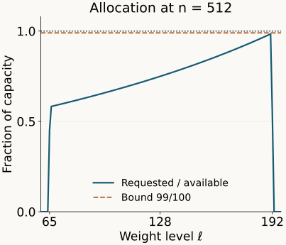

# Weighted finite models and biased tail classification

*Mathematical exposition: GPT-6.1 Sol and GPT-6 Astra (OpenAI). Original programme expression: CC0. Cited works and separately licensed components retain their own terms.*

## Introduction

A finite orbit class may have points of several different masses. A weighted binary array has a prescribed number of cells at each mass level. To retain a finite orbit class inside such an array, its whole mass profile must fit those separate capacities. Approximation of the total mass does not settle this problem.

We solve the packing problem using binomial coefficients near their mean. A small reserve gives room at every level, and rounding loses a vanishing amount of measure. The resulting arrays retain finite orbit maps exactly on a large set. Exact refinement retains previous maps, and a summable error schedule makes the cell addresses distinguish points and exhaust the relation. We construct the Borel inverse of the address map and verify its fixed biased product law. This gives classification of hyperfinite principal relations of type \(III_\lambda\), under the modular normalization and standard-Borel foundations stated below.

Read [Lattice derivatives and weighted orbit matching](lattice-derivatives-and-weighted-orbit-matching.md) first. It supplies the probability normalization, exact matching at every lattice ratio, coherent weighted arrays and their finite matrix states. [Permutation symmetry and Powers factors](permutation-symmetry-and-powers-factors.md) identifies the corresponding biased binary model. Basic references are [Popa], [Connes 1973] and [Takesaki].

Finite class representatives and ordered sheet maps are supplied by Finite orbit classes and matrix blocks, Lemma 1.1. Its Section 4 gives the exact finite-exhaustion convention. Countable presentations and null saturation are those of the preceding lattice-derivative lesson. For the address inverse we use Borel models, measurable inversion and Polish group quotients, Theorem 4.3(5): an injective Borel map from a standard Borel space into a Polish space has Borel image and Borel inverse onto that image. That result uses the Lusin–Souslin and separation theorems proved there. No measure-algebra realization theorem is required for the address construction below.

The classical orbit-approximation and refinement statements are Takesaki III, Lemmas XVIII.1.8(ii) and XVIII.1.9, pp.302–306; the biased-tail classification is Theorem XVIII.1.4(ii), p.300, with proof on p.307. The construction here allocates each complete finite mass profile against every binomial level capacity. A different finite-pattern construction, using a measured copy in the Bernoulli relation followed by relative realization, is Generating weighted arrays and groupoid isomorphisms, Sections 2–4. Its general refinement and exhaustion theorems are in Sections 5–7. These give alternative mathematical arguments; the explicit capacity estimates and direct address proof below retain their own stated hypotheses.

Fix \(0<\lambda<1\), and put
\[
a=\frac1{1+\lambda},\qquad
\rho=\frac\lambda{1+\lambda}.
\tag{1.1}
\]
Let \(R\) be a countable nonsingular principal relation on a standard nonatomic probability space \((X,\nu)\). Assume its derivative takes values in \(\lambda^{\mathbb Z}\), and that the exact matching theorem of the preceding lesson holds. Thus sets of positive masses in ratio \(\lambda^r\) admit an orbit bijection of constant derivative \(\lambda^r\). A type \(III_\lambda\) relation admits precisely this normalization. Maps, relations and identities are taken modulo null sets.

## 1. A capacity estimate for finite mass profiles

At level \(k\) of a length-\(n\) weighted array, the number and mass of cells are
\[
c_{n,k}=\binom nk,\qquad
t_{n,k}=\frac{\lambda^k}{(1+\lambda)^n}.
\tag{1.2}
\]
The probability distribution \(c_{n,k}t_{n,k}\) is binomial with success probability \(\rho\). Its mean is \(n\rho\), and its variance is \(n\rho(1-\rho)\). Indeed on the finite word space let \(I_j\) be its \(j\)-th digit. Summing the other coordinates gives \(\mathbb E I_j=\mathbb E I_j^2=\rho\), and for distinct coordinates \(\mathbb E(I_iI_j)=\rho^2\). Expanding the square of \(K_n=\sum_jI_j\) therefore gives those two formulas. For any \(d>0\), the pointwise inequality \(\mathbf1_{\{|K_n-n\rho|>d\}}\le (K_n-n\rho)^2/d^2\), followed by the finite weighted sum, gives the tail bound used below.

A finite orbit block has a base of mass \(\beta\) and sheets with constant derivatives \(\lambda^{r_1},\ldots,\lambda^{r_q}\) from that base. Choose a sheet of largest mass as base. Then we may take one exponent to be zero and all exponents nonnegative. The block's total mass is
\[
\beta C,\qquad C=\sum_{i=1}^q\lambda^{r_i}.
\tag{1.3}
\]
A base chunk of mass \(t_{n,k}\) needs one array cell at level \(k+r_i\) for each sheet. Repeated exponents require separate cells.

**Lemma 1.1 (simultaneous capacities).** Suppose finitely many profiles \(p=1,\ldots,L\) have positive base masses \(\beta_p\), sheet exponents \(0\le r_{p,i}\le N\), and total mass
\[
M=\sum_p\beta_p C_p\le1.
\tag{1.4}
\]
Given \(\tau>0\), for every sufficiently large \(n\) there are nonnegative integers \(b_{p,k}\) such that
\[
\begin{gathered}
\sum_k b_{p,k}t_{n,k}\le\beta_p,\\
\sum_{p,i}b_{p,\ell-r_{p,i}}\le c_{n,\ell}
\quad(0\le\ell\le n),
\end{gathered}
\tag{1.5}
\]
where a subscript outside \(0,\ldots,n\) means zero, and
\[
\sum_{p,k}C_pb_{p,k}t_{n,k}>M-\tau.
\tag{1.6}
\]
We can require all used levels to lie strictly between \(0\) and \(n\).

*Proof.* Fix a reserve \(0<\eta<1\), to be chosen small. Use the integer band
\[
J_n=\{k:|k-n\rho|\le n^{2/3}-N\}.
\tag{1.7}
\]
For sufficiently large \(n\), the larger band \(|\ell-n\rho|\le n^{2/3}\) lies strictly inside \(0,\ldots,n\). Set
\[
b_{p,k}=
\begin{cases}
\lfloor(1-\eta)\beta_pc_{n,k}\rfloor,&k\in J_n,\\
0,&k\notin J_n.
\end{cases}
\tag{1.8}
\]
The first inequality in (1.5) follows from \(\sum_kc_{n,k}t_{n,k}=1\).

For each fixed \(r\ge0\), the exact ratio is
\[
\frac{c_{n,\ell-r}}{c_{n,\ell}}
=\prod_{j=0}^{r-1}\frac{\ell-j}{n-\ell+j+1}.
\tag{1.9}
\]
The empty product is one. Uniformly on the larger band, \(\ell/n\to\rho\), so this ratio tends to
\[
\left(\frac\rho{1-\rho}\right)^r=\lambda^r.
\tag{1.10}
\]
There are only finitely many exponents. Consequently, uniformly on that band,
\[
\frac{\sum_{p,i}\beta_pc_{n,\ell-r_{p,i}}}{c_{n,\ell}}
\longrightarrow M.
\tag{1.11}
\]
At a level receiving a cell, the base level is in \(J_n\), so the receiving level is in the larger band. Using (1.8), its occupancy is at most \((1-\eta)(M+o(1))c_{n,\ell}\). Since \(M\le1\), this is at most \(c_{n,\ell}\) for sufficiently large \(n\). Other levels have zero occupancy. This proves every separate capacity inequality in (1.5).

Let \(K_n\) have the binomial distribution above. Rounding in (1.8) loses less than one base chunk per profile and level. Thus the retained mass \(M_n\) obeys
\[
\begin{aligned}
M-M_n\le{}&\eta M+(1-\eta)M\Pr(K_n\notin J_n)\\
&+(n+1)a^n\sum_p C_p.
\end{aligned}
\tag{1.12}
\]
Here \(t_{n,k}\le a^n\). Chebyshev's inequality gives, once \(n^{2/3}>N\),
\[
\Pr(K_n\notin J_n)
\le\frac{n\rho(1-\rho)}{(n^{2/3}-N)^2}
\longrightarrow0.
\tag{1.13}
\]
Also \((n+1)a^n\to0\). Choose \(\eta\) with \(\eta M<\tau/2\), then choose \(n\) large enough for the capacity inequalities and the remaining error below \(\tau/2\). This proves (1.6). The band choice gives the final assertion. \(\square\)

The reserve is fixed before \(n\) tends to infinity. It prevents rounding or finite binomial-ratio errors from consuming more cells than a level has. Exercise 6.1 shows why a scalar mass bound cannot replace (1.5).

**Proposition 1.2 (an explicit finite certificate).** In Lemma 1.1 fix a reserve \(0<\eta<1\) and a positive integer \(m\), and set
\[
 \begin{gathered}
 n=m^3,\qquad d_m=m^2-N,\\
 R_m=\frac{\rho+1/m}{1-\rho-1/m}.
 \end{gathered}
 \tag{1.14}
\]
Suppose
\[
 \begin{gathered}
 m>\max\{\rho^{-1},(1-\rho)^{-1}\},\\
 d_m>0,\\
 (1-\eta)\sum_p\beta_p\sum_iR_m^{r_{p,i}}\le1,
 \end{gathered}
 \tag{1.15}
\]
and
\[
 \begin{aligned}
 E_m={}&\eta M\\
 &+(1-\eta)M\frac{m^3\rho(1-\rho)}{d_m^2}\\
 &+(m^3+1)a^{m^3}\sum_pC_p<\tau.
 \end{aligned}
 \tag{1.16}
\]
Then (1.8), on the band \(|k-m^3\rho|\le d_m\), satisfies every capacity and retains mass greater than \(M-\tau\). When \(\lambda,\eta,\beta_p\) are rational, these are finite rational comparisons.

*Proof.* The larger band \(|\ell-m^3\rho|\le m^2\) is strictly inside \((0,m^3)\) by the first condition in (1.15). On that band every factor of (1.9) is bounded above by
\[
 \frac{\ell-j}{n-\ell+j+1}
 \le\frac{\rho+1/m}{1-\rho-1/m}=R_m.
 \tag{1.17}
\]
Here the denominator bound is positive, and only terms with a valid base level are used. Thus the requested number at level \(\ell\) is at most
\[
 (1-\eta)c_{n,\ell}
       \sum_p\beta_p\sum_iR_m^{r_{p,i}}
 \le c_{n,\ell}.
 \tag{1.18}
\]
The base-mass bound follows from the floor in (1.8), as before. The tail estimate in (1.13), now with radius \(d_m\), and the same rounding estimate give exactly \(M-M_n\le E_m<\tau\). \(\square\)

**Example 1.3.** For \(\lambda=1/3\), one profile \((0,1,1)\), \(\beta=3/5\), and \(\eta=1/4\), take \(m=8\), so \(n=512\). Then \(\rho=1/4\), \(C=5/3\), \(M=1\), \(d_m=63\), and \(R_m=3/5\). The finite capacity test is
\[
 \frac34\frac35\left(1+2\frac35\right)=\frac{99}{100}<1.
 \tag{1.19}
\]
The used base levels are exactly \(65\le k\le191\). The loss bound is
\[
 \begin{aligned}
 E_8&=\frac14+\frac8{441}
       +855\left(\frac34\right)^{512}\\
    &<\frac3{10}.
 \end{aligned}
 \tag{1.20}
\]
For the last inequality, \((3/4)^8<1/8\), so the final term is less than \(855/2^{192}<1/1000\); direct rational comparison gives \(1/4+8/441+1/1000<3/10\). Thus the construction retains more than \(7/10\) of the mass with no level over capacity. The small unreserved allocation in Exercise 6.1 shows why the simultaneous test matters.

*Figure 1. Example 1.3 and (1.8), (1.19). At each integer level \(\ell\), the plotted fraction is \((b_\ell+2b_{\ell-1})/\binom{512}{\ell}\), computed with integer floors before conversion to plotting coordinates. The only nonzero levels are 65 through 192; all other levels have zero occupancy. The dashed line is the proved upper bound \(99/100\), and capacity one is the top dotted line. This finite example illustrates the capacity proof, not the asymptotic classification by itself. The [figure source](../figures/binomial-capacity-reserve.py) reproduces the exact comparisons and the plot.*

## 2. Retaining a finite relation inside a weighted array

**Theorem 2.1.** Let \(F\subset R\) be a Borel subrelation with finite classes, and let \(\mathcal P\) be a finite measurable partition. Given \(\tau>0\), there are a weighted binary array with relation \(H\) and an \(F\)-invariant set \(D\) such that
\[
\nu(X\setminus D)<\tau,\qquad F|_D\subset H.
\tag{2.1}
\]
Every array cell contained in \(D\) lies in one member of \(\mathcal P\). The partition has an approximation \(\mathcal Q\) by unions of array cells with total symmetric-difference error below \(2\tau\).

*Proof.* Use the finite-selector prerequisite to describe each class-size part by its base and ordered sheet maps. Cut off entire classes of large size. Next cut off entire classes for which the finitely many base-to-sheet derivative exponents have large range. As the bounds increase, these invariant sets exhaust \(X\): every finite class has finitely many finite integer exponents. Choose a retained invariant set \(G\) with
\[
\nu(X\setminus G)<\tau/2.
\tag{2.2}
\]
Partition the bases according to the remaining exponent profiles and the \(\mathcal P\)-membership of every sheet. There are finitely many profiles. In each, choose a sheet with least exponent as the new base, breaking ties by the fixed order. This makes all relative exponents nonnegative. We obtain positive Borel bases \(B_p\), of masses \(\beta_p\), and maps
\[
\theta_{p,i}:B_p\to\theta_{p,i}B_p,
\qquad\delta(\theta_{p,i}x,x)=\lambda^{r_{p,i}}.
\tag{2.3}
\]
One sheet map is the identity; each sheet lies in one partition member. The total mass \(\sum_p\beta_p C_p\) is \(\nu(G)\le1\).

Apply Lemma 1.1, losing less than \(\tau/2\) of this mass. Split \(B_p\) into \(b_{p,k}\) base chunks of mass \(t_{n,k}\) at each used level \(k\), leaving a remainder. This is possible because the first inequality in (1.5) bounds the total requested base mass. Transport every chunk to all its sheets. A sheet of exponent \(r_{p,i}\) has chunk mass \(t_{n,k+r_{p,i}}\).

The second inequality in (1.5) supplies distinct binary word labels at each level for all these sheet chunks. Let \(D\) be their union. Whole \(F\)-classes are retained, so \(D\) is \(F\)-invariant. It has mass greater than \(\nu(G)-\tau/2\), giving (2.1)'s first inequality.

The unused word labels prescribe exactly the mass of \(X\setminus D\): subtract the assigned cell masses from \(\sum_kc_{n,k}t_{n,k}=1\). Split this remainder into one cell for each unused label with its prescribed mass. This completes the weighted partition. The all-zero label is unused because the lemma placed all selected levels in the interior. Call its cell \(Z_0\).

For each retained base chunk \(A\subset B_p\) at level \(k\), choose an exact derivative-\(\lambda^k\) matching \(w_A:Z_0\to A\). For every sheet of that chunk, prescribe the common-base transport
\[
v_{p,i,A}=\theta_{p,i}w_A.
\tag{2.4}
\]
Its derivative is \(\lambda^{k+r_{p,i}}\). For each remainder cell choose a matching directly from \(Z_0\), and use the identity for \(Z_0\) itself. Denote the resulting transports by \(v_s\), and set \(U_{st}=v_sv_t^{-1}\). They form the weighted array.

Within each retained block, the same \(w_A\) cancels in (2.4). Thus its original maps \(\theta_{p,i}\theta_{p,j}^{-1}\) agree exactly with the array transports. This proves \(F|_D\subset H\).

Assign each retained cell to its actual member of \(\mathcal P\), and each remainder cell to any member. The resulting unions form \(\mathcal Q\). Misassigned points lie outside \(D\); each contributes to exactly two symmetric differences. Hence their total error is at most \(2\nu(X\setminus D)<2\tau\). \(\square\)

The finite relation need not have bounded class size before the invariant cutoff, and its sheet derivatives need not have bounded exponents before that cutoff. Both bounds are obtained with arbitrarily small loss.

## 3. Exact agreement on most of each orbit map

Call \(R\) **hyperfinite** if it has an increasing finite Borel exhaustion, modulo source counting null sets. Assume this from now on.

**Theorem 3.1.** Given finitely many Borel partial orbit maps \(S_1,\ldots,S_m\), a finite partition \(\mathcal P\), and \(\varepsilon>0\), one weighted array has partial maps \(T_j\subset S_j\) with the following control. Write \(A_j,A'_j\) for their respective domains and \(B_j,B'_j\) for their respective ranges. Then
\[
\begin{aligned}
\sum_j\nu(A_j\setminus A'_j)
&+\sum_j\nu(B_j\setminus B'_j)<\varepsilon,
\end{aligned}
\tag{3.1}
\]
and a partition by cell unions whose total error from \(\mathcal P\) is below \(\varepsilon\). Here \(T_j\subset S_j\) means a restriction, so the maps agree everywhere on the retained domain.

*Proof.* For a finite exhaustion \(F_q\), put
\[
A_{j,q}=\{x\in\operatorname{dom}S_j:(S_jx,x)\in F_q\}.
\tag{3.2}
\]
These domains increase to \(\operatorname{dom}S_j\) modulo null sets. Their images increase to \(\operatorname{ran}S_j\), since the maps are nonsingular bijections of their domains. Continuity from below for both finite measures lets us choose one stage \(F\) such that the sum of all omitted domain and range masses is below \(\varepsilon/2\).

Apply Theorem 2.1 with
\[
\tau<\min\{\varepsilon/(4m),\varepsilon/2\}
\tag{3.3}
\]
when \(m>0\); if there are no maps, require only \(2\tau<\varepsilon\). Let \(D\) be its invariant retained set. Restrict \(S_j\) to \(A_{j,q}\cap D\), and call that restriction \(T_j\). Its graph belongs to \(F|_D\subset H\). On each source/target cell pair it is a restriction of the unique array transport, so it is a partial map of the array relation.

The further lost sources lie in \(X\setminus D\). Because \(D\) is \(F\)-invariant, their images also lie in \(X\setminus D\). Each lost domain and each lost range therefore has mass below \(\tau\). Adding the \(2m\) losses to the exhaustion error proves (3.1). The partition bound is below \(2\tau<\varepsilon\). \(\square\)

Range control uses the invariant retained set. For an arbitrary nonsingular map, a small discarded source set can have a much larger image; source error alone would not establish (3.1).

## 4. Refinement through one base cell

Let an existing weighted array have length \(r\), cells \(Z_u\), and common-base transports \(v_u:Z_0\to Z_u\). Here \(0\) is the all-zero word. Write
\[
w_u=\frac{\lambda^{|u|}}{(1+\lambda)^r},\qquad
\nu_0=\frac{\nu|_{Z_0}}{w_0}.
\tag{4.1}
\]
Thus \(\nu_0\) is the normalized probability on the base cell, and
\[
\nu(v_uA)=w_u\nu_0(A)\quad(A\subset Z_0).
\tag{4.2}
\]
The reduced relation on \(Z_0\) is hyperfinite and nonatomic. Its derivative is the restriction of \(\delta\). Exact lattice matching still holds, because any matching between subsets of \(Z_0\) already has graph in the reduced relation; scalar normalization cancels from mass ratios and derivatives.

**Theorem 4.1 (weighted refinement).** Given this array, finitely many partial orbit maps, a finite partition, and \(\varepsilon>0\), there is a weighted array of length \(r+n\), with \(n\ge1\), that refines it exactly. It contains restrictions of the prescribed maps with total domain-and-range loss below \(\varepsilon\), and its cell unions approximate the prescribed partition with total error below \(\varepsilon\).

*Proof.* For each prescribed map \(S_j\) and pair of old words \(u,v\), form the partial base map
\[
S_j^{u,v}=v_u^{-1}S_jv_v.
\tag{4.3}
\]
Its domain consists of base points whose \(v_v\)-image is in the domain of \(S_j\) and whose subsequent image lies in \(Z_u\). On the base also take the finite partition that records, for every \(u\), the prescribed partition membership of \(v_ux\).

Apply Theorem 3.1 on \((Z_0,\nu_0)\) to all the base maps and this joint partition. Let the new base array have length \(n\), cells \(Y_s\), and transports \(z_s:Y_0\to Y_s\). Take the joint base map loss and the total joint partition error each below \(\varepsilon\). The capacity proof permits \(n\) to be as large as needed, in particular positive.

Define cells and transports on \(X\) by
\[
W_{u,s}=v_uY_s,
\tag{4.4}
\]
\[
V_{(u,s),(v,t)}=v_uz_sz_t^{-1}v_v^{-1}.
\tag{4.5}
\]
The cell mass is
\[
\nu(W_{u,s})
=w_u\frac{\lambda^{|s|}}{(1+\lambda)^n}
=\frac{\lambda^{|u|+|s|}}{(1+\lambda)^{r+n}}.
\tag{4.6}
\]
Its label is the concatenated word \(us\). The derivative of (4.5) is
\[
\lambda^{|u|+|s|-|v|-|t|}.
\tag{4.7}
\]
The middle factors cancel in compositions, giving all array identities. For \(s=t\), (4.5) is exactly the old transport \(v_uv_v^{-1}\) restricted to \(W_{v,s}\). These cells partition \(Z_v\). Thus every old transport is recovered as the disjoint union of its equal-suffix pieces, and refinement is exact.

Let \(T_j^{u,v}\subset S_j^{u,v}\) be the base restrictions supplied by Theorem 3.1. Lift them by \(v_uT_j^{u,v}v_v^{-1}\), and take their union over \(u,v\). This gives \(T_j\subset S_j\). The component domains and ranges are separately disjoint because they partition the source and target cell choices of the original bijection \(S_j\). Each lift is a partial map of the refined array.

If \(d_j^{u,v}\) and \(e_j^{u,v}\) are the base lost domain and range masses, the exact lifted losses are
\[
\begin{gathered}
\nu(\operatorname{dom}S_j\setminus\operatorname{dom}T_j)
=\sum_{u,v}w_vd_j^{u,v},\\
\nu(\operatorname{ran}S_j\setminus\operatorname{ran}T_j)
=\sum_{u,v}w_ue_j^{u,v}.
\end{gathered}
\tag{4.8}
\]
Every \(w_u\le1\), so the total lifted loss is no larger than the joint base loss. This establishes the claimed domain-and-range estimate without treating the old transports as measure preserving.

For the partition, assign each base cell to one of the approximating joint membership patterns. On each \(Z_u\), use that pattern's \(u\)-component to assign \(W_{u,s}\). The total error for that component is no larger than the joint base partition error. Its transported mass is multiplied by \(w_u\). Summing and using \(\sum_uw_u=1\) gives the claimed total error on \(X\). \(\square\)

This is the weighted specialization of base-cell refinement. The crucial factors are the source weight \(w_v\) for a lost domain and the target weight \(w_u\) for a lost range. The weights in (4.6) determine a biased product state, while exact refinement gives the ordinary matrix inclusion \(A\mapsto A\otimes1\).

## 5. A fixed product law on the addresses

A point has one compatible sequence of cell labels. To obtain an isomorphism from these addresses, they must distinguish points on a conull set and carry exactly the orbit arrows to finite prefix changes. The proof supplies these properties and the Borel inverse, using the precise injective-image theorem stated in the introduction.

**Theorem 5.1.** Every hyperfinite principal relation of type \(III_\lambda\) on a standard nonzero sigma-finite measure space is measure-class isomorphic to the binary tail relation with coordinate probabilities \((a,\rho)\). After the equivalent probability normalization of the preceding lesson, the isomorphism can be chosen measure preserving.

*Proof.* Normalize the base measure as in that lesson. Its nonatomic probability \(\nu\) has lattice derivatives and exact lattice matching, so all results above apply. Choose countably many Borel sets \(B_i\) separating points and generating the sigma-field and countably many partial graph maps \(S_i\) presenting the relation.

Start with the identity array of length zero, meaning one cell \(X\) and its identity map. Apply Theorem 4.1 repeatedly. At step \(j\), approximate \(S_1,\ldots,S_j\), and the finite partition generated by \(B_1,\ldots,B_j\), with total errors below \(2^{-j}\). We get exactly refining weighted arrays of strictly increasing lengths \(N_j\), with increasing relations \(H_j\).

For each fixed \(S_i\), the points of its domain whose arrows belong to \(H_j\) form an increasing family. For every \(j\ge i\), its omitted measure is below \(2^{-j}\), since \(H_j\) contains the approximating restriction. The union therefore contains that entire presenting graph modulo null sets. Remove the countable collection of exceptional sets and its null saturation. On the remaining invariant conull space,
\[
R=\bigcup_j H_j.
\tag{5.1}
\]

For each fixed \(B_i\), the cell partitions give approximating unions with summable errors. The elementary Borel–Cantelli bound makes their indicators eventually equal to \(\mathbf1_{B_i}\) almost everywhere. Thus each generator belongs to the completed address sigma-field, which is consequently the full completed sigma-field of \(X\). Thus both the orbit arrows and measurable sets are recovered by the arrays.

Here is the map and its inverse explicitly at the level of measurable spaces. After the countable null-set removals above, define
\[
 \begin{gathered}
 \Phi:X\longrightarrow\{0,1\}^{\mathbb N},\\
 \Phi(x)|_{N_j}=u\ \Longleftrightarrow\ x\in Z_u^{(j)}.
 \end{gathered}
 \tag{5.1a}
\]
Exact refinement makes these finite words compatible. Every cylinder has Borel inverse image, so \(\Phi\) is Borel.

Let \(C_{i,j}\) be the union of stage-\(j\) cells approximating \(B_i\), and let \(D_{i,j}\) be the union of the cylinders with those labels. Then \(C_{i,j}=\Phi^{-1}(D_{i,j})\). Define the Borel set
\[
 D_i=\bigcup_{J\ge i}\bigcap_{j\ge J}D_{i,j}.
 \tag{5.1b}
\]
The summable error estimate shows that, outside a null set for each \(i\),
\[
 \mathbf1_{B_i}(x)=\mathbf1_{D_i}(\Phi(x)).
 \tag{5.1c}
\]
Remove the countable union of these exceptional sets and its \(R\)-saturation, together with the earlier null exceptions. Call the resulting invariant conull Borel set \(X_0\). If \(x,y\in X_0\) have equal addresses, (5.1c) gives the same membership in every \(B_i\). Since that family separates points, \(x=y\). Hence \(\Phi|_{X_0}\) is injective. Theorem 4.3(5) of the stated Borel-model prerequisite gives a Borel image \(Y_0=\Phi(X_0)\) and a Borel inverse \(Y_0\to X_0\). There is no appeal here to a separately chosen measure-algebra isomorphism.

For every word \(u\) of length \(N_j\), its cylinder has inverse image the corresponding array cell, so
\[
\nu(\Phi^{-1}[u])
=\frac{\lambda^{|u|}}{(1+\lambda)^{N_j}}
=a^{N_j-|u|}\rho^{|u|}.
\tag{5.2}
\]
For a shorter cylinder, sum over all suffixes; their product weights sum to one. Equation (5.2) therefore holds at every finite length. Cylinder sets determine the probability measure on the countable product, giving
\[
\Phi_*\nu=\bigotimes_{k=1}^\infty(a,\rho).
\tag{5.3}
\]
Since the Borel set \(Y_0\) is the image of the conull set \(X_0\), (5.3) gives it product measure one. Thus \(\Phi:X_0\to Y_0\) is a measure-preserving Borel isomorphism.

An array map at stage \(j\) replaces the first \(N_j\) digits and fixes every later quotient label, by (4.5). Conversely, every change of finitely many digits is a prefix replacement at a sufficiently long stage. For \(x\in X_0\), every such prefix replacement is the address of its image under the corresponding array map; invariance of \(X_0\) keeps that image in \(X_0\). Thus \(Y_0\) is invariant under every finite prefix change. Conversely, if \(\Phi(x)\) and \(\Phi(y)\) differ in finitely many digits, choose \(N_j\) beyond them. The corresponding stage-\(j\) array map sends \(x\) to a point of \(X_0\) with address \(\Phi(y)\); injectivity makes this point \(y\). Together with (5.1), these two implications identify precisely the two relations. Reverting to the original equivalent sigma-finite measure gives the measure-class assertion. \(\square\)

The relation-algebra transport is Orbits, stabilizers, and relation algebras, Theorem 5.2. In the normalized probability models its unitary is pullback under \((y,x)\mapsto(\Phi(y),\Phi(x))\): the map bijects each counting fibre and preserves the outer base integral. Its inverse is pullback by \(\Phi^{-1}\). It transports diagonal multiplication and partial graph operators, so conjugation is an onto normal isomorphism with normal inverse and carries diagonal algebra onto diagonal algebra. To identify the binary relation factor, use [Theorem PC2.1](../foundations/crossed-product-and-injective-core-foundations.md#pc2) and [Section 5 of the Powers lesson](permutation-symmetry-and-powers-factors.md#5-a-diagonal-algebra-and-finite-coordinate-flips). The finite-coordinate flip graph unitaries form a genuine representation, satisfy diagonal covariance and generate the relation algebra. Every nonidentity flip has no fixed point, so its faithful normal diagonal expectation is zero. These are exactly the recognition hypotheses. Thus the binary relation factor is the crossed product already identified with the Powers product there, with the same diagonal.

The Powers construction is therefore the common diagonal pair for these hyperfinite type \(III_\lambda\) relations. This conclusion concerns standard countable principal relations. The factor classification under its separate injectivity and separable-predual hypotheses was treated in the Powers lesson.

## 6. Exercises with solutions

Level 1 is a computation. Level 2 asks for a construction or estimate. Level 3 tests a hypothesis or proves a compatibility assertion.

**Exercise 6.1 (total mass does not control capacities).** *Level 2.* Take \(\lambda=1/3\) and one profile with exponents \((0,1,1)\) and base mass \(\beta=3/5\). Its total mass is one. At \(n=2\), try the unreserved allocation \(b_k=\lfloor\beta\binom2k\rfloor\). Show that its selected mass is less than one, yet one array level has too many requested cells.

*Solution.* The profile factor is \(C=1+2/3=5/3\), so \(\beta C=1\). The allocation is \((b_0,b_1,b_2)=(0,1,0)\). Its single base chunk has mass \(t_{2,1}=3/16\). The two exponent-one sheets each require a level-two cell of mass \(1/16\). There is only \(\binom22=1\) such cell, while the requested number is two. The selected total mass is \((5/3)(3/16)=5/16<1\). Thus a scalar mass inequality can hold while the level capacity fails. Lemma 1.1 supplies all the level inequalities at sufficiently large \(n\), using the reserve and uniform binomial ratios.

**Exercise 6.2 (separating the three losses).** *Level 1.* Suppose \(M=19/20\), the reserve is \(\eta=1/10\), the band tail probability is at most \(1/100\), and the rounding term in (1.12) is at most \(3/1000\). Give a lower bound for the retained mass. Keep the three contributions separate before adding them.

*Solution.* The reserve loss is \(19/200\); the tail contribution is at most \(171/20000\); and the rounding loss is at most \(3/1000=60/20000\). Their sum is \(2131/20000\). Consequently
\[
M_n\ge\frac{19}{20}-\frac{2131}{20000}
=\frac{16869}{20000}.
\]
This is a bound given the stated finite conditions, not a claim that a particular small value of \(n\) already meets them.

**Exercise 6.3 (a small source can have a large range).** *Level 2.* In a normalized type \(III_{1/3}\) relation, take disjoint sets \(A,B\) of masses \(1/100\) and \(81/100\). Use exact lattice matching to construct a partial map between them. Compute both errors if the approximating map is empty, and explain how invariant retention avoids this problem.

*Solution.* Their ratio is \(81=(1/3)^{-4}\), so exact matching gives \(S:A\to B\) with constant derivative \(81\). The empty restriction loses domain mass \(1/100\) and range mass \(81/100\), for total error \(82/100\). For an \(F\)-arrow and an \(F\)-invariant retained set \(D\), a point discarded outside \(D\) has its image outside \(D\) too. Both omitted masses are then separately bounded by \(\nu(X\setminus D)\), irrespective of the derivative.

**Exercise 6.4 (a weighted refinement).** *Level 1.* Let \(\lambda=1/3\), refine a length-one array by a length-two base array, and compute the masses of \(W_{1,01}\) and \(W_{0,01}\). Find the derivative from \(W_{0,01}\) to \(W_{1,01}\), and from \(W_{0,00}\) to \(W_{1,01}\).

*Solution.* The old masses are \(3/4,1/4\), and the suffix \(01\) has mass \(3/16\) in the normalized base law. Thus
\[
\nu(W_{1,01})=\frac3{64},\qquad
\nu(W_{0,01})=\frac9{64}.
\]
The equal-suffix transport has derivative \(1/3\), exactly the old derivative. The full refined map from \(000\) to \(101\) has derivative \((1/3)^2=1/9\); its source mass is \(27/64\) and its target mass \(3/64\). The extra one in the suffix contributes the second power.

**Exercise 6.5 (errors tending to zero need not give eventual agreement).** *Level 3.* On a product space with independent binary coordinates satisfying \(\Pr(x_j=1)=1/(j+1)\), let \(Y_j=\{x_j=1\}\). These sets approximate the empty set in measure. Prove that their indicators are not eventually zero almost everywhere. Explain what summability supplies in Theorem 5.1.

*Solution.* For \(M\ge N\ge1\), independence gives
\[
\begin{aligned}
\Pr(x_j=0\text{ for }N\le j\le M)
&=\prod_{j=N}^M\frac{j}{j+1}\\
&=\frac{N}{M+1}.
\end{aligned}
\]
Letting \(M\to\infty\) shows that the probability of all zeros from any fixed \(N\) onward is zero. The countable union over \(N\) is still null, so ones occur infinitely often almost everywhere, although \(\Pr(Y_j)\to0\). In Theorem 5.1, summable symmetric-difference errors let the union bound show that the probability of any mismatch after stage \(N\) tends to zero. Hence only finitely many mismatches occur, giving the asserted almost-everywhere membership recovery. Summability is sufficient for this argument; we are not claiming it is necessary for every possible coding construction.

**Exercise 6.6 (interpolating a jump in length).** *Level 3.* Suppose a length-\(r\) weighted array is refined by a length-\(n\) quotient array as in (4.5). Construct compatible arrays at every intermediate length \(r+\ell\), \(0\le\ell\le n\), and compute their matrix inclusions.

*Solution.* Write a quotient word as \(ps\), where \(p\) has length \(\ell\) and \(s\) has length \(n-\ell\). Keep \(|p|\) and \(|s|\) for their numbers of ones, as before. For an old word \(u\), set
\[
\widehat W_{u,p}=\bigsqcup_s W_{u,ps}.
\]
Summing suffix weights gives the mass of the concatenated \((r+\ell)\)-word \(up\). Define its transport from \((v,q)\) to \((u,p)\) by the disjoint union
\[
\widehat V_{(u,p),(v,q)}
=\bigsqcup_s V_{(u,ps),(v,qs)}.
\]
Each piece has the same derivative, because the number of ones in \(s\) cancels. The pieces have separately disjoint domains and ranges. In compositions the same \(s\) is retained, so their array identities follow from the fine identities. At \(\ell=0\) this is exactly the old array; at \(\ell=n\) it is the fine one. Successive matrix inclusions are
\[
e_{u,p;v,q}\longmapsto
e_{u,p0;v,q0}+e_{u,p1;v,q1},
\]
namely \(A\mapsto A\otimes1_2\). The state weights on the two new summands have factors \(a\) and \(\rho\). Thus the inclusions are ordinary tensor-multiplicity inclusions with the fixed biased product state.

## References

- [Popa] Sorin Popa, *Lectures on ergodic theory of group actions (a von Neumann algebra approach)*, graduate lecture notes, UCLA. [Open notes](https://www.math.ucla.edu/~popa/Books/OElectures.pdf).
- [Connes 1973] Alain Connes, “Une classification des facteurs de type III,” *Annales scientifiques de l’École Normale Supérieure* (4) **6** (1973), 133–252. [Open article](https://www.numdam.org/article/ASENS_1973_4_6_2_133_0.pdf). Its modular invariants underlie the probability normalization in the preceding lesson.
- [Takesaki] Masamichi Takesaki, *Theory of Operator Algebras III*, Encyclopaedia of Mathematical Sciences 127, Springer, 2003. [Publisher record](https://doi.org/10.1007/978-3-662-10453-8). Lemma XVIII.1.8(ii), pp.302–306, treats finite orbit approximation; Lemma XVIII.1.9, p.306, treats base-cell refinement; Theorem XVIII.1.4(ii), p.300, with proof on p.307, is the biased-tail classification.
