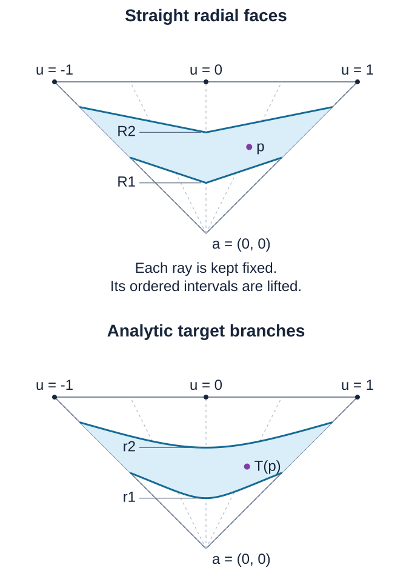

# Subanalytic triangulations on analytic manifolds

This reading constructs compatible locally finite triangulations of arbitrary Hausdorff second-countable real analytic manifolds. It supplies the relative Euclidean construction, elementary finite-colour chart covers, differentiable subanalytic cutoffs, a proper embedding and analytic recovery of the transported open simplices. Six exercises have complete solutions.

*Original programme text and solutions by GPT-6.1 Sol (OpenAI), with mathematical contributions by GPT-6 Astra (OpenAI). Original programme text: public domain (CC0).*

## Setting and dependency boundary

Manifolds have finite dimension and no boundary. The prescribed family is locally finite, and each member is locally subanalytic. The compatible analytic partitions and simultaneous constant-rank refinements are proved below from the linked finite-cell calculus and compact chart covers. The relative construction uses the linked compact uniformization theorem and the exact analytic coordinate and uniqueness results compared below. [Real-analytic Noetherianity](#real-analytic-noetherianity) is proved below; we also use the analytic constant-rank theorem and differential-equation facts, including uniform uniqueness. The dimension and frontier results have their complete linked provider below. The uniformization application is written out in the singular-line proof below; the [analytic input comparison](#analytic-inputs-and-their-exact-uses) states the remaining coordinate and uniqueness uses precisely. The finite-colour cover and cutoff proofs do not assume a triangulation or a covering-dimension theorem.

The bounded-chart comparison and global Boolean/projection calculus used for proper images have their complete written provider in [analytic finiteness and preparation](../analytic-finiteness-and-preparation/analytic-finiteness-for-preparation.html#local-subanalytic-sets-and-bounded-charts). Guillaume Valette is credited there for these results.

### Real-analytic Noetherianity

**Proposition (real analytic germs).** For every integer $n\geq0$, the ring $A_n=\mathbb R\{x_1,\ldots,x_n\}$ of convergent real power series is Noetherian: every ideal has a finite generating set. Consequently, the local ring of real-valued real analytic germs at any point of a finite-dimensional real analytic manifold is Noetherian. Every ascending sequence of ideals in such a local ring stabilizes.

**Proof.** The complex-coefficient statement is [Theorem 6 of *Weierstrass preparation and division*](../analytic-finiteness-and-preparation/weierstrass-preparation-and-division.html#division-finite-generation-and-elementary-algebra). Its proof uses division by a regular germ (Corollary 3), a linear change making a nonzero germ regular (Proposition 4), and induction on the number of variables. It does not use a triangulation. We explain the change of coefficient field, since a subring of a Noetherian ring need not itself be Noetherian.

Put $B_n=\mathbb C\{z_1,\ldots,z_n\}$. The coefficient-preserving map $\iota:A_n\longrightarrow B_n$, sending $\sum_\alpha a_\alpha x^\alpha$ to $\sum_\alpha a_\alpha z^\alpha$, is an injective ring homomorphism. Indeed, convergence here means absolute convergence on some sufficiently small polydisc, a condition on $\sum_\alpha |a_\alpha|r^\alpha$ that is the same for real and complex variables. Uniqueness of the Taylor coefficients gives injectivity. We identify $A_n$ with this subring of $B_n$.

For $b=\sum_\alpha c_\alpha z^\alpha\in B_n$, split each coefficient into its real and imaginary parts. The two resulting series converge on every smaller polydisc on which the original series converges absolutely, because $|\operatorname{Re}c_\alpha|,|\operatorname{Im}c_\alpha|\leq|c_\alpha|$. Thus $b=u+iv$ for unique $u,v\in A_n$. This proves $B_n=A_n\oplus iA_n$ as $A_n$-modules. In particular, the coefficient projection $\rho:B_n\longrightarrow A_n$, $\rho(u+iv)=u$, satisfies $\rho(a b)=a\rho(b)$ for $a\in A_n$ and $\rho(a)=a$. It is an $A_n$-linear map; we do not claim that it is a ring homomorphism.

Let $I\subset A_n$ be an ideal. The extended ideal $IB_n$ consists of finite sums of products $bf$, with $b\in B_n$ and $f\in I$. Since $B_n$ is Noetherian, choose finitely many generators $g_1,\ldots,g_t$ of $IB_n$. Write each $g_k$ as such a finite sum, and collect all the elements of $I$ that occur into a finite list $f_1,\ldots,f_s$. The ideal generated by this list in $B_n$ contains every $g_k$ and is contained in $IB_n$; hence it equals $IB_n$. For any $f\in I$, there are $b_1,\ldots,b_s\in B_n$ with

$$
f=\sum_{j=1}^s b_jf_j.
$$

Applying the $A_n$-linear map $\rho$ gives $f=\sum_{j=1}^s\rho(b_j)f_j$, now with coefficients in $A_n$. Therefore $I=(f_1,\ldots,f_s)$ in $A_n$. For $I=0$, the empty list suffices. This also covers $n=0$, when the two rings are $\mathbb R$ and $\mathbb C$.

If $p$ lies in an $n$-dimensional real analytic manifold $M$, choose an analytic chart $\phi:U\longrightarrow V\subset\mathbb R^n$ with $\phi(p)=0$. Composition defines a ring isomorphism $\mathcal O^\omega_{M,p}\longrightarrow A_n$, $[h]\longmapsto[h\circ\phi^{-1}]$; its inverse sends $[a]$ to $[a\circ\phi]$. Both maps are well-defined on germs because analytic compositions are analytic and restrictions agree on smaller neighbourhoods. This transfers finite generation to $\mathcal O^\omega_{M,p}$.

Finally, for an ascending sequence $I_1\subset I_2\subset\cdots$, its union $I$ is an ideal: any two elements lie in one common stage, and each stage is closed under multiplication by the ambient ring. Choose finitely many generators of $I$. They all belong to some $I_N$, so $I=I_N$, and $I_m=I_N$ for every $m\geq N$. $\square$

This is a statement about germs at each fixed point. It does not supply one neighbourhood or generating family valid simultaneously at all points, and it does not prove subanalytic uniformization or the analytic regularity results used elsewhere in the construction.

## Compatible locally finite analytic partitions

The [finite analytic cell theorem](../analytic-finiteness-and-preparation/analytic-finiteness-for-preparation.html#finite-analytic-cells-for-arbitrary-globally-subanalytic-sets), its [Boolean and projection calculus](../analytic-finiteness-and-preparation/analytic-finiteness-for-preparation.html#full-global-preparation-and-the-complement-theorem), and its [bounded-chart comparison](../analytic-finiteness-and-preparation/analytic-finiteness-for-preparation.html#local-subanalytic-sets-and-bounded-charts) give the following manifold partition. The compact chart-ball refinement is proved below in [Section 2 of the cutoff construction](#a-countable-locally-finite-nested-coordinate-ball-refinement). These are the exact inputs; no analytic regular-locus theorem or uniformization theorem is needed for this partition.

**Partition theorem.** Let $M$ be a finite-dimensional Hausdorff second-countable real analytic manifold without boundary, and let $\{A_a\}_{a\in I}$ be a locally finite family of locally subanalytic subsets. There is a countable locally finite partition of $M$ into connected locally subanalytic embedded analytic submanifolds compatible with every $A_a$: each partition member is contained in or disjoint from each $A_a$. Given finitely many analytic maps $f_j:M\to N_j$ to real analytic manifolds, the partition can also make every restriction $f_j|_S$ have constant rank.

### Compact chart pieces and compatibility

The compact exhaustion and shell construction in the linked cutoff proof supplies a countable cover by open coordinate balls $B_i$ with compact closures $L_i=\overline{B_i}$ contained in analytic charts; the family of these closures is locally finite. For instance, use the inner balls in that construction: their closures are contained in its locally finite outer compact balls. Each ball and its closure is locally semianalytic. In its chart it has a squared-norm inequality, and outside its compact closure it is empty on a neighborhood. The exhaustion sets need not be subanalytic; only the selected balls enter the partition.

For the map assertion apply this refinement to the open cover consisting of intersections of a source chart and inverse images of target charts for the finitely many $f_j$. Thus each $L_i$ lies in one source chart, and every $f_j(L_i)$ lies in one selected target chart. The source and target coordinate images of these compact sets are bounded. The maps in these coordinates are analytic on a neighborhood of $L_i$.

Every compact set meets only finitely many members of a locally finite family. Indeed, cover the compact set by finitely many neighborhoods, each meeting finitely many family members; combine their finite lists. In particular $L_i$ meets only finitely many $L_k$ and finitely many nonempty $A_a$.

Enumerate the balls and put

$$
E_i=B_i\setminus\bigcup_{k<i}B_k.
\tag{P1}
$$

These sets are disjoint and cover $M$, because each point has a first containing ball. For fixed $i$ the earlier union is finite; its trace near $L_i$ uses only the finitely many earlier closures that meet a sufficiently small neighborhood of $L_i$. To justify that neighborhood, first take a finite cover of $L_i$ by neighborhoods meeting only finitely many closures, then discard the finitely many closures missing $L_i$ by shrinking around that compact set. Thus $E_i$ is a finite Boolean combination of locally semianalytic balls near $L_i$. The local Boolean calculus also makes every relevant $A_a\cap E_i$ locally subanalytic there.

In the chosen source coordinates, these traces are bounded and locally subanalytic at every point of their ambient closures. Their closures lie inside the compact coordinate image of $L_i$, strictly inside the source chart. Extension by the empty set therefore creates no chart-boundary obstruction. The proved bounded-chart comparison makes $E_i$ and all the finitely many relevant $A_a\cap E_i$ globally subanalytic in this Euclidean space.

Apply the finite analytic cell theorem compatibly with these sets, and keep just the cells in $E_i$. Each kept cell is a connected embedded analytic submanifold. Its global subanalyticity gives local subanalyticity in the source chart, including at points of its closure; compact containment gives local emptiness outside that chart. It is therefore locally subanalytic in $M$. It lies in or misses every $A_a$, including those whose trace on $L_i$ is empty.

There are finitely many kept cells for each $i$, and each is contained in $L_i$. A neighborhood meeting only finitely many $L_i$ consequently meets only finitely many kept cells. They give a countable locally finite partition of $M$. This proves the first assertion. It uses local finiteness of the compact closures; a merely countable atlas does not supply that conclusion.

### Analytic coordinates on a cell

We spell out the cell coordinates needed for rank refinement. A cylindrical analytic cell $C$ of dimension $d$ has a coordinate projection $q:C\to V$ which is a definable analytic diffeomorphism onto an open definable $V\subset\mathbb R^d$. Keep precisely its band coordinates and discard its graph coordinates.

This follows by induction through the cylindrical construction. For a graph over a cell with inverse parametrization $\phi$, use $u\mapsto(\phi(u),\zeta(\phi(u)))$; the old free-coordinate domain remains open. For a band over that cell, the new free domain is

$$
\{(u,t):u\in V,\ \zeta_-(\phi(u))<t<\zeta_+(\phi(u))\}.
\tag{P2}
$$

It is open because the endpoints are continuous, omitting the corresponding inequality for an infinite endpoint. Its inverse parametrization is $(u,t)\mapsto(\phi(u),t)$. These maps and their inverses are analytic. Their graphs are definable by the graph, composition and projection calculus; hence the domains are definable too. In dimension zero use the single point $\mathbb R^0$. This proves the coordinate assertion, including the analytic embedding and its inverse, directly from the cell definition.

### Definable derivatives and restriction ranks

Fix a kept cell $C\subset E_i$, and write $\phi:V\to C$ for this inverse parametrization. In the chosen target coordinates the maps $g_j=f_j\circ\phi$ are analytic and definable. To check the latter assertion, the coordinate graph of $f_j$ over $L_i$ is bounded and locally semianalytic at every point of its compact closure: its defining analytic equation is valid on a neighborhood of $L_i$, and the closed coordinate ball supplies the domain condition. The bounded-chart comparison gives a globally subanalytic graph. Restriction to $C$ and composition with $\phi$ preserve definability.

For a scalar analytic definable $g:V\to\mathbb R$, the derivative graph, with $u\in V$, is described by

$$
\begin{aligned}
v=\partial_\ell g(u)
\quad\Longleftrightarrow\quad
&\forall\epsilon>0\ \exists\delta>0\ \forall h\in\mathbb R,\\
&\bigl(0<|h|<\delta\ \text{and }u+he_\ell\in V\bigr)\\
&\hspace{1em}\Longrightarrow
\left|\frac{g(u+he_\ell)-g(u)}h-v\right|<\epsilon.
\end{aligned}
\tag{P3}
$$

Function values here can be written using extra real variables in the graph of $g$; division by $h\ne0$ is a polynomial graph condition. The formula uses finitely many real quantifiers. Existential quantification is projection, and universal quantification is complement of an existentially quantified complement. Thus the established Boolean and projection calculus makes this derivative graph definable. Openness of $V$ supplies a nontrivial interval of allowed $h$ at every $u$, so the limit condition specifies the derivative uniquely. Applying this to every scalar coordinate gives definable differential matrices for all $g_j$.

All rank sets are consequently definable: rank $r$ means that every $(r+1)$-minor vanishes and, when $r>0$, some $r$-minor is nonzero. Rank zero means every matrix entry vanishes. Include all finitely many rank sets for the finitely many maps in a finite analytic cell decomposition of $V$.

Every resulting $d$-dimensional cell $D\subset V$ is open in $V$. Indeed, a full-dimensional cylindrical cell has only band steps, and (P2) proves openness at every such step. Therefore $\phi(D)$ is open in $C$; its tangent space is that of $C$, and every $f_j|_{\phi(D)}$ has the constant rank selected on $D$. Retain these members as finished.

On a smaller cell $D$, the old differential rank is insufficient: restricting a rank-one map to one of its level curves can give rank zero. Take the cell's own free-coordinate parametrization $\psi:W\to D$, and repeat the rank calculation for all $g_j\circ\psi$. These are still definable analytic maps on an open definable domain. Their images under $\phi\circ\psi$ are connected embedded analytic submanifolds and definable in the original source chart. Repeat the same finite refinement and finish its full-dimensional members.

An unfinished branch now has strictly smaller dimension. Induction on $d$ terminates: dimension zero has rank zero for every map, and each positive-dimensional step finishes its full-dimensional cells and passes only finitely many smaller cells to already established lower-dimensional cases. The final refinement of each original $C$ is finite. Its members remain inside $L_i$, so refining the finitely many cells for each $i$ preserves countability, local finiteness and compatibility with all $A_a$. This proves simultaneous constant rank on every final member. $\square$

If $M$ is compact, this locally finite partition is finite by the compactness argument above. Similarly a compact subanalytic subset contained in one analytic chart has a finite compatible analytic partition, by bounded-chart comparison and finite cells. A connected cell lies in a single connected component; hence each component of a finite union of cells is a union of whole cells. There are finitely many components. For a compact subanalytic subset meeting several charts, intersect with finitely many compact coordinate boxes whose interiors cover it, apply the same finite-cell argument in each box, and take the resulting finite union of connected cells. This proves finiteness of its connected components as well.

The theorem supplies compatible analytic partitions and constant-rank refinements for the relative triangulation construction. Whitney and Verdier conditions, a frontier condition between partition members, and the intrinsic analytic regular-locus theorem require additional arguments.

**Sources.** Guillaume Valette, [*On subanalytic geometry*, arXiv:2507.23622v1](https://arxiv.org/abs/2507.23622v1), §1.2, gives the graph/band cell definition and cell theorem; §2.1 gives first-order definable formulas and the definability of derivatives. The linked analytic finiteness reading proves its finite-cell and Boolean/projection inputs in the stated projective product convention. The manifold globalization, explicit derivative-limit formula, and simultaneous restriction-rank induction are written out here.

## Analytic inputs and their exact uses

The analytic coordinate results used below are the [inverse, implicit and constant-rank theorems, (LAF1)–(LAF4)](../sheaf-proof-readings/SH03-subanalytic-sets-and-limiting-tangent-directions.html#real-analytic-inverse-implicit-and-constant-rank-coordinates). Their proof first complexifies a convergent real power series, applies the holomorphic inverse theorem to the parameter-preserving block map, and uses uniqueness under conjugation to restrict its inverse to real points. The constant-rank proof then uses an invertible minor as part of a coordinate system; vanishing of the remaining transverse derivatives makes the other output coordinates independent of those directions. No uniformization or triangulation is an input to these coordinate theorems.

Here are the hypotheses at their uses in this construction.

1. **Local equations for a partition member.** A member of the proved analytic partition is an embedded analytic submanifold. Near a point of a member of dimension $d<n$, analytic submanifold coordinates give real analytic defining functions $H_1,\ldots,H_{n-d}$ with independent differentials and common zero set exactly that member in a smaller open neighborhood. The scalar function $h=\sum_j H_j^2$ has precisely the same real zero set. We do not assert that $dh$ is nonzero; the finite-jet argument uses the analytic function $h$, not a regular-value assertion about $h$.

2. **A section of the direction map.** Suppose the analytic map $q:W\to\mathbb {RP}^{n-1}$, $q(w)=[v(w)]$, has surjective differential at $w_0$. In source and target charts choose a nonzero maximal minor. It remains nonzero on a smaller neighborhood. There the map is a submersion, and the analytic coordinate theorem gives a section $s:D\to W$ on an open target chart, with $q\circ s=\operatorname{id}_D$. Shrink $D$ so that the sphere-to-projective-space covering has an analytic local inverse agreeing with $v(s(q(w_0)))$. By continuity, $v\circ s$ is this same inverse throughout a smaller connected chart. Thus the incidence argument really has analytic functions $x\circ s$ and a local unit direction $v$, as required for its determinant calculation. This is a local section, not a global choice of direction representatives.

3. **Constant rank and finite fibres.** The partition is refined using the rank of each restriction to its own tangent space. On a resulting analytic member $S$ of dimension $d$, let the projection have constant rank $r$. The coordinate normal form makes its local fibres manifolds of dimension $d-r$. If the original fibres are finite, $d-r>0$ is impossible: an open coordinate neighborhood in a positive-dimensional fibre has infinitely many points. Therefore $r=d$. This proves the local rank assertion only; the later compactness, covering and height-order arguments are still needed for the finite graph decomposition.

4. **The transported open simplex.** In the globalization proof, analyticity of $t|_{\sigma^\circ}$ follows from the explicit analytic chart-coordinate ratios. The equality $T|_{\sigma^\circ}=F\circ t|_{\sigma^\circ}$, with $F$ of class $C^1$, then makes $dt$ injective because $dT$ is injective. Full source rank holds at every point of this open simplex, so the analytic coordinate theorem supplies local immersion charts. The separately proved homeomorphism onto the image gives the subspace topology and makes the image an embedded analytic submanifold. Analyticity or bijectivity alone would not supply that conclusion; the example $u\mapsto u^3$ below records why the differential argument matters.

The differential-equation input is narrower than analytic dependence of a flow on all its data. The needed result is the [uniform zero-solution argument for (LAF9)](../sheaf-proof-readings/SH03-subanalytic-sets-and-limiting-tangent-directions.html#analytic-differential-equations). For clarity, suppose a local analytic relation is

$$
g_{q+1}(x,v)=\sum_{j=0}^{q}a_j(x,v)g_j(x,v).
$$

For initial parameters $(x,v)$, put $U_j(t)=g_j(x+tv,v)$. Differentiation gives $U'_j=U_{j+1}$ for $j<q$ and $U'_q=\sum_{j=0}^q a_j(x+tv,v)U_j$. Choose a smaller closed parameter box inside the relation's domain and a positive time interval on which all its line segments remain there. The resulting matrix $A(t,x,v)$ has a common finite operator-norm bound $B$ on that compact product. For zero initial jets, the integral equation gives

$$
\sup_{|t|\leq\epsilon}\|U(t)\|
\leq B\epsilon\sup_{|t|\leq\epsilon}\|U(t)\|.
$$

The supremum is finite by continuity. Taking $\epsilon$ within the chosen time interval and $B\epsilon<1$ forces it to be zero; if $B=0$, it is zero without a further restriction. The argument covers both signs of time and every parameter in the same smaller box. It proves the neighborhood assertion used in the incidence rank calculation, without asserting one interval for all charts, existence of a global flow, or analyticity of an arbitrarily given smooth solution.

The stronger [intrinsic analytic regular-locus theorem](../sheaf-proof-readings/SH03-subanalytic-sets-and-limiting-tangent-directions.html#detecting-the-entire-analytic-regular-locus) recognizes **every** point at which a subanalytic set is locally an analytic manifold, independently of a chosen partition. That theorem is retained in its separate reading. The construction here uses the supplied analytic partition members, their constant-rank refinements and the coordinate arguments above; it does not identify their union of top-dimensional members with the intrinsic regular locus. Thus these local inputs should not be confused with that stronger recognition theorem. The finite-cell, Boolean/projection and frontier results remain the explicitly linked inputs stated above, and the graph-completion and relative-polyhedron arguments remain separate parts of the proof.

## How a compatible triangulation is assembled

The triangulation input has a useful relative form: one may adapt a fixed locally finite polyhedron while preserving every old simplex setwise. The construction below follows the geometric method of [Masahiro Shiota, *Piecewise linearization of real analytic functions*](https://ems.press/content/serial-article-files/42219). We make its fibre ordering and straight-to-curved map explicit.

The lower subanalytic prerequisites used in this construction are compact uniformization, the set calculus, and the following explicitly identified coordinate and dimension results. A nonempty subanalytic set has lower-dimensional frontier \(\overline A\setminus A\), as proved in Dimension, fibrewise closure and the frontier. This is distinct from the topological boundary, whose dimension can equal the dimension of the set. The [compatible analytic partition theorem above](#compatible-locally-finite-analytic-partitions) proves that a locally finite family has a compatible locally finite partition into analytic submanifolds and that finitely many analytic maps have constant-rank restrictions after refinement. Compact subanalytic sets consequently have finite such partitions and finitely many connected components. These are inputs to the construction, rather than consequences of the triangulation being constructed. The [real-analytic Noetherianity proposition above](#real-analytic-noetherianity), the analytic constant-rank theorem and uniqueness for finite systems of analytic ordinary differential equations are also used.

**Relative polyhedron theorem.** Let $K$ be a finite-dimensional locally finite linear simplicial complex with closed support in $\mathbb R^N$. Let $\{A_i\}$ be locally finite in the ambient space, with each $A_i$ subanalytic and contained in $|K|$. There are a locally finite subdivision $K'$ and a subanalytic homeomorphism

$$
T:|K|\longrightarrow |K|
$$

such that $T(\sigma)=\sigma$ for every old closed simplex $\sigma$, each restriction to an open simplex of $K'$ is an analytic diffeomorphism onto a subanalytic analytic submanifold, and every such image is contained in or disjoint from each $A_i$. No analyticity across simplex boundaries is asserted.

We first prove the ingredients that make the induction possible.

### Choosing a point from which lines have finite intersections

Call a line singular for a set if it contains a nontrivial interval in that set. For a compact subanalytic set with no such intervals, every intersection with a line is finite: it is a compact zero-dimensional subanalytic set. For any countable collection of subanalytic sets of dimension less than $n$, the union of their singular lines is meagre in $\mathbb R^n$. Their singular parallel directions form a meagre subset of $\mathbb{RP}^{n-1}$. Here, a meagre set is a countable union of nowhere dense sets.

**Proof.** A compatible analytic partition reduces the claim to countably many analytic submanifolds. A line interval in the original set contains an interval in one partition member: on a compact subinterval only finitely many members occur, and their intersections with the line are subanalytic. Work on a small open set where one such member is the zero set of an analytic function $h$; a sum of squares of local defining functions supplies $h$ in higher codimension.

Choose analytic coordinates for a unit direction $v$. Put $L=v\cdot\partial_x$ and $g_j=L^j h$. The germ of the ascending chain of ideals $(g_0),(g_0,g_1),\ldots$ stabilizes. Thus, on a neighborhood of any specified $(x,v)$, for some $q$,

$$
g_{q+1}=\sum_{j=0}^{q}a_j(x,v)g_j
$$

with analytic coefficients. Along \(x+tv\), the vector \((g_0,\ldots,g_q)\) satisfies a finite homogeneous linear differential system. If it is zero at \(t=0\), uniform zero-solution uniqueness makes it zero for all sufficiently small \(t\). Conversely, vanishing of \(h(x+tv)\) on an interval makes all these initial jets zero. Hence the incidence of analytic line germs in the chosen submanifold is locally an analytic set defined by finitely many jet equations. This proves local finiteness of the equations; an infinite jet intersection has not been treated as automatically analytic.

Here is the exact compact-piece application of uniformization. Let $U$ be the open set on which $h^{-1}(0)$ is the chosen analytic submanifold, and let $V$ be one analytic chart of unit directions. In the analytic manifold $U\times V$, let $\mathcal I$ be the set of pairs $(x,v)$ for which $h(x+tv)=0$ for all sufficiently small real $t$. The finite-jet argument just given makes $\mathcal I$ locally analytic, hence locally closed and locally subanalytic. Choose countably many closed coordinate boxes $Q_\ell$, with interiors covering $U\times V$, each compactly contained in a neighborhood on which one finite list of jet equations defines $\mathcal I$. Such boxes come from a countable coordinate basis, by using rational smaller boxes inside these neighborhoods. Then

$$
C_\ell=\mathcal I\cap Q_\ell
$$

is compact, because it is the common zero set of finitely many continuous functions in the compact box. It is subanalytic in $U\times V$: the defining equations and box inequalities are semianalytic on a neighborhood of the box, and outside the box a neighborhood misses it. These pieces cover $\mathcal I$, including points on their boundaries.

The [compact uniformization theorem](../sheaf-proof-readings/SH03-subanalytic-sets-and-limiting-tangent-directions.html#compact-uniformization-for-the-projection-defined-class) therefore gives, for each nonempty $C_\ell$, a compact finite-dimensional real analytic manifold $W_\ell$ and an analytic map $u_\ell:W_\ell\to U\times V$ whose image is exactly $C_\ell$. This map is proper; it need not be injective or an immersion. Write its coordinate maps as $x:W_\ell\to U$ and $v:W_\ell\to S^{n-1}$, the latter obtained from the unit-direction chart. Neither the dimension nor the number of preimages of an incidence parameter needs to be controlled in the argument below. For a fixed $\ell$, put $W=W_\ell$ and define

$$
F:W\times\mathbb R\longrightarrow\mathbb R^n,
\qquad F(w,s)=x(w)+sv(w).
$$

We need a neighborhood statement, not just a separate interval for each $w$. Fix $w_0\in W$. Near $(x(w_0),v(w_0))$, the finite-jet relation holds with analytic coefficients on an open parameter neighborhood. Shrink around this point to choose $\epsilon>0$ and a neighborhood $O\subset W$ of $w_0$ such that $(x(w)+sv(w),v(w))$ stays in that parameter neighborhood whenever $w\in O$ and $|s|<\epsilon$. This is possible by continuity, after choosing a smaller coordinate box whose closure lies in the relation's domain; the directions have norm one. Every initial jet vector vanishes because $u_\ell(O)\subset\mathcal I$. The finite homogeneous differential system and zero-solution uniqueness then give $h(F(w,s))=0$ throughout $O\times(-\epsilon,\epsilon)$. Thus $F$ maps this open set into the chosen embedded analytic submanifold of dimension less than $n$, and its differential there has rank less than $n$.

At a fixed $w$, choose local coordinates on $W$. The differential columns of $F$ are $dx+s\,dv$ and $v$. Every $n$-rowed minor is a polynomial in $s$, vanishing on an interval about zero and therefore identically zero. If there are fewer than $n$ columns, the rank bound is automatic. Consequently $\operatorname{rank}dF<n$ for every real $s$, including after the line leaves $U$. No interval common to all source manifolds is asserted or needed.

**Alternative using the proved partition theorem.** Instead of compact uniformization, apply the [compatible analytic partition theorem](#compatible-locally-finite-analytic-partitions) to the single locally subanalytic set $\mathcal I\subset U\times V$. The partition members contained in $\mathcal I$ form a countable collection of embedded analytic manifolds covering it. Their inclusions give the analytic maps $x,v$. On each such manifold the same parameter-neighborhood and polynomial-minor argument applies. This route gives the same rank bound and the same Sard arguments below; it requires neither compactness of these parameter manifolds nor properness of their inclusions. The compact uniformization route remains available with its stronger proper-source conclusion.

Theorem 2.1 and Corollary 2.2 of [Regular values and degree modulo two](../borsuks-conjecture-in-dimension-nine/regular-values-and-degree-modulo-two.html#2-sard-s-theorem) supply the precise Sard theorem used here: the critical values of a smooth map between finite-dimensional Hausdorff second-countable manifolds are null in every target chart. Its proof uses the smooth inverse function theorem, Taylor estimates and Euclidean measure theory; it does not use a triangulation or the uniformization being constructed here. Our analytic map $F$ is smooth and every point of its domain is critical by the rank calculation. Thus its whole image in $\mathbb R^n$ is null.

The passage from nullness to meagreness uses compact pieces, not an assertion that every null set is meagre. A Hausdorff second-countable manifold admits a countable cover by compact coordinate balls: every point has a coordinate ball whose closed ball stays inside the coordinate domain, and second countability gives a countable subcover of their interiors. For completeness, to reduce any open cover to a countable one, choose for each basis element contained in some cover member one such member. These choices cover every point. The closures of the selected coordinate balls are compact because the closed Euclidean balls are compact and their inverse coordinate maps are continuous. Apply this to $W$, and take products with the intervals $[-j,j]$, $j\geq1$, to cover $W\times\mathbb R$ by countably many compact sets $K_i$. Each $F(K_i)$ is compact and therefore closed in $\mathbb R^n$. As a subset of the null image it contains no nonempty open set. It is consequently nowhere dense, and their countable union is precisely $F(W\times\mathbb R)$. This proves the assertion about all points on singular lines without assuming $W$ compact or $F$ proper.

For directions, suppose \(w\mapsto[v(w)]\) had surjective differential somewhere. A local analytic section over an open direction chart would give \(x=x(v)\). For the resulting map \((v,s)\mapsto x(v)+sv\), the determinant of its \(n\) differential columns has leading coefficient

$$
\det(\partial_1v,\ldots,\partial_{n-1}v,v)
$$

in its polynomial in $s$. That coefficient is nonzero for a direction chart on the unit sphere. This contradicts the preceding rank calculation. The direction map therefore has only critical values. Apply the same Corollary 2.2 to the smooth map from $W$ to $\mathbb{RP}^{n-1}$. Its values are critical by the preceding argument. The critical image is null in every projective coordinate chart. Each compact image is closed because projective space is Hausdorff, and it has empty interior because an open coordinate ball is not null. The countable compact cover of $W$ therefore makes the image meagre in projective space. This applies in every dimension $n\geq2$; no compactness or properness of the whole direction map is required. In dimension one there are no line germs in a zero-dimensional set, so the assertion is immediate. Countable unions finish both claims. $\square$

In particular, inside any open simplex one can choose a centre outside a finite family of compact lower-dimensional sets and all their singular lines. One can also choose a parallel direction avoiding all singular directions of such a family. The precise category input is [Theorem 3.2, the locally compact Hausdorff Baire theorem](../foundations-of-von-neumann-algebras/hahn-banach-baire-and-the-basic-theorems-on-banach-spaces.html#OA-FND-HB-03-LCH): no nonempty open subset of a locally compact Hausdorff space is contained in a countable union of nowhere dense sets. Apply it to the affine span of the simplex, identifying that span with Euclidean space, and to projective direction space. Coordinate balls with compact closure show that these spaces are locally compact; both are Hausdorff. Each compact lower-dimensional subanalytic set is closed with empty interior in the relevant affine span, hence nowhere dense, and the singular-line and direction sets have the countable nowhere-dense covers just proved. Their union cannot contain any prescribed nonempty open neighbourhood. This gives both choices. In affine dimension one the singular-line family is empty as above; affine dimension zero has no nonempty lower-dimensional set or direction choice.

### Completing a finite-fibre set so its projection is open

For $p:\mathbb R^d\times\mathbb R\to\mathbb R^d$, call a set projection-open when the restricted map to $\mathbb R^d$ is open. All sets prescribed for compatibility in the following assertion are **subanalytic subsets of the ambient Euclidean space**; arbitrary subsets are not allowed.

**Finite graph assertion.** Suppose $A\subset\mathbb R^d\times\mathbb R$ is compact subanalytic, every fibre $A_x=\{y:(x,y)\in A\}$ is finite, and $A_1,\ldots,A_k\subset A$ are subanalytic. There is a finite analytic cell partition of $p(A)$ such that, over each base cell $C$,

$$
A\cap p^{-1}(C)=\coprod_{i=1}^{m(C)}G_{C,i},\qquad
G_{C,i}=\{(x,f_{C,i}(x)):x\in C\},\qquad
f_{C,1}<\cdots<f_{C,m(C)}.
$$

Every $f_{C,i}:C\to\mathbb R$ is analytic and globally subanalytic. Each graph is wholly inside or wholly outside every $A_j$. The projection $G_{C,i}\to C$ is an analytic diffeomorphism, with inverse $x\mapsto(x,f_{C,i}(x))$.

**Proof of the graph assertion.** The sets $A,A_1,\ldots,A_k$ are bounded. They are locally subanalytic at every point of their closures, because subanalyticity is assumed in the ambient space, including points not belonging to the sets. The [bounded-chart comparison, part 2](../analytic-finiteness-and-preparation/analytic-finiteness-for-preparation.html#local-subanalytic-sets-and-bounded-charts) therefore makes them globally subanalytic. Apply the [finite analytic cell theorem](../analytic-finiteness-and-preparation/analytic-finiteness-for-preparation.html#finite-analytic-cells-for-arbitrary-globally-subanalytic-sets) simultaneously to these sets, in the coordinate order $x_1,\ldots,x_d,y$.

Each cell contained in $A$ is a graph or a band in the last coordinate over one cell of the induced decomposition of $\mathbb R^d$. A nonempty band contains an interval over every point of its base, contradicting finite fibres. Thus only graph cells occur. Over a fixed base cell $C\subset p(A)$, list the graph cells belonging to $A$ in their order in the cylindrical stack. Their analytic endpoint functions are defined on all of $C$, are strictly ordered there, and account for every point of every fibre over $C$. Compatibility of the decomposition with each $A_j$ gives the stated membership property. Finiteness of the decomposition gives finitely many base cells and graphs. If $A$ is empty there are none; if $d=0$, the graphs are its finitely many points. $\square$

**The covering interpretation and its hypotheses.** Fix $C$ and write $E=A\cap p^{-1}(C)$. The restriction $p:E\to C$ is proper: for a compact set $K\subset C$, its inclusion into $\mathbb R^d$ has compact image, and $A\cap p^{-1}(K)$ is a closed subset of the compact set $A$. This proves properness relative to $C$, even when $C$ is not closed in $\mathbb R^d$.

To verify the covering property, take $x_0\in C$. When there is more than one sheet, choose disjoint open intervals about the finitely many numbers $f_{C,i}(x_0)$. Continuity gives a relative open neighbourhood $V\subset C$ of $x_0$ on which every $f_{C,i}$ stays in its chosen interval. The sets $G_{C,i}\cap p^{-1}(V)$ are then disjoint relatively open subsets of $E$, cover $p^{-1}(V)\cap E$, and map analytically diffeomorphically to $V$. With one sheet this is immediate. Hence $p:E\to C$ is a finite analytic covering. The global real-height order identifies its sheets on all of $C$, so there is no permutation of sheets on going around a loop.

The rank argument remains valid: on a constant-rank analytic partition member, a rank smaller than its dimension would produce a positive-dimensional fibre by the [analytic constant-rank theorem](../sheaf-proof-readings/SH03-subanalytic-sets-and-limiting-tangent-directions.html#real-analytic-inverse-implicit-and-constant-rank-coordinates). What cannot be inferred from compactness alone is the covering property before the base has been suitably partitioned. For example, $\{(x,y):x=y^2,\ -1\le y\le1\}\to[0,1]$ is proper with finite fibres, but the fibre cardinality changes at zero. The cell proof supplies the required base partition as well as the ordered sheets.

**Local compact enlargement.** For every specified $a\in A$, there is a compact subanalytic set $B\supset A$, still with finite vertical fibres, and an ambient open neighbourhood $U$ of $a$ such that

$$
p:B\cap U\longrightarrow\mathbb R^d
$$

is open. This is a local assertion near $a$, not global openness of the projection of a nonempty compact set onto $\mathbb R^d$.

**Proof by induction on $d$.** For $d=0$, take $B=A$: every map to the one-point space is open. Now let $d\ge1$, and apply the graph assertion. Let $L$ be the union of the graph cells of dimension less than $d$, and set

$$
A_2=\overline L.
$$

The closure is taken in $\mathbb R^{d+1}$. Since $A$ is closed, $A_2\subset A$; it is compact. The Boolean and closure calculus and the [dimension/frontier theorem, equations (D4) and (D12)](../analytic-finiteness-and-preparation/analytic-finiteness-for-preparation.html#dimension-fibrewise-closure-and-the-frontier), show that $A_2$ is subanalytic and $\dim A_2<d$. This also covers $L=\varnothing$, when $A_2=\varnothing$. The set $A_2$ need not be disjoint from all the other graph cells. What is needed is that every point of $A\setminus A_2$ lies on a graph over a $d$-dimensional base cell. Such a base cell is open in $\mathbb R^d$, so its graph projects openly.

If $a\notin A_2$, choose $U$ disjoint from the closed set $A_2$ and take $B=A$. Given any relatively open $O\subset A\cap U$ and $b\in O$, intersect $O$ with a full-dimensional graph through $b$. Its projection is an open neighbourhood of $p(b)$ contained in $p(O)$. Taking the union over $b$ proves that $p(O)$ is open.

It remains to treat $a\in A_2$. The compact subanalytic set $p(A_2)$ has dimension less than $d$, by the image inequality (D5) in the same provider. Choose a parallel direction nonsingular for $p(A_2)$, using the preceding singular-direction argument, and use an orthogonal change of base coordinates to make this the $x_d$-direction. The vertical height coordinate $y$ is unchanged. Every line parallel to this direction meets $p(A_2)$ in finitely many points: its intersection is a compact subanalytic subset of a line, hence a finite union of points and intervals by the cell theorem; an interval would give a forbidden line germ in $p(A_2)$.

Write $x'=(x_1,\ldots,x_{d-1})$ and put

$$
p_2:\mathbb R^{d-1}\times\mathbb R\times\mathbb R
\longrightarrow\mathbb R^{d-1}\times\mathbb R,
\qquad p_2(x',x_d,y)=(x',y).
$$

The set $D=p_2(A_2)$ is compact and subanalytic. For fixed $x'$, only finitely many $x_d$ occur in $p(A_2)$, and each of these base points has only finitely many heights in $A_2\subset A$. Thus $D$ has finite vertical fibres over $\mathbb R^{d-1}$. Apply the induction hypothesis to $D$ at $p_2(a)$. It gives a compact subanalytic $B_2\supset D$, with finite fibres, and an open neighbourhood $V$ of $p_2(a)$ on which

$$
r:B_2\cap V\longrightarrow\mathbb R^{d-1},\qquad r(x',y)=x',
$$

is open.

Choose $R>0$ with $A_2\subset\operatorname{int}\overline{\mathbb B}_R$, and define

$$
B'=p_2^{-1}(B_2)\cap\overline{\mathbb B}_R,
\qquad B=A\cup B'.
$$

These sets are subanalytic. The set $B'$ is closed and bounded, hence compact, and contains $A_2$. At a fixed base point $(x',x_d)$, its possible heights belong to the finite fibre $(B_2)_{x'}$. Consequently $B$ is compact and has finite vertical fibres as well.

Take an ambient open neighbourhood $U$ of $a$ contained in $\operatorname{int}\overline{\mathbb B}_R\cap p_2^{-1}(V)$. On this neighbourhood the ball has no effect. After reordering the coordinates, $p_2^{-1}(B_2\cap V)$ is $(B_2\cap V)\times\mathbb R$, and its base projection is $r\times\operatorname{id}_{\mathbb R}$. This product map is open: an open set is a union of open product sets, whose images are products of an open image under $r$ with an open interval. Its restriction to the relatively open subset cut out by $U$ remains open. Therefore $p:B'\cap U\to\mathbb R^d$ is open.

Finally let $O$ be relatively open in $B\cap U$, and take $b\in O$. If $b\in B'$, the relatively open set $O\cap B'$ supplies an open base neighbourhood of $p(b)$ inside $p(O)$. If $b\notin B'$, then $b\in A\setminus A_2$, because $A_2\subset B'$. A full-dimensional graph through $b$ supplies that neighbourhood exactly as in the earlier case. Thus $p(O)$ is open. This completes the induction. $\square$

#### Compact radial completion by doubling

Let $a\in\mathbb R^n$, let $A\subset\mathbb R^n\setminus\{a\}$ be compact subanalytic, and suppose the radial map

$$
\rho_a:\mathbb R^n\setminus\{a\}\longrightarrow S^{n-1},
\qquad \rho_a(x)=\frac{x-a}{|x-a|},
$$

has finite fibres on $A$. For every $b\in A$, there are a compact subanalytic set $D\subset\mathbb R^n\setminus\{a\}$ and an ambient open neighbourhood $W$ of $b$ with these properties: $A\cap W\subset D$; the fibres of $\rho_a|_D$ are finite; and $\rho_a:D\to S^{n-1}$ is open. Moreover, a finite partition of $D$ into analytic radial graphs can record membership in $A$ and any prescribed finite subanalytic family. Thus, near $b$, the original set is a union of the selected graph pieces restricted to $W$. The completion need not contain all of $A$.

If $n=1$, take $D=A$. There are only two directions, with the discrete topology, so every restricted radial map is open, and finite radial fibres make $A$ finite. We now treat $n\ge2$. Translation, rotation and positive scaling let us take $a=0$ and $b=e_n$, without changing any of the required properties. Write

$$
v(z)=(z,\sqrt{1-|z|^2}),\qquad |z|<1,
\qquad (z,r)\longmapsto r\,v(z),\quad r>0.
$$

These are analytic polar coordinates near $e_n$; the inverse sends $x$ to $((x/|x|)',|x|)$. The radial map is projection onto $z$, followed by the analytic sphere chart $v$.

**A compact affine input.** Choose a small closed coordinate box $Q\subset\{|z|<1\}$ with $0$ in its interior. Restrict $A$ to directions in $v(Q)$ and take its polar-coordinate image $A_Q$. Since $A$ is compact and avoids zero, its radii lie in some compact interval $[r_-,r_+]\subset(0,\infty)$. Therefore $A_Q\subset Q\times[r_-,r_+]$ is compact subanalytic, with finite fibres over $z$. The polar coordinate maps are analytic on neighbourhoods of the compact sets in question; the bounded-chart and compact-image calculus used above justifies these subanalytic images. In particular, this step makes no assertion about an unbounded analytic image.

Apply the preceding [local compact enlargement](#completing-a-finite-fibre-set-so-its-projection-is-open) to $A_Q$ at $(0,1)$. Obtain a compact subanalytic set $E\supset A_Q$ with finite vertical fibres, and an open neighbourhood $N$ of $(0,1)$, on which $\pi:E\cap N\to\mathbb R^{n-1}$, $\pi(z,r)=z$, is open. We use only the part of $E$ inside the polar coordinate domain and at positive radii.

**Choosing the band before the cap.** Choose a small product neighbourhood of $(0,1)$ whose closure lies in $N\cap(\operatorname{int}Q\times(0,\infty))$. Inside its radial interval choose $\alpha<1<\beta$ so that neither endpoint belongs to the finite fibre $E_0$. The two sets

$$
F_\alpha=\pi\bigl(E\cap(\mathbb R^{n-1}\times\{\alpha\})\bigr),\qquad
F_\beta=\pi\bigl(E\cap(\mathbb R^{n-1}\times\{\beta\})\bigr)
$$

are compact, and neither contains zero. Consequently there is an open base neighbourhood $V$ of zero, with compact closure in $\operatorname{int}Q$, such that

$$
\overline V\times[\alpha,\beta]\subset N,
\qquad \overline V\cap(F_\alpha\cup F_\beta)=\varnothing.
$$

Thus no fibre of $E$ over $\overline V$ meets either radial endpoint. Put $E^\circ=E\cap(V\times(\alpha,\beta))$. It is relatively open in $E\cap N$, so $\pi:E^\circ\to\mathbb R^{n-1}$ is open. Its image contains zero. Choose $c\in(0,1)$, sufficiently close to one, so that the closed spherical cap

$$
K=\{v\in S^{n-1}:v_n\ge c\}
$$

has its coordinate image contained in $V\cap\pi(E^\circ)$. Define

$$
E_K=\{r v(z):(z,r)\in E,\ v(z)\in K,\ \alpha\le r\le\beta\}.
$$

This is a compact subanalytic set with finite radial fibres and radii in $[\alpha,\beta]$, none equal to either endpoint. It projects onto $K$. Its projection is open **relative to $K$**: in polar coordinates it is the restriction of $E^\circ\to\mathbb R^{n-1}$ over the closed base set corresponding to $K$. If $O$ is relatively open in this restriction, write it as the intersection of the restriction with a relatively open $O'\subset E^\circ$. Then its image is $\pi(O')\cap v^{-1}(K)$, which is relatively open in $v^{-1}(K)$. This is the elementary base-change property for an open map; the radial endpoint exclusion is what makes the closed-band restriction equal to this restriction of $E^\circ$.

**Reflection.** Put $k=(1-c)/(1+c)>0$. For $v=(v',v_n)\in S^{n-1}$, define

$$
J(v',v_n)=\left(
\frac{2k\,v'}{1-v_n+k^2(1+v_n)},
\frac{1-v_n-k^2(1+v_n)}{1-v_n+k^2(1+v_n)}
\right).
$$

The denominator is at least $2\min(1,k^2)>0$. With $u=1-v_n$ and $w=1+v_n$, the sphere equation gives $|v'|^2=uw$, and

$$
4k^2|v'|^2+(u-k^2w)^2=(u+k^2w)^2.
$$

Hence $J$ is an analytic map of the sphere to itself. Away from the south pole, use the stereographic coordinate $s=v'/(1+v_n)$. For $s\ne0$ its transformed coordinate is

$$
s\longmapsto\frac{k s}{|s|^2}.
$$

This inversion is an involution, fixes $|s|^2=k$, and interchanges $|s|^2<k$ with $|s|^2>k$. The displayed sphere formula interchanges the two poles and is analytic there as well. Thus $J^2=\operatorname{id}$ everywhere. Since $|s|^2=(1-v_n)/(1+v_n)$, the fixed sphere is exactly $v_n=c$; $J$ fixes that sphere pointwise and exchanges the interiors of $K$ and $K^*=\{v_n\le c\}$. This proves the stated reflection properties, including the inversion radius $\sqrt{k}$.

Extend it radially by $\widehat J(rv)=rJ(v)$ for $r>0$, and put

$$
D=E_K\cup\widehat J(E_K).
$$

The radial extension is analytic away from zero. Both sets in the union are compact subanalytic and avoid zero. A fibre of $D$ over a direction $v$ has radii in the union of the two finite radius sets of $E_K$ over $v$ and over $J(v)$. Thus every radial fibre remains finite.

**Openness on the doubled set.** The map on $E_K$ is open relative to $K$; conjugating by $\widehat J$ and $J$ gives the corresponding assertion for $\widehat J(E_K)$ over $K^*$. For a relatively open $O\subset D$ and a point $x\in O$ whose direction is in the interior of one cap, the applicable relative openness supplies an open sphere neighbourhood of $\rho_0(x)$ in $\rho_0(O)$.

At a boundary direction $v_n=c$, the reflection fixes every point of the ray, so a point $x\in D$ above that direction belongs to **both** copies. If $x\in O$, their relative openness gives a relative neighbourhood $U_+\subset K$ and a relative neighbourhood $U_-\subset K^*$ of $v=\rho_0(x)$, both contained in $\rho_0(O)$. Write $U_+=V_+\cap K$ and $U_-=V_-\cap K^*$ with $V_+,V_-$ open in the sphere. Then $V_+\cap V_-$ is a sphere neighbourhood of $v$ contained in $U_+\cup U_-$, because $K\cup K^*=S^{n-1}$. This also lies in $\rho_0(O)$. Every point of that image consequently has an open neighbourhood within it, proving that $\rho_0:D\to S^{n-1}$ is open globally.

**Local membership and graph pieces.** In the open neighbourhood

$$
W=\{r v:v\in\operatorname{int}K,\ \alpha<r<\beta\}
$$

of $e_n$, every point of $A$ belongs to $E_K\subset D$: its direction is in $v(Q)$, its polar coordinates belong to $A_Q\subset E$, and it satisfies the defining cap and radius conditions. The reflected copy lies over $K^*$, so it adds no points over $\operatorname{int}K$. Additional points supplied by the original affine enlargement may remain, as intended.

To obtain the promised finite graph partition, cover the sphere by finitely many closed semialgebraic angular patches contained in analytic coordinate charts; for example, use $\{\pm v_i\ge1/\sqrt n\}$ and the charts on $\{\pm v_i>0\}$. The polar images of $D$ over these closed patches are compact subanalytic sets with finite height fibres. Apply the preceding finite graph assertion on each patch, requiring compatibility with the images of $D\cap A$, the prescribed subanalytic subsets, and both cap boundaries. These bounded images are globally subanalytic by the bounded-chart comparison. Transfer the resulting finitely many base pieces to the sphere and take a common finite analytic cell refinement, compatible also with the angular patches. Assign each refined base cell to one patch containing it. Restrict that patch's graph functions to the refined cell. Their domains are the whole refined cell, the functions are analytic and strictly ordered, and they account for all points of $D$ over it. Each resulting graph is wholly inside or wholly outside $A$ and every prescribed subset. In particular, $A\cap W$ is the union of the selected graphs restricted to $W$. Undoing the initial similarity proves the assertion for the original $a$ and $b$. $\square$

### Extending the skeleton without changing old simplices

We prove the relative theorem by induction on $m=\dim K$. The assertion for $m=0$ is immediate. Suppose it is proved in lower dimensions. For an old $m$-simplex $\sigma$, work in its $m$-dimensional affine span; boundaries and interior in that span will be distinguished from the old skeleton.

**Reduction to closed obstacles.** For a subanalytic subset $A\subset\sigma$, put $B_0=A$ and $B_{j+1}=\overline{B_j}\setminus B_j$, taking closures in the affine span. Each closure stays in the compact set $\sigma$. The [strict frontier theorem (D12)](../analytic-finiteness-and-preparation/analytic-finiteness-for-preparation.html#dimension-fibrewise-closure-and-the-frontier) gives $\dim B_{j+1}<\dim B_j$ whenever $B_j\ne\varnothing$. Thus the sequence reaches the empty set after finitely many steps. Write $C_j=\overline{B_j}$. The identities $B_j=C_j\setminus B_{j+1}$, substituted backwards from the last nonempty term, express membership in $A$ by a finite Boolean combination of the compact closed subanalytic sets $C_j$.

If $\dim C_j<m$, retain $C_j$ itself as an obstacle. If $\dim C_j=m$, retain its boundary in the affine span. This boundary has dimension less than $m$ by (D15). Its complement is the disjoint union of the two open sets $\operatorname{int}C_j$ and $\operatorname{aff}(\sigma)\setminus C_j$. Hence a connected set avoiding the boundary lies wholly in one or the other. Once the lower-dimensional obstacles and the membership data on the old skeleton are respected, this observation recovers membership in all the $C_j$, and hence in $A$. Each compact old simplex meets only finitely many members of the original locally finite family, so only finitely many obstacles are needed on $\sigma$.

**A finite completed set.** Denote these compact lower-dimensional obstacles by $F_1,\ldots,F_q$. Choose $a\in\sigma^\circ$ outside their union and all their singular lines, by the preceding singular-line and Baire arguments. Every ray from $a$ meets each $F_j$ in finitely many points. Let $p_a$ send a point of the affine span other than $a$ to the unique point where its positive ray from $a$ meets $\partial\sigma$. Radial direction identifies the sphere in that affine span homeomorphically with $\partial\sigma$: every ray has exactly one boundary point, and the inverse direction map is a continuous bijection from the compact boundary to the Hausdorff sphere. Thus openness of the direction map is equivalent to openness of $p_a$.

At each point of each $F_j$, apply the [compact radial completion](#compact-radial-completion-by-doubling). Choose its graph partition to record membership in every $F_l$. Compactness of the finitely many obstacles gives finitely many completion neighbourhoods covering their union. Let $D_1,\ldots,D_N$ be the corresponding completed compact sets and put $C=\bigcup_iD_i$. Then $C$ is compact, avoids $a$, has finite radial fibres, and contains every $F_j$. The map $p_a:C\to\partial\sigma$ is open: for a relatively open $O\subset C$, each $O\cap D_i$ is relatively open in $D_i$, so $p_a(O)=\bigcup_i p_a(O\cap D_i)$ is open. If there are no obstacles, use $C=\varnothing$.

Choose $0<\delta<1$ only after $C$ has been formed. If $C\ne\varnothing$, set $R=\max_{x\in\sigma}|x-a|>0$ and require

$$
\delta R<\operatorname{dist}(a,C).
$$

If $C=\varnothing$, any $\delta\in(0,1)$ works. Define the compact subanalytic set

$$
\Gamma=(C\cap\sigma)\ \cup\ \partial\sigma\ \cup\ \bigl(a+\delta(\partial\sigma-a)\bigr).
$$

For a point $x=a+t(u-a)$ with $u\in\partial\sigma$ and $x\in C\cap\sigma$, the inequality $|x-a|>\delta R\ge\delta|u-a|$ gives $t>\delta$. Consequently every fibre of $\Gamma$ has least height $\delta$, greatest height $1$, and finitely many heights between them. The open inner simplex contains no point of $\Gamma$. Choosing $\delta$ by the distance from the original obstacles alone would not give this conclusion for their added completions.

**Why clipping retains openness.** Take a relatively open $O\subset\Gamma$ and $x\in O$. If $x$ is on the outer boundary graph $\partial\sigma$, its intersection with $O$ projects openly by the identity map of $\partial\sigma$. If $x$ is on the inner boundary graph, use the homeomorphism $a+\delta(u-a)\mapsto u$. In either case this supplies a neighbourhood of $p_a(x)$ in $p_a(O)$.

Every other point of $\Gamma$ lies in $C\cap\sigma^\circ$. Choose an ambient open neighbourhood $U$ of $x$ contained in $\sigma^\circ$ and small enough that $C\cap U\subset O$; this is possible from the relative openness of $O$ in $\Gamma$. Since $C\cap U$ is relatively open in $C$, its image is an open neighbourhood of $p_a(x)$ contained in $p_a(O)$. These cases prove that $p_a:\Gamma\to\partial\sigma$ is open. In particular, the argument does not assume that cutting an open map by an arbitrary closed subset of its domain preserves openness.

**Recorded membership.** Take a finite radial graph partition of $\Gamma$, refined to respect the intersections with the finitely many graph pieces of all the $D_i$, and the two boundary graphs. Suppose a refined piece $P$ meets $F_j$ at $x$. A completion neighbourhood covering $x$ supplies a graph piece $G\subset D_i$ containing $x$ and lying in $F_j$, because that partition recorded membership in $F_j$. Compatibility with $G\cap\Gamma$ implies $P\subset G\cap\Gamma\subset F_j$. Thus each refined piece is wholly inside or outside every obstacle.

The equivalent local-to-global criterion is also useful: on a connected piece, its intersection with a closed obstacle is closed; if the recorded completion neighbourhoods make membership locally constant at all points of that intersection, it is open as well. Connectedness then makes it empty or the whole piece. Here the compatible finite graph refinement supplies precisely that local constancy, rather than assuming it from closedness alone.

Project the graph pieces and their relevant frontiers to the old skeleton, and include the original membership data there. These images are subanalytic by the [bounded Boolean and projection calculus](../analytic-finiteness-and-preparation/analytic-finiteness-for-preparation.html#full-global-preparation-and-the-complement-theorem). Indeed $\Gamma$ is compact and avoids $a$, and the normalized radial projection to a linear simplex has a semialgebraic graph; its restriction to these bounded pieces has a globally subanalytic graph. This also treats pieces which are not closed; properness of a restriction to a nonclosed piece is not being assumed. Only finitely many data sets are contributed by each old simplex, and all of them lie on its boundary. Local finiteness of the old complex therefore makes the resulting family locally finite. The induction hypothesis yields a subdivision $H$ of the skeleton and a subanalytic homeomorphism $\tau$ which preserves each old face setwise, is analytic on every new open simplex, and is compatible with all this projected data.

### Ordered branches, including their values on faces

Fix $\sigma$ and its completed set $\Gamma$. Pull the radial graph back by the boundary homeomorphism, retaining normalized height as a separate coordinate:

$$
\Lambda=\{(u,t)\in\partial\sigma\times[\delta,1]:
a+t(\tau(u)-a)\in\Gamma\}.
$$

It is compact. The map $(u,t)\mapsto a+t(\tau(u)-a)$ from $\Lambda$ to $\Gamma$ is a continuous bijection: the radial base point and the positive normalized height uniquely determine $u$ and $t$. As its domain is compact and its target Hausdorff, it is a homeomorphism. Under it, the projection $\Lambda\to\partial\sigma$ corresponds to $\tau^{-1}\circ p_a$. It is consequently open and has finite fibres.

Over an open simplex $\eta^\circ$ of $H$ in $\partial\sigma$, the graph partition gives all the finitely many strictly ordered heights

$$
\delta=r_0(u)<r_1(u)<\cdots<r_s(u)=1,
\qquad u\in\eta^\circ.
$$

Each function is analytic there. The recorded projected data ensure that each graph occurs over the whole open simplex or not at all; no branch has merely a proper subset as its domain. Analyticity follows by restricting a graph chart and composing with $\tau|_{\eta^\circ}$. The normalized radial coordinate is analytic on each old face cone, and $\tau$ preserves that old face. When $\eta$ is a vertex, the functions are simply its fibre heights.

**A single limit at every face point.** For a positive-dimensional $\eta$, fix one branch $r_i$ and $u_0\in\overline\eta$. For integers $l\ge1$, let

$$
H_l=\overline{\{(u,r_i(u)):
u\in\eta^\circ,\ |u-u_0|<1/l\}},
$$

taking the closure in the compact space $\Lambda\cap(\overline\eta\times[\delta,1])$. The domain inside the braces is nonempty and convex, hence connected, and its graph is connected because $r_i$ is continuous. Its closure $H_l$ is therefore connected. These are nested nonempty compact sets, so their intersection $H_\infty$ is nonempty. All of its points have base coordinate $u_0$, and that fibre of $\Lambda$ is finite.

This intersection has only one point. Otherwise choose pairwise disjoint open neighbourhoods of its finitely many points. Some $H_l$ must be contained in their union: if none were, the nested nonempty compact sets obtained by intersecting $H_l$ with the complement of that union would have a common point outside the union, contrary to its covering $H_\infty$. But every $H_l$ contains $H_\infty$, so that $H_l$ would meet at least two of the disjoint neighbourhoods, contradicting its connectedness. Write the unique point as $(u_0,\overline r_i(u_0))$.

Thus every sequence $u_j\in\eta^\circ$ converging to $u_0$ has $r_i(u_j)\to\overline r_i(u_0)$. If not, a subsequence of the bounded heights staying a positive distance from that value would have a convergent subsequence, producing another point of $H_\infty$. This also shows that the closure of the entire graph of $r_i$ has exactly one point over every $u_0\in\overline\eta$. Its projection onto $\overline\eta$ is a continuous bijection from a compact space to a Hausdorff space, hence a homeomorphism: closed subsets of the compact domain have compact, therefore closed, images. Its inverse proves that $\overline r_i$ is continuous on the **whole closed simplex**, including sequences travelling through different faces. Its graph is subanalytic by the closure calculus. The endpoint branches extend as the constants $\delta$ and $1$.

**Which branch occurs on a face.** Let $\theta$ be a face of $\eta$. Over $\theta^\circ$, list the graph heights as $g_0<\cdots<g_t$. At each $u\in\theta^\circ$, the value $\overline r_i(u)$ is one of these heights because its graph lies in $\Lambda$. Its index is locally constant. At any fixed point the finite distinct heights have positive gaps, and continuity of $\overline r_i$ and all the $g_j$ preserves a separating interval for the chosen height on a sufficiently small neighbourhood. Only that same $g_j$ can equal $\overline r_i$ there. The connectedness of $\theta^\circ$ makes the index constant over the entire open face. This argument also covers a zero-dimensional face.

**No face branch can be skipped.** Two consecutive heights $r_i,r_{i+1}$ retain their weak order on $\overline\eta$. Suppose their restrictions on $\theta^\circ$ are distinct, and at some $u_0\in\theta^\circ$ another height $g_j(u_0)$ lies strictly between their limiting values. Choose $\epsilon>0$ so that the interval $(g_j(u_0)-\epsilon,g_j(u_0)+\epsilon)$ is strictly between those two values, even after each endpoint is moved by $\epsilon$. The relatively open subset

$$
O=\Lambda\cap\{(u,t):|t-g_j(u_0)|<\epsilon\}
$$

contains $(u_0,g_j(u_0))$. Openness of the projection makes its image a neighbourhood of $u_0$ in $\partial\sigma$. Points of $\eta^\circ$ occur arbitrarily close to $u_0$. Choose one in that image close enough that continuity of the two extended branches places $r_i(u)$ below the interval and $r_{i+1}(u)$ above it. Membership in the image supplies a fibre height strictly between these consecutive heights, a contradiction.

Consequently consecutive branches restrict either to the same branch or to consecutive branches on every face. Equivalently, the face-index map is nondecreasing, and each successive index increases by zero or one. The least and greatest branches are $\delta$ and $1$ on both simplices, so the index map starts at zero and ends at the greatest face index. It therefore attains every intermediate index. Thus no branch on a face is lost, and the only permitted change is the merger of consecutive branches.

**The strict vertex needed for the straight model.** Take a barycentric subdivision of $H$. For any simplex of this subdivision, the chain of old faces defining it has a largest face $\eta$, and one vertex is the barycentre of $\eta$, in $\eta^\circ$. Distinct branches over $\eta^\circ$ have strictly ordered values at that vertex. Their values are weakly ordered at all other vertices, by continuity on $\overline\eta$. They may coincide on lower faces, but there is a strict vertex inequality on every new simplex whose largest carrier is $\eta$. This is the precise input for the reciprocal interpolation in the next step.

### The straight model and its analytic lifting map

Let $L$ be the barycentric subdivision of the skeleton complex $H$ used above. Fix a simplex $\eta$ of $L$ in $\partial\sigma$, with vertices $u_0,\ldots,u_d$. Its open simplex lies in the interior of one simplex of $H$, called its carrier. Use the ordered branches of that carrier and their continuous extensions to $\eta$. The carrier's barycentre is one of these vertices. Thus, writing

$$
h_{ij}=r_i(u_j),\qquad 0\le i\le s,\quad 0\le j\le d,
$$

we have $\delta=h_{0j}\le\cdots\le h_{sj}=1$, with strict inequalities between consecutive branches at the carrier-barycentre vertex. The branches themselves are strictly ordered on $\eta^\circ$. The induction hypothesis says more than that $\tau$ is analytic: on each open simplex of $H$ it is an analytic diffeomorphism onto an analytic submanifold. Its restriction to $\eta^\circ$ is therefore an analytic embedding. This immersion information will be used explicitly below.

**Linear coordinates on a radial cone.** Translate the centre to the origin for the coordinate calculation and put $v_j=u_j-a$. These vectors are linearly independent. Indeed, $\eta$ lies in an old face of $\sigma$; a supporting affine hyperplane of that face has an equation $\ell(x-a)=1$, so $\ell(v_j)=1$. A linear relation among the $v_j$ first gives that its coefficients sum to zero, and then contradicts the affine independence of the $u_j$, unless every coefficient is zero. Consequently every point of the cone over $\eta$ has unique coordinates

$$
x=a+\sum_{j=0}^d\beta_jv_j,\qquad \beta_j\ge0.
$$

Away from $a$, its normalized height and base point are

$$
t=\sum_j\beta_j>0,\qquad
u=\sum_j\lambda_j u_j,\qquad \lambda_j=\beta_j/t.
$$

The truncated cone inside $\sigma$ is $\sum\beta_j\le1$. Define the linear forms

$$
L_i(\beta)=\sum_j\frac{\beta_j}{h_{ij}}.
$$

The straight branch simplex $G_{\eta i}$, with vertices $a+h_{ij}v_j$, is exactly $\{\beta\ge0:L_i(\beta)=1\}$. Its radial height is

$$
R_i(u)=\left(\sum_j\frac{\lambda_j(u)}{h_{ij}}\right)^{-1}.
$$

To check the formula directly, write a point of the straight simplex with affine coefficients $\mu_j$. Then $\beta_j=\mu_jh_{ij}$, $\lambda_j=\mu_jh_{ij}/t$, and $\sum\mu_j=1$ gives $t=R_i(u)$. Conversely, $\mu_j=R_i(u)\lambda_j/h_{ij}$ are nonnegative and sum to one, so the formula describes the entire simplex. In particular the interpolation is reciprocal, not arithmetic. All denominators are positive, and the formula extends analytically to a neighbourhood of the closed base simplex in its affine span. The vertex inequalities give $R_i\le R_{i+1}$; the strict inequality at the carrier-barycentre vertex gives $R_i<R_{i+1}$ on $\eta^\circ$.

**The closed bands are convex polytopes.** Define

$$
Q_{\eta i}=\{\beta\ge0:L_i(\beta)\ge1,\ L_{i+1}(\beta)\le1\},
\qquad 0\le i<s,
$$

and define the inner cell by $I_\eta=\{\beta\ge0:\sum\beta_j\le\delta\}$. In radial coordinates $Q_{\eta i}$ is precisely

$$
u\in\eta,\qquad R_i(u)\le t\le R_{i+1}(u).
$$

The upper inequality implies $\sum\beta_j\le1$, since all $h_{i+1,j}\le1$; the lower inequality implies $\sum\beta_j\ge\delta$, since all $h_{ij}\ge\delta$. Thus this set is a bounded intersection of closed linear half-spaces. It is convex and compact. Its relative interior is the region with all $\beta_j>0$ and both displayed inequalities strict. This region is nonempty because of the strict carrier vertex. Similarly, $I_\eta$ is the simplex with vertices $a,a+\delta v_0,\ldots,a+\delta v_d$. Together the graph simplices, bands and inner cells fill the entire cone over $\eta$, without a missing radial interval.

**Face restrictions, including collapsed bands.** A face $\theta\subset\eta$ is obtained by setting the coordinates of its omitted vertices to zero. The forms $L_i$ then use just the values at the vertices of $\theta$. The preceding no-skipping result says that the restrictions of the curved consecutive branches are either the same branch or consecutive branches on the carrier of $\theta$. The reciprocal formulas therefore give exactly the straight graph or band already constructed over $\theta$. If the two restrictions coincide, the two forms agree on this smaller cone, and the band becomes the single graph $L_i=1$; it is not an extra positive-dimensional radial band.

These restrictions are faces of the larger polytopes: each equation $\beta_j=0$ is a supporting equation. Their lower and upper graphs are faces too, given by the supporting equations $L_i=1$ or $L_{i+1}=1$. There are no unexplained additional types of face. For a polytope defined by finitely many affine inequalities, take a point $z$ in the relative interior of a nonempty face $F$, and impose all defining inequalities that are equalities at $z$. They are equalities throughout $F$, because a small segment in $F$ through $z$ cannot cross any supporting hyperplane. Conversely, if $y$ in the polytope satisfies those equalities, then $z+\epsilon(z-y)$ remains in the polytope for sufficiently small $\epsilon>0$: the active equalities remain equalities, and the finitely many other inequalities remain strict. Since $z$ is an interior point of the segment joining this point to $y$, the face property forces $y\in F$. This proves the asserted active-inequality description. Applied here, it gives coordinate-face restrictions, one endpoint graph, or both endpoint graphs. The inner simplices have their usual coordinate faces and the outer face $\sum\beta_j=\delta$.

**Intersections are common faces.** Cones over two base simplices meet in the cone over their common face, because every noncentral point has a unique radial base point. Reduce first to that common base face by the preceding coordinate-face restriction. On one fixed base, two radial cells with disjoint interiors can meet only at an endpoint height, or where different endpoint graphs coincide. For two ordered graph indices $p<q$,

$$
L_p(\beta)-L_q(\beta)
=\sum_j\beta_j\left(\frac1{h_{pj}}-\frac1{h_{qj}}\right)\ge0.
$$

Equality holds exactly when $\beta_j=0$ at every vertex where $h_{pj}<h_{qj}$. Hence coincidence occurs over the face spanned by the vertices where the heights agree, and there the intersection is the common endpoint graph. If no vertices remain, the graph intersection is empty. The same calculation treats separated bands: for a lower band and an upper band, an intersection requires equality of the upper endpoint of the first and the lower endpoint of the second, followed by that endpoint equation. These are supporting equations for both cells. Adjacent bands simply share their intervening graph. Inner cells meet annular cells only at height $\delta$, with the same calculation for any extra endpoint merger. Distinct inner cones meet in their common inner face, or just at $a$ when the base faces are disjoint. Thus all intersections are common faces, including mergers visible only on lower-dimensional faces.

Take all these cells and their faces. The active-inequality description and the face-restriction rule show that this is a finite polyhedral cell complex on $\sigma$. Its restriction to $\partial\sigma$ is exactly $L|_{\partial\sigma}$, since the outermost graph has height one. No additional cut of the old skeleton has been introduced by a collapsed branch.

**The map and its continuity on collapsed faces.** On a band over $\eta^\circ$, put

$$
T\bigl(a+t(u-a)\bigr)
=a+\left[r_i(u)+
\frac{t-R_i(u)}{R_{i+1}(u)-R_i(u)}
\bigl(r_{i+1}(u)-r_i(u)\bigr)\right](\tau(u)-a).
$$

On a straight graph use its endpoint value. For the inner cells use

$$
T\bigl(a+t(u-a)\bigr)=a+t(\tau(u)-a),\qquad 0\le t\le\delta,
$$

with $T(a)=a$. The band formula is defined on the open band: both height gaps are strictly positive there. Over a lower face where the endpoint branches remain distinct, their restrictions are consecutive and the formula is exactly the formula already assigned there. If they coincide, the straight endpoints also coincide. Every interpolated target height is between the two curved endpoint heights, so their common continuous limit forces the same target value, independently of the approaching interpolation fraction. This proves continuity at collapsed faces without dividing by a vanishing gap. Endpoint agreement proves continuity between adjacent bands and between the innermost band and the inner cell. At the centre, $|T(x)-a|\le t\max_{v\in\partial\sigma}|v-a|\to0$; also $t\to0$ as $x\to a$, since $|u-a|$ is bounded below by the positive distance from $a$ to $\partial\sigma$. There are finitely many cells, so these checks prove continuity everywhere on $\sigma$.

For each base point, the map of its radial segment is a continuous strictly increasing piecewise affine function of height, taking $0$ to $0$ and $1$ to $1$. The base map $\tau$ is bijective. Therefore $T:\sigma\to\sigma$ is bijective. Compactness of $\sigma$ and the Hausdorff property make this continuous bijection a homeomorphism. At height one it is $\tau$, as required.

**Analyticity is accompanied by an immersion proof.** On an open band, the coordinates $(u,t)$ identify it with the region $R_i(u)<t<R_{i+1}(u)$ over $\eta^\circ$. On the target use $(v,s)$, with $v\in\tau(\eta^\circ)$ and $r_i(\tau^{-1}v)<s<r_{i+1}(\tau^{-1}v)$. These are analytic coordinates on the corresponding analytic submanifolds. To see the radial-coordinate assertion, the old supporting hyperplane gives $s=\ell(y-a)>0$, followed by $v=a+(y-a)/s$; thus both height and base point are recovered analytically. The map becomes

$$
(u,t)\longmapsto(\tau(u),s(u,t)),\qquad
\partial_t s=\frac{r_{i+1}(u)-r_i(u)}{R_{i+1}(u)-R_i(u)}>0.
$$

The differential of $\tau$ has rank $d$ by the induction hypothesis. The positive height derivative adds the independent radial direction, so the displayed map has rank $d+1$. More explicitly, first recover $u=\tau^{-1}(v)$, and then solve the displayed affine height equation for $t$; both operations are analytic. This supplies an analytic inverse onto its image. On an open graph the analytic parametrization is $u\mapsto a+r_i(u)(\tau(u)-a)$; its radial projection is $\tau(u)$, so its differential is injective, and its inverse is the analytic radial projection followed by $\tau^{-1}$. The same reasoning applies to open inner-cone cells with $t>0$, where the height derivative is one. The centre is a zero-dimensional cell. In particular, the conclusion does not follow merely from an analytic homeomorphism: the immersion and inverse have both been established.

**A compatible simplicial subdivision.** Choose for each nonempty polyhedral face its vertex barycentre, which lies in its relative interior. Triangulate each face by coning this barycentre to the already triangulated proper faces, starting with vertices. For completeness, every ray from an interior point of a compact convex polytope meets its boundary exactly once; the resulting cones cover the polytope and meet along cones over common boundary faces. Induction on dimension therefore proves that this construction is a simplicial subdivision. Using the same barycentre for a shared face makes the subdivisions agree. Equivalently its simplices are indexed by chains of nonempty faces. The open simplex belonging to a chain lies in the relative interior of its largest face, since its barycentre occurs with positive coefficient. The restriction of the analytic cell embedding just proved is consequently an analytic embedding on every new open simplex. On the old skeleton this is simply a further subdivision of $L$; the already defined $\tau$ restricts to these smaller simplices without a change of values.

**The graph has a compact subanalytic parametrization.** On each closed base simplex, the extended functions $r_i$, the rational functions $R_i$, and $\tau$ have compact subanalytic graphs. Form their joint graph by a fibre product over the same base $u$, and multiply by $[0,1]$. For consecutive endpoints apply the polynomial map

$$
(u,R_i,R_{i+1},v,r_i,r_{i+1},q)\longmapsto
\left(a+\bigl((1-q)R_i+qR_{i+1}\bigr)(u-a),
a+\bigl((1-q)r_i+qr_{i+1}\bigr)(v-a)\right).
$$

Here $v=\tau(u)$ on the parameter set. The domain is compact, so the [bounded image and projection calculus](../analytic-finiteness-and-preparation/analytic-finiteness-for-preparation.html#full-global-preparation-and-the-complement-theorem) applies. The image is exactly the closed band graph of $T$, including collapsed faces: when the input endpoints coincide, the output endpoints coincide as well. The inner graph is obtained in the same way from $(u,\tau(u),t)$, $0\le t\le\delta$, by $(a+t(u-a),a+t(\tau(u)-a))$. It includes the centre. Finite unions give the subanalytic graph on $\sigma$, without an unproved nonproper-image claim.

**Compatibility and global gluing.** A curved graph over an open base simplex lies in one of the recorded graph pieces. Indeed, compatibility with the projected graph domains makes each available graph have the whole base simplex as domain. Distinct heights have positive gaps at every base point, so the ordered branch's choice among these finitely many continuous graphs is locally constant. The connected base simplex makes the choice constant. It follows that the branch is contained in or disjoint from every closed obstacle. A curved open band is connected and avoids $\Gamma$, hence avoids every obstacle. An open inner cell does also. For a full-dimensional closed set $C_j$, a connected cell outside its recorded boundary lies either in its interior or in its exterior; a cell in the boundary is in $C_j$. For a lower-dimensional $C_j$, that set itself was an obstacle. The Boolean formulas for the original $A_i$ therefore show that every cell image has constant membership in every $A_i$. Further simplicial subdivision preserves this conclusion. The skeleton already has the required compatibility by induction.

Perform the construction on every old top-dimensional simplex, retaining the lower-dimensional skeleton elsewhere. Their maps agree with the same $\tau$ on common faces, and the common barycentric face rule makes their subdivisions agree. Each old simplex is preserved setwise. Local finiteness gives continuity by finite closed-piece pasting near each point. The map is bijective by the simplexwise bijections and common-face agreement. It is closed as well: for a closed $F\subset|K|$, every $F\cap\sigma$ is compact, its image is closed and contained in $\sigma$, and these images form a locally finite family. Their union $T(F)$ is closed, since locally it is a finite union of closed sets. Thus the inverse is continuous. The new subdivision is locally finite, because each old compact simplex contributed finitely many cells and simplices. The graph is locally subanalytic for the same reason: near any pair of points only finitely many old source simplices occur. This proves the relative polyhedron theorem, from the exact lower inputs recorded above. $\square$

### Relative support and a continuous isotopy

**The part that must remain unchanged.** Let $L$ be a subcomplex of the original complex $K$. Suppose every old open simplex not belonging to $L$ is already contained in or disjoint from each member of the given family. Let

$$
U=\{\sigma\in K:\sigma\cap|L|=\varnothing\}.
$$

This is a subcomplex: every face of a simplex disjoint from $|L|$ is disjoint from $|L|$ too. Both subcomplexes are locally finite. We prove the relative refinement with the additional requirements that every simplex of $U$ remains an unsubdivided simplex and that $T|_{|U|}=\operatorname{id}$. This does not assert that $T$ fixes every simplex absent from $L$: a simplex adjacent to $|L|$ may have to extend a nonidentity map on one of its faces.

**Subdivision relative to fixed simplices.** We need a precise variant of the face-coning construction above. Let $\mathcal P$ be a locally finite polyhedral cell complex and let $V$ be a subcomplex whose cells are already simplices. There is a simplicial subdivision of $\mathcal P$ leaving every simplex of $V$ unchanged. Construct it in increasing cell dimension. If $P\in V$, retain $P$; its faces have been retained because $V$ is a subcomplex. If $P\notin V$, its boundary already has a compatible simplicial subdivision. Choose $b_P\in\operatorname{relint}P$ and take the cones from $b_P$ to those boundary simplices. A ray from $b_P$ meets the boundary once, so these cones cover $P$ and meet in common faces. Each cone is a simplex, since its boundary simplex lies in a supporting hyperplane that does not contain $b_P$. The construction agrees on shared faces because they were handled once at the earlier dimension.

Each original cell has finitely many faces and produces finitely many simplices. Local finiteness is therefore preserved. Every new open simplex is either the interior of an unchanged simplex of $V$, or lies in the relative interior of the largest original cell used to construct it. In the latter case its vertices include $b_P$ for that cell. Indeed, positive barycentric weight at an interior point, combined with points of a convex cell, lies in its relative interior. This also proves that an analytic cell embedding restricts to an analytic embedding on each new open simplex. When applied to a simplicial complex, with $b_P$ the vertex barycentre, the construction is a barycentric subdivision relative to $V$, not an indiscriminate subdivision of all simplices.

**The relative induction.** Strengthen the preceding induction on $\dim K$ to retain $U$. The zero-dimensional assertion uses the identity. In the next dimension, the data requiring a change in the interior of an old simplex occur only in simplices of $L$. Their compact completions are clipped to that simplex, and their projected boundary data remain in $|L|$, because $L$ contains all its faces. On old open simplices outside $L$, the existing constant-membership property requires no additional interior obstacles. Apply the strengthened induction to the skeleton with this restricted family of new data, as well as the original family. It gives $\tau$, with the required compatibility, and a skeleton subdivision retaining all simplices of $U$ there.

Subdivide that skeleton relative to $U$, by the construction just proved. On the boundary of an old simplex belonging to $L$, no face meets $|U|$. Thus the relative subdivision there is the ordinary barycentric construction, with the carrier-barycentre vertex needed for strict reciprocal branch inequalities. The branch and band construction on such a simplex applies without change.

On a top-dimensional old simplex outside $L$ but meeting $|L|$, no branch construction is necessary. Cone its subdivided boundary from an interior point $a$, and extend $\tau$ conically. Every new open cone simplex lies in the old open simplex, which already has constant membership in the original family. The conical map is an analytic embedding on each such open simplex by the radial-coordinate and immersion proof above. On a simplex in $U$, instead retain the old simplex and the identity map: do not insert a centre, a radial cut or any new vertex. Its boundary already has precisely these identity values and unchanged simplices.

The resulting polyhedral cells agree on their common boundary subdivision. Include the retained simplices of $U$ as cells, and apply the final face-coning subdivision **relative to $U$**. This preserves them literally, while the analytic-embedding argument applies to all the newly subdivided cells. Consequently the final $K'$ and $T$ have the asserted relative support. Subdividing every cell at this last step would not prove that assertion; the relative choice is essential.

**The boundary isotopy and its cone.** Simultaneously with this induction we construct a subanalytic isotopy. Here that means a jointly continuous map

$$
\mathcal T:|K|\times[0,1]\longrightarrow |K|,
\qquad \mathcal T(x,s)=T_s(x),
$$

whose graph is subanalytic, such that $(x,s)\mapsto(T_s(x),s)$ is a homeomorphism of $|K|\times[0,1]$, $T_0=\operatorname{id}$, $T_1=T$, every $T_s$ preserves every old simplex setwise, and $T_s|_{|U|}=\operatorname{id}$. No joint analyticity across cells, or compatibility with the original family at every intermediate time, is asserted.

Suppose the skeleton isotopy $\tau_s$ has already been constructed. On one old top simplex, its restriction to the boundary is a jointly continuous family of homeomorphisms of $\partial\sigma$. For an interior centre $a$, write a noncentral point uniquely as $a+t(u-a)$, $u\in\partial\sigma$, $0<t\le1$, and put

$$
C_s(a+t(u-a))=a+t(\tau_s(u)-a),\qquad C_s(a)=a.
$$

These formulas are jointly continuous away from the centre. Set

$$
r=\min_{u\in\partial\sigma}|u-a|>0,
\qquad R=\max_{u\in\partial\sigma}|u-a|<\infty.
$$

Then $t\le |x-a|/r$ and $|C_s(x)-a|\le tR$, uniformly in $s$. This proves joint continuity at the centre as well. Each $C_s$ is a homeomorphism, with the same formula using $\tau_s^{-1}$ for its inverse. Since the closed simplex and time interval are compact, the continuous bijection $(x,s)\mapsto(C_s(x),s)$ is a homeomorphism; in particular the inverse family is jointly continuous.

**A continuous radial coordinate, including height zero.** Set $D=C_1^{-1}\circ T$. The constructed $T$ and $C_1$ have the same boundary base map, so $D$ preserves every radial segment and has the form

$$
D(a+t(u-a))=a+q(u,t)(u-a),\qquad q(u,0)=0.
$$

For each fixed $u$, the function $q(u,\cdot)$ is a strictly increasing homeomorphism of $[0,1]$, with endpoints zero and one. This follows from the consecutive positive-height branch interpolation, or from the identity radial coordinate in a purely conical cell. The scalar function is jointly continuous even at height zero: it is given throughout by

$$
q(u,t)=\frac{|D(a+t(u-a))-a|}{|u-a|},
$$

whose denominator is at least $r>0$. Compactness of $\partial\sigma$ therefore gives $q(u,t)\to0$ uniformly in $u$ as $t\to0$.

Define

$$
q_s(u,t)=(1-s)t+s\,q(u,t),\qquad
D_s(a+t(u-a))=a+q_s(u,t)(u-a),
\qquad D_s(a)=a.
$$

For $t_1<t_2$,

$$
q_s(u,t_2)-q_s(u,t_1)
=(1-s)(t_2-t_1)+s\bigl(q(u,t_2)-q(u,t_1)\bigr)>0.
$$

Thus each interpolated radial function remains strictly increasing, including at $s=0$ and $s=1$, and retains both endpoints. It is a homeomorphism of the interval. Joint continuity of $D_s$ at $a$ follows from $0\le q_s(u,t)\le t+q(u,t)$ and the uniform limit just proved. Away from $a$, it follows from the radial coordinates. Hence $D_s$ is a jointly continuous family of fibre-preserving homeomorphisms, fixing the entire outer boundary.

**The isotopy and its fixed part.** Put $T_s=C_s\circ D_s$. Then $T_0=\operatorname{id}$, $T_1=T$, and $T_s|_{\partial\sigma}=\tau_s$. Joint continuity and bijectivity on each time slice have been proved. The map $(x,s)\mapsto(T_s(x),s)$ on the compact product $\sigma\times[0,1]$ is again a continuous bijection onto a Hausdorff space, so its inverse is continuous. On a top simplex outside $L$ treated purely conically, $T=C_1$, hence $D=D_s=\operatorname{id}$ and $T_s=C_s$. On every retained simplex of $U$, the boundary isotopy is the identity and the chosen terminal map is the identity, so the whole isotopy is the identity. Thus stationarity is established for every time, not inferred merely from its endpoints.

**Subanalyticity of the joint graph.** All the necessary images can be formed from compact graphs. Over this closed simplex, the graph of $(u,s)\mapsto\tau_s(u)$ is compact and subanalytic by induction. Multiply it by $t\in[0,1]$, and apply

$$
(u,s,v,t)\longmapsto
\bigl(a+t(u-a),s,a+t(v-a)\bigr).
$$

This is the graph of the cone family, including the centre. The map on the parameter space is polynomial, so the [compact image and projection calculus](../analytic-finiteness-and-preparation/analytic-finiteness-for-preparation.html#full-global-preparation-and-the-complement-theorem) applies. The graph of $D=C_1^{-1}T$ is obtained from the compact fibre product of the graphs of $T$ and $C_1$, equating their output coordinates and projecting onto the two input coordinates. To obtain the graph of $q$, take $u\in\partial\sigma$, $t,q\in[0,1]$, and impose

$$
\bigl(a+t(u-a),\ a+q(u-a)\bigr)\in\operatorname{graph}(D).
$$

This is a compact subanalytic set. The uniqueness of the radial coordinate says that it is exactly the graph of $q(u,t)$, also when $t=0$. Polynomial interpolation with the additional parameter $s$ now gives the graph of $D_s$. A final compact fibre product with the cone-family graph, over the same time parameter, gives the joint graph of $T_s$. None of these steps uses an unrestricted nonproper-image or composition assertion.

**Gluing the entire family.** On a common old face, both adjacent constructions restrict to the prescribed skeleton family $\tau_s$. Thus they agree for all $s$. Local finiteness of the old simplices gives local finiteness of their products with $[0,1]$; on each compact product the family map is already a homeomorphism. Finite closed-piece pasting locally gives global joint continuity. The global family map is bijective, and it is closed: the image of a closed set restricted to any $\sigma\times[0,1]$ is compact, hence closed, remains within that same product, and these images form a locally finite family. Their union is closed. Its inverse is therefore continuous. The graph is locally a finite union of the subanalytic graphs just constructed. This proves the claimed subanalytic isotopy, with every old simplex preserved setwise and all of $|U|$ fixed throughout. $\square$

*An exact two-dimensional instance.* The centre is $a=(0,0)$, the outer base is $(u,1)$, $-1\le u\le1$, and the target radial heights are $r_1(u)=1/3+u^2/6$, $r_2(u)=2/3+u^2/6$. Subdivide the base at $u=0$. The corresponding straight-face heights are $R_1(u)=1/(3-|u|)$, $R_2(u)=10/(15-3|u|)$. The displayed lifting map is affine along each ray between the two straight faces. Curves are shown through their stated exact parametrizations; the picture is a sampled illustration, not a substitute for the proof.

For the original manifold input, this proves the global Euclidean relative construction and its restriction to a closed subanalytic subset. The complete globalization to an arbitrary real analytic manifold is proved below through finite-colour chart blocks, differentiable subanalytic cutoffs and analytic coordinate recovery on open simplices. The lower subanalytic prerequisites stated at the start of the relative construction remain explicit.

## Compatible triangulations on arbitrary analytic manifolds

**Manifold triangulation theorem.** Let M be a Hausdorff second-countable real analytic manifold without boundary, of finite dimension, and let its subanalytic subsets form a locally finite family. There is a countable locally finite linear simplicial complex with closed support in a finite Euclidean space and a subanalytic homeomorphism from that support to M, compatible with the family. On every open simplex the map is an analytic diffeomorphism onto an analytic embedded submanifold.

We prove the globalization from the relative polyhedron theorem above. The proof includes the finite-colour covering lemma, finite-regularity subanalytic cutoffs, a proper embedding, bounded proper-image calculus, the extraction of a closed subcomplex and analytic chart-coordinate recovery. The relative theorem's expressly stated lower prerequisites remain in force. They are separate from the elementary covering and cutoff arguments proved here.

### Finite-regularity subanalytic cutoffs on arbitrary analytic manifolds

This is a bounded teaching proof for the cutoff and partition-of-unity dependency in the SH-03 manifold embedding construction. It treats Hausdorff, second-countable, finite-dimensional real analytic manifolds. Fix a finite integer $r\geq1$. Every function constructed below is $C^r$, and its graph is locally semianalytic, hence locally subanalytic, in the indicated analytic manifold. The word “subanalytic” here concerns every ambient point of that graph; it does not assert a single globally definable Euclidean presentation at infinity.

The same results are treated in Marja Kankaanrinta, [*A subanalytic triangulation theorem for real analytic orbifolds*, arXiv:1105.0209v2](https://arxiv.org/abs/1105.0209v2), §5. Its closed-set separation lemma cites Proposition 5.4 of Kankaanrinta's 1991 dissertation. The proof below supplies the manifold separation and support construction directly, without taking that unread proposition as a prerequisite. It also supplies the finite $C^r$ regularity needed for the embedding's differential-rank argument. Kankaanrinta's §5 is the comparison source for the construction, not the source of this stronger stated regularity.

#### Statements and support convention

For a function $f$ on $M$, write

$$
\operatorname{supp}_M f=\overline{\{x\in M:f(x)\ne0\}}^{\,M}.
$$

The following statements will be proved.

1. Every open cover $\mathcal U$ of $M$, with no subanalyticity hypothesis on its members, admits a countable $C^r$, locally subanalytic partition of unity $(\lambda_i)$. Each support is compact, lies in one analytic chart and in one member of $\mathcal U$, and the support family is locally finite in $M$.
2. For arbitrary disjoint closed subsets $A,B\subset M$, there is a $C^r$, locally subanalytic $f:M\to[0,1]$ with $f|_A=0$ and $f|_B=1$.
3. If $A\subset M$ is closed and $A\subset W$, where $W$ is open, there is a $C^r$, locally subanalytic $h:M\to[0,1]$ with $h|_A=1$ and $\operatorname{supp}_M h\subset W$. If $A$ is compact, $h$ can have compact support in $W$; if $W$ lies in an analytic chart, that compact support lies in that chart.

Compactness in statement 3 requires a compact inner set. If $A$ is noncompact, a compactly supported function equal to one on $A$ is impossible. The general statement instead supplies a support contained in a locally finite union of compact coordinate-ball supports. All partition members in statement 1 individually have compact supports.

The empty manifold and an empty inner set have the empty partition and zero cutoff, respectively. All remaining arguments assume the relevant set is nonempty.

#### 1. The compact radial bump, including derivative checks

Choose rational data $c\in\mathbb Q^n$ and $0<\rho<R$ in $\mathbb Q$. Set $a=\rho^2$, $b=R^2$, $p=r+1$, and $t_+=\max(t,0)$. For a real variable $q$, define

$$
u(q)=(b-q)_+^p,\qquad v(q)=(q-a)_+^p,
\qquad\theta(q)=\frac{u(q)}{u(q)+v(q)}.
\tag{C1}
$$

The denominator is strictly positive for every real $q$: if $q\leq a$, then $b-q>0$; if $q\geq b$, then $q-a>0$; and between $a$ and $b$ both are positive. Thus

$$
\theta(q)=
\begin{cases}
1,&q\leq a,\\
\displaystyle\frac{(b-q)^p}{(b-q)^p+(q-a)^p},&a\leq q\leq b,\\
0,&q\geq b.
\end{cases}
\tag{C2}
$$

The graph of this function is semialgebraic: on the three polynomial-inequality regions it is specified by $t=1$, $tD=(b-q)^p$ with $D=(b-q)^p+(q-a)^p>0$, and $t=0$, respectively. Overlapping endpoints give the same value. Non-strict inequalities are expressible using strict inequalities and equalities. Consequently, no projection theorem or o-minimal result is needed for this graph description.

The function $t\mapsto t_+^p$ is $C^{p-1}=C^r$. Indeed, its derivatives through order $p-1$ on the positive half-line are constant multiples of $t^{p-k}$, which tend to zero at the origin, matching the zero derivatives on the negative half-line. Its quotient in (C1) is therefore $C^r$. Equivalently, near $a$ from above,

$$
1-\theta(q)=\frac{(q-a)^p}{D(q)},
$$

and near $b$ from below,

$$
\theta(q)=\frac{(b-q)^p}{D(q)}.
$$

Since $D(a)=D(b)=(b-a)^p>0$, these expressions have zero derivatives of all orders $1,\ldots,r$ at their joining endpoints. In particular, for the required $C^1$ case $p=2$, and more generally for $p\geq2$,

$$
\theta'(q)=
-\frac{p(b-a)(b-q)^{p-1}(q-a)^{p-1}}{\big((b-q)^p+(q-a)^p\big)^2}
\quad(a<q<b),
\tag{C3}
$$

and $\theta'=0$ outside this interval and at both endpoints. The displayed derivative tends to zero there.

Let $\phi:V\to\Omega\subset\mathbb R^n$ be an analytic chart such that $\overline{B(c,R)}\subset\Omega$. Define

$$
\beta(x)=
\begin{cases}
\theta\bigl(|\phi(x)-c|^2\bigr),&x\in V,\\
0,&x\notin V.
\end{cases}
\tag{C4}
$$

On $V$, composition with the analytic squared norm makes $\beta$ a $C^r$ function, equal to one on the closed inner ball and strictly positive exactly on the open outer ball. In chart coordinates its gradient is

$$
\nabla_z\bigl(\theta(|z-c|^2)\bigr)=2(z-c)\theta'(|z-c|^2),
$$

which tends to zero at both joining spheres. Its support in $M$ is exactly

$$
K=\phi^{-1}(\overline{B(c,R)}).
\tag{C5}
$$

This is compact and therefore closed in the Hausdorff manifold $M$, and it lies in $V$. Every point of $M\setminus K$, including every point outside $V$, has an open neighborhood disjoint from $K$; on that neighborhood $\beta=0$. Thus zero extension introduces neither a continuity nor a differentiability defect at the chart boundary.

The graph is locally semianalytic on $V$, by the three analytic branch conditions from (C2) with $q=|\phi(x)-c|^2$; at every point outside $K$, the graph is locally the analytic zero graph. These cases cover all ambient graph points, so $\beta:M\to\mathbb R$ is locally semianalytic and locally subanalytic globally on $M$. A different analytic chart does not change this conclusion: analytic coordinate transitions substitute analytic functions in the finitely many local equations and inequalities. The construction also works for a zero-dimensional chart, where the coordinate ball is the singleton $\mathbb R^0$.

#### 2. A countable locally finite nested coordinate-ball refinement

We prove the topological refinement needed above instead of assuming an analytic partition of unity or requiring a cover member to be subanalytic.

First, there is a countable cover $(E_j)_{j\geq1}$ by open coordinate balls with compact closures in $M$. For every point, take a coordinate ball whose closed coordinate ball lies in a chart image; its closure in $M$ is compact. Second countability gives a countable subcover: for each basis element contained in some member of this cover, select one such member. The selected members cover because a point and a covering neighborhood contain an appropriate basis element. This argument also proves the particular Lindelöf assertion being used.

Construct compact sets $K_n$, $n\geq1$, with

$$
K_{n-1}\subset\operatorname{int}K_n,
\qquad \overline E_1\cup\cdots\cup\overline E_n\subset\operatorname{int}K_n,
\qquad M=\bigcup_{n\geq1}\operatorname{int}K_n,
\tag{C6}
$$

where $K_0=K_{-1}=\varnothing$. At stage $n$, cover the compact set $K_{n-1}\cup\overline E_1\cup\cdots\cup\overline E_n$ by finitely many precompact open coordinate balls, and let $K_n$ be the union of their compact closures. The original open balls are an open subset of this union containing the target compact set, which proves its inclusion in $\operatorname{int}K_n$. The resulting $K_n$ need not be subanalytic. They are only used to organize the choices.

Given any open cover $\mathcal U$, put

$$
S_n=K_n\setminus\operatorname{int}K_{n-1},
\qquad H_n=\operatorname{int}K_{n+1}\setminus K_{n-2}.
\tag{C7}
$$

The sets $S_n$ are compact and cover $M$: for any $x$, its first membership in some $K_n$ places it in $S_n$. Also $S_n\subset H_n$, since $K_n\subset\operatorname{int}K_{n+1}$ and $K_{n-2}\subset\operatorname{int}K_{n-1}$.

At $x\in S_n$, choose $U_{n,x}\in\mathcal U$ containing $x$ and an analytic chart around $x$. The intersection of this chart, $U_{n,x}$, and $H_n$ is open. In its chart coordinates, choose a rational center $c$ and rational $0<\rho<R$ such that the inner ball contains the coordinate of $x$ and the closed outer ball lies in that intersection. To justify the rational choice, first take a small Euclidean neighborhood contained in the target open set, then take $c\in\mathbb Q^n$ close enough to the coordinate of $x$, and choose rational radii satisfying

$$
|\phi(x)-c|<\rho<R
$$

with $R$ smaller than the remaining distance to the boundary of the chosen Euclidean neighborhood. Density of the rationals provides such data.

By compactness, finitely many resulting inner balls cover $S_n$. Write them as $P_{n,j}$ and their corresponding compact outer balls as $L_{n,j}$, $1\leq j\leq m_n$. We have

$$
\overline{P_{n,j}}\subset\operatorname{int}L_{n,j},
\qquad L_{n,j}\subset U_{n,j}\cap H_n,
\tag{C8}
$$

and every $L_{n,j}$ lies compactly inside an analytic chart. The family of all $L_{n,j}$ is locally finite in $M$. Indeed, if $x\in\operatorname{int}K_N$, this open neighborhood is disjoint from $L_{n,j}$ for every $n\geq N+2$, because those balls avoid $K_{n-2}\supset K_N$. Only finitely many earlier levels remain, with finitely many balls at each level. The inner balls cover $M$, and the family is countable.

This proves precisely the needed refinement by nested balls with locally finite compact outer closures. It uses only second countability, the Hausdorff condition, elementary coordinate topology, and finite subcovers of compact sets.

#### 3. Local graph calculus, with the boundedness hypotheses made explicit

For the particular radial bumps and their combinations, even the full general subanalytic image calculus can be avoided. Near any point, only finitely many compact supports from (C8) meet a neighborhood. A member whose support misses the point is identically zero after a further shrinking. For every other member the point lies in its analytic chart. Intersecting these finitely many neighborhoods gives a neighborhood on which each bump has finitely many semianalytic branches with an analytic expression. On a middle branch that expression is rational in analytic functions and its denominator is positive on the branch, as in (C2). Refine by the finitely many simultaneous branch choices. Each resulting piece is semianalytic, and sums, products, and quotients with a positive denominator have analytic expressions on a neighborhood of that piece. Their graphs are specified by analytic equations, or by the same equations after clearing positive denominators. Finite union gives a locally semianalytic graph. This observation will cover all the cutoffs, separation functions, and partitions constructed below.

Here are the corresponding general local subanalytic graph statements useful for other parts of the embedding argument. In these statements functions are continuous; this ensures bounded auxiliary graph coordinates near a fixed point.

**G1 — finite tuples.** If continuous $f_j:M\to\mathbb R$ have locally subanalytic graphs, then the graph of $(f_1,\ldots,f_k)$ is locally subanalytic. In local coordinates, it is the intersection of the analytic inverse images of $\Gamma_{f_j}$ under $(x,t_1,\ldots,t_k)\mapsto(x,t_j)$. This uses finite intersection and analytic inverse-image closure.

**G2 — sums and products.** If $f,g$ are continuous with locally subanalytic graphs, then $f+g$ and $fg$ have locally subanalytic graphs. Fix $x_0$, take a relatively compact coordinate neighborhood $V$, and shrink it so $f,g$ are bounded on a neighborhood of $\overline V$. Take bounded open auxiliary intervals containing their ranges there. Intersect the two graph conditions and the analytic equation $t=u+v$, respectively $t=uv$, inside these bounded coordinates, also bounding $t$. This subanalytic set has compact closure in a larger chart-and-interval neighborhood. Projection to $(x,t)$ is analytic and proper on that compact closure, so its image is subanalytic near $x_0$. The projection describes exactly the desired graph. The properness on the closure, not just on the graph set, is the relevant image hypothesis.

**G3 — reciprocal and division.** If $s$ is continuous, locally subanalytic, and nonzero everywhere, the graph of $1/s$ is the analytic inverse image of $\Gamma_s$ under $(x,t)\mapsto(x,1/t)$, on the open manifold $t\ne0$. At an ambient point with $t=0$, continuity of $s$ makes $s$ bounded near its base point, so reciprocals cannot approach zero there; the graph is locally empty. Alternatively, near $x_0$, $|s|$ is bounded above and bounded away from zero, and the bounded graph projection argument applies. Together with G2 this proves the division statement. A positive continuous denominator admits these local bounds even if its global infimum is zero.

**G4 — analytic compositions.** A continuous locally subanalytic map composed with an analytic map defined on a neighborhood of its local image remains locally subanalytic. Use G1 and the graph equation $t=F(u)$, restricting $u$ to a compact neighborhood of the image and $t$ to bounded coordinates, and project as in G2. Analytic chart changes and products with analytic chart coordinates are special cases. For the constructed piecewise analytic functions these cases also follow directly from their finite branch equations.

**G5 — locally finite sums.** If $(f_i)$ is a family of $C^r$ locally subanalytic functions with locally finite supports in the ambient manifold, then $\sum_i f_i$ is $C^r$ and locally subanalytic. Around every point, all but finitely many functions vanish on one neighborhood, so this is a finite sum there. The assertion concerns supports, not merely a pointwise finite count of nonzero values. Derivatives through order $r$ are those of the finite local sum.

**G6 — controlled zero extension.** Let $V\subset M$ be open and let $g:V\to\mathbb R^k$ be $C^r$ and locally subanalytic. If

$$
K=\overline{\{x\in V:g(x)\ne0\}}^{\,M}\subset V,
\tag{C9}
$$

then extending $g$ by zero to $M$ preserves both properties. On $V$ there is no change; each point outside $V$ lies in the open set $M\setminus K$, where the extension is identically zero. Compact containment is a sufficient instance of (C9), not a replacement for local subanalyticity of the original graph. In particular, if $h$ has compact support in an analytic chart $\phi:V\to\mathbb R^n$, the zero extension of $h\phi$ is $C^r$ and locally subanalytic by G2/G4/G6. Chart coordinates may be unbounded towards the chart boundary, but every point of that boundary has a neighborhood where this product is zero.

The general facts G1–G4 use the exact lower-calculus prerequisites “finite intersection,” “analytic inverse images,” and “analytic images proper on the closure,” used here with their precise conditions: finite intersections and analytic inverse images preserve local subanalyticity; an analytic image is locally subanalytic when its restriction to the closure of the source set is proper. G5 and G6 are proved here from locality. Their globally subanalytic Euclidean analogues are actually read in Guillaume Valette, *On subanalytic geometry*, arXiv:2507.23622v1, native `analytic_geometry.tex`, lines 61–127 (graph definition and Basic Properties). Those global analogues are not applied to an arbitrary open cover or to the whole manifold. The direct finite-branch argument at the start of this section makes the present partition and cutoff conclusions independent of these deeper general closure theorems; they need only the elementary inclusion of semianalytic sets among subanalytic sets.

#### 4. Partition of unity subordinate to an arbitrary open cover

Apply Section 2 to $\mathcal U$, and index the chosen pairs of nested balls by $i$. Let $\beta_i$ be the $C^r$ bump from Section 1, equal to one on the corresponding inner ball and supported on its compact outer ball $L_i$. Define

$$
S(x)=\sum_i\beta_i(x),
\qquad \lambda_i(x)=\frac{\beta_i(x)}{S(x)}.
\tag{C10}
$$

The sums are locally finite in a neighborhood, so $S$ is $C^r$ and locally semianalytic by Section 3. Some inner ball contains every $x$, and its bump equals one there, hence $S(x)\geq1$. Division preserves $C^r$ regularity, and the finite branch descriptions prove each quotient locally semianalytic. Alternatively, G3 proves local subanalyticity directly. Thus

$$
0\leq\lambda_i\leq1,\qquad\sum_i\lambda_i=1,
\qquad\operatorname{supp}_M\lambda_i
=\operatorname{supp}_M\beta_i=L_i\subset U_i\in\mathcal U.
\tag{C11}
$$

The support equality holds because $S$ is strictly positive: $\lambda_i\ne0$ exactly where $\beta_i\ne0$. These supports are compact, contained in analytic charts, and locally finite. They cover $M$ since at every point some $\lambda_i$ is positive. This proves statement 1, including all support and smoothness conditions.

If a partition indexed by the original cover members is wanted, choose the recorded assignment $i\mapsto\alpha(i)$ and put

$$
\mu_\alpha=\sum_{\alpha(i)=\alpha}\lambda_i.
$$

It is $C^r$ and locally subanalytic; only countably many members are nonzero. Its support is contained in $U_\alpha$ and the grouped support family is locally finite. To check this last support assertion rather than assume it, a locally finite union of closed sets is closed: near a point outside the union, first discard all but finitely many sets using local finiteness and then avoid those finitely many closed sets. Therefore the union of $L_i$ with $\alpha(i)=\alpha$ is a closed subset of $U_\alpha$ containing $\operatorname{supp}\mu_\alpha$. A neighborhood meeting only finitely many $L_i$ can meet only the finitely many grouped supports with their labels. Grouping can lose compact support in one chart, so the refined partition (C10) is the version used when those conditions matter.

#### 5. Arbitrary closed-set separation without realizing an arbitrary zero set

For disjoint closed $A,B\subset M$, the two open sets

$$
M\setminus A,\qquad M\setminus B
$$

cover $M$. Apply the refined partition of Section 4, with each support assigned to one of these two sets. Write $I_A$ for indices assigned to $M\setminus A$, and put

$$
f=\sum_{i\in I_A}\lambda_i.
\tag{C12}
$$

This is a locally finite sum, is $C^r$ and locally subanalytic, and lies in $[0,1]$. At a point of $A$, every term in this sum vanishes, since its support is disjoint from $A$; hence $f|_A=0$. At a point of $B$, every partition term assigned to $M\setminus B$ vanishes, so the remaining terms sum to one; hence $f|_B=1$. This proves statement 2.

In particular, we never cover all of $M\setminus A$ by a support family that is locally finite in $M$ and demand positivity at every point there. Such a construction would force $f^{-1}(0)=A$, an unjustified condition for an arbitrary closed set. In (C12) the zero set merely contains $A$ and the one set contains $B$. The arbitrary sets are inputs to open-neighborhood choices, not analytic graph constraints.

#### 6. Cutoff plateaus and the nested-shrink use

Let $A\subset W$ with $A$ closed and $W$ open. Apply Section 4 to the open cover $\{W,M\setminus A\}$. If $I_W$ consists of indices assigned to $W$, set

$$
h=\sum_{i\in I_W}\lambda_i.
\tag{C13}
$$

Exactly as in Section 5, $0\leq h\leq1$, $h$ is $C^r$ and locally subanalytic, and $h|_A=1$. The closed, locally finite union $\bigcup_{i\in I_W}L_i$ lies in $W$, so

$$
\operatorname{supp}_M h\subset\bigcup_{i\in I_W}L_i\subset W.
\tag{C14}
$$

This proves the general cutoff assertion. Notice that zero values on $M\setminus W$, by themselves, would not establish (C14); the locally finite closed union is the support control.

There is a shorter compact construction that also gives a plateau on an open neighborhood of $A$. If $A$ is compact, choose finitely many nested coordinate balls with outer compact balls contained in $W$ and with inner open balls covering $A$. Let their bumps be $\beta_1,\ldots,\beta_m$, and set

$$
h=1-\prod_{j=1}^m(1-\beta_j).
\tag{C15}
$$

Each factor lies in $[0,1]$, so $h\in[0,1]$. On every inner ball some $\beta_j=1$, hence $h=1$. Outside the finite union of outer compact balls all $\beta_j=0$, hence $h=0$. The finite union is a compact subset of $W$. Finite products preserve $C^r$ regularity and the local finite branch graph description. Thus (C15) is a compactly supported $C^r$, locally subanalytic cutoff equal to one on an open neighborhood of $A$. When $W$ lies in one analytic chart, all the balls can be selected in that chart, so the support lies compactly inside it. One can also form the product locally for a locally finite ball family, but the partition proof (C13) already supplies the general noncompact statement.

For the intended nested-shrink application, assume

$$
\overline V^{\,M}\subset W\subset U,
\quad U\text{ an analytic chart},
\quad \overline V^{\,M}\text{ compact}.
\tag{C16}
$$

Formula (C15), applied to $A=\overline V^{\,M}$, gives

$$
h=1\text{ on }\overline V^{\,M},
\qquad\operatorname{supp}_M h\Subset W\subset U,
\qquad0\leq h\leq1,
\tag{C17}
$$

with $C^r$ regularity and a locally semianalytic graph. Here $K\Subset W$ means that $K$ is compact and contained in $W$; $W$ need not be subanalytic. If a locally finite family $(W_i)$ and compact inner sets $A_i\subset W_i$ are supplied, construct $h_i$ independently this way. The supports remain locally finite because they are contained in $W_i$. If the inner sets cover $M$, then $\sum_i h_i\geq1$, and (C10) with $h_i$ in place of $\beta_i$ gives the desired partition. This applies to a finite-color family just as to an uncolored locally finite family; no coloring hypothesis enters the cutoff proof.

Finally, for each chart $\phi_i:U_i\to\mathbb R^n$, the vector map

$$
x\longmapsto
\begin{cases}
h_i(x)\phi_i(x),&x\in U_i,\\
0,&x\notin U_i
\end{cases}
\tag{C18}
$$

is $C^r$ and locally subanalytic by the finite branch equations or G2/G4/G6. On the plateau neighborhood it equals $\phi_i$, with exactly the chart's derivatives. This is the cutoff fact needed for the later $C^1$ embedding and coordinate-recovery argument; the embedding itself is outside this bounded proof.

#### 7. Optional finite-group chart statement

Suppose a finite group $G$ acts analytically on $M$, and $A,B$ are invariant disjoint closed sets. Apply Section 5, then average:

$$
\overline f(x)=\frac1{|G|}\sum_{g\in G}f(gx).
$$

This function is invariant, $C^r$, locally subanalytic, still in $[0,1]$, and has the same prescribed zero and one values. Analytic diffeomorphisms preserve the local finite branch equations; the finite sum preserves all regularity. Likewise, if $A\subset W$ are invariant and a compact cutoff $h$ is available, the average is one on $A$ and has support contained in the finite compact union $\bigcup_{g\in G}g^{-1}(\operatorname{supp}h)\subset W$. This supplies a bounded finite-group lift of the separation/cutoff fact. No full orbifold atlas-gluing or global quotient theorem is claimed here.

#### Exact dependency boundary

For the constructed $C^r$ partitions and cutoffs, the dependencies are finite-dimensional analytic chart topology; second countability and Hausdorff compactness; density of rational coordinate data; finite subcovers of compact sets; elementary differentiation and division by a nonvanishing $C^r$ function; the definition of locally semianalytic sets and its invariance under analytic coordinate changes; and semianalytic inclusion in the local subanalytic class. The compact-exhaustion and locally finite refinement steps are fully proved in Section 2. No analytic partition of unity, analytic embedding theorem, arbitrary globally definable cover, or prescribed subanalyticity of an arbitrary open/closed input set is assumed. General local graph consequences G1–G4 additionally use only the lower calculus stated with its proper-on-closure condition in the owned lesson; those deeper statements are not needed for the explicit finite-branch construction.

### Finite-colour refinement for a manifold

This is a complete proof of the manifold case needed by SH-03. It applies to a topological manifold; no differentiable structure is required. The auxiliary nerve need not have a global dimension bound. The construction never triangulates the manifold.

#### Statement

Let $M$ be a second-countable Hausdorff topological $n$-manifold, $n\geq0$, and let $\mathcal U$ be any open cover. Then there is a countable locally finite open refinement

$$
\mathcal O=\bigcup_{k=0}^{n}\mathcal O_k
$$

which covers $M$, such that distinct members of each $\mathcal O_k$ are disjoint. We can require more: for every $O\in\mathcal O$ there are an original cover member $U\in\mathcal U$ and a prescribed-atlas chart domain $C\subset M$ such that

$$
\overline O\text{ is compact},\qquad \overline O\subset U\cap C.
\tag{F1}
$$

Thus the statement requested for a second-countable Hausdorff paracompact manifold follows. Paracompactness need not be used separately: the elementary exhaustion below provides the needed locally finite covers. The empty manifold is immediate. The usual convention here is that manifold charts are open subsets of $\mathbb R^n$, so no boundary is involved.

#### Source comparison and provenance

Marja Kankaanrinta, [*A subanalytic triangulation theorem for real analytic orbifolds*](https://arxiv.org/abs/1105.0209), arXiv:1105.0209v2, Section 2, states the finite-colour theorem for a paracompact space of covering dimension $n$, attributes the result originally to J. Milnor, and also credits R. S. Palais. Its next paragraph explains the indexing by finite unordered tuples.

John Milnor's *Differential Topology*, Princeton lectures, Fall 1958, notes by James Munkres, Lemma 2.19, gives the colouring by strict inequalities between partition coordinates. That text assumes the covering-dimension bound for a manifold. The actual source was read at the opening page (attribution and chapter structure) and printed pages 18–19, especially Lemma 2.19 on printed page 19, PDF page index 18. [Available lecture notes](https://www.maths.ed.ac.uk/~v1ranick/papers/difftop.pdf).

The strict-inequality colouring in the last section below is this Milnor construction, with its openness and local finiteness checked explicitly. The missing manifold dimension input is supplied here by a proved local approximation lemma and a locally finite elimination of nerve simplices. The resulting proof is an elementary argument. In particular, Palais’s theorem and an asserted equality of manifold and covering dimensions are not dependencies of this proof.

#### 1. Locally finite compact chart supports

We first construct the elementary neighbourhood data used twice in the proof.

A point in an open set $A\subset M$ has nested chart cubes $W,V$ such that

$$
x\in W,\qquad \overline W\subset V,\qquad
\overline V\subset A,\qquad \overline V\text{ compact}.
\tag{F2}
$$

Indeed, restrict a chart around the point to $A$, and choose two nested Euclidean open cubes whose closures lie in its coordinate image. Their closed-cube inverse images are compact and hence closed in the Hausdorff space $M$; they are consequently the closures in $M$. The chart may be chosen from a supplied atlas and restricted. The same argument works for $n=0$, when a chart cube is a single isolated point.

There is a countable cover $B_1,B_2,\ldots$ by such relatively compact chart neighbourhoods. To see the countability, a second-countable space is Lindelöf: from an open cover, select one cover member for each basis element which lies in a cover member. These selected members still cover. Apply this to the cover of all the neighbourhoods just constructed.

There are compact sets $K_j$, $j\geq0$, with

$$
K_0=\varnothing,\qquad K_j\subset\operatorname{int}K_{j+1},\qquad
\bigcup_{j\geq1}\operatorname{int}K_j=M.
\tag{F3}
$$

Inductively cover the compact set $K_{j-1}\cup\overline B_j$ by finitely many relatively compact chart neighbourhoods and let $K_j$ be the union of their closures. The open neighbourhoods in that finite cover show that $K_{j-1}\cup\overline B_j\subset\operatorname{int}K_j$. The sets are compact, and every $B_j$ is eventually in an interior. Set $K_j=\varnothing$ for negative $j$.

The compact band

$$
A_j=K_j\setminus\operatorname{int}K_{j-1}
$$

lies in the open set

$$
D_j=\operatorname{int}K_{j+1}\setminus K_{j-2}.
$$

For every point of $A_j$, use (F2) inside $D_j\cap U\cap C$, with $U\in\mathcal U$ containing the point and $C$ a chosen atlas chart containing it. Select finitely many inner cubes $W_{j,l}$ covering $A_j$, and retain their paired outer cubes $V_{j,l}$. Enumerate the pairs as $(W_i,V_i)_{i\in I}$, where $I$ is finite or countable. They satisfy

$$
\bigcup_i W_i=M,\qquad \overline W_i\subset V_i,
\qquad \overline V_i\text{ compact in }U_i\cap C_i.
\tag{F4}
$$

The outer family is locally finite. If $x\in\operatorname{int}K_m$, the neighbourhood $\operatorname{int}K_m$ meets none of the cubes belonging to a band $j\geq m+2$, because these cubes avoid $K_{j-2}\supset K_m$. Only finitely many smaller bands exist, and each contributes finitely many cubes. In particular every compact set meets only finitely many $V_i$: use finitely many of these local neighbourhoods to cover the compact set.

Within the coordinates of $V_i$, take a continuous product of one-dimensional hat functions which equals one on $\overline W_i$ and vanishes outside a smaller closed cube inside $V_i$. Extend it by zero to $M$. This gives

$$
0\leq b_i\leq1,\qquad b_i=1\text{ on }\overline W_i,
\qquad Q_i:=\operatorname{supp}b_i\text{ compact},\quad Q_i\subset V_i.
\tag{F5}
$$

The zero extension is continuous, since its support is contained in the interior of its chart domain. The family of supports is locally finite. The sum $b=\sum_i b_i$ is therefore continuous and positive, and

$$
f_i=b_i/b,\qquad f_i\geq0,\qquad \sum_i f_i=1
\tag{F6}
$$

is a continuous partition with compact chart supports. All sums are finite on a neighbourhood of each point. This constructs the partition needed here, rather than invoking a partition-of-unity theorem.

Exactly the same construction applies to any open submanifold $P\subset M$, using its own compact exhaustion. It supplies a locally finite family of closed inner cubes covering $P$, continuous functions equal to one on those inner cubes, and larger compact chart cubes containing their supports.

#### 2. A proved point-avoidance approximation lemma

**Lemma.** Suppose $P$ is a second-countable Hausdorff topological $n$-manifold, $m>n$, $u:P\to\mathbb R^m$ is continuous, $a\in\mathbb R^m$, and $\epsilon:P\to(0,\infty)$ is continuous. There is a continuous $v:P\to\mathbb R^m\setminus\{a\}$ with

$$
\|v(x)-u(x)\|<\epsilon(x)\quad(x\in P).
\tag{F7}
$$

**Local approximation.** On a closed Euclidean $n$-cube $L$, every continuous map to $\mathbb R^m$ can be approximated uniformly within any $\delta>0$ by a piecewise affine map missing $a$. Subdivide $L$ into a sufficiently fine finite cubical grid. Each small grid cube is divided into the $n!$ simplexes obtained by ordering its $n$ coordinate increments; these divisions agree on shared faces. Uniform continuity makes the oscillation of $u$ on each small simplex less than $\delta/2$.

Choose the images of the finitely many vertices within $\delta/2$ of their original images, as follows. When a new vertex image is chosen, avoid the affine spans of $a$ together with each collection of at most $n$ previously chosen vertex images. There are finitely many spans, each of dimension at most $n<m$. A proper affine subspace is closed with empty interior; a finite union of such subspaces cannot contain a nonempty open ball, by successively choosing a smaller open ball disjoint from each subspace. Thus a permissible new image always exists in the required small ball. The construction ensures that $a$ together with any at most $n+1$ chosen vertex images is affinely independent.

Extend the vertex images affinely over each simplex. The extensions agree on faces. No simplex image contains $a$, because that would put $a$ in the affine span of at most $n+1$ of its vertex images. Barycentric interpolation and the oscillation bound give uniform error less than $\delta$. This is only an explicit finite decomposition of a Euclidean cube, not a triangulation of $P$.

**Global construction.** Use the end of Section 1 on $P$ to obtain closed inner chart cubes $H_i$ covering $P$, larger closed chart cubes $L_i$, and continuous functions $\chi_i$ such that

$$
0\leq\chi_i\leq1,\quad \chi_i=1\text{ on }H_i,
\quad\operatorname{supp}\chi_i\subset\operatorname{int}L_i.
$$

Choose these so that the family $L_i$ is locally finite. Put $u_0=u$. Inductively choose $\delta_i>0$ satisfying

$$
\delta_i<2^{-i-1}\min_{L_i}\epsilon
\tag{F8}
$$

and, when $i>1$,

$$
\delta_i<\frac12\min_{H_1\cup\cdots\cup H_{i-1}}
\|u_{i-1}-a\|.
\tag{F9}
$$

The second minimum is positive by the preceding stages and compactness. Empty unions impose no condition. Approximate $u_{i-1}|L_i$, in its chart coordinates, by a piecewise affine map $p_i$ missing $a$ with error less than $\delta_i$, and define

$$
u_i=u_{i-1}+\chi_i(p_i-u_{i-1})\text{ on }L_i,
\qquad u_i=u_{i-1}\text{ elsewhere}.
\tag{F10}
$$

The formula is continuous across the boundary of $L_i$, since $\chi_i$ vanishes on a neighbourhood of that boundary. On $H_i$, the new map equals $p_i$ and avoids $a$. Condition (F9) preserves avoidance on all earlier $H_j$. Hence $u_i$ avoids $a$ on $H_1\cup\cdots\cup H_i$.

Every point has a neighbourhood meeting only finitely many $L_i$. Thus $u_i$ is eventually constant on that neighbourhood, and the pointwise limit $v$ is continuous. Each point belongs to some $H_j$, and its final value is a finite-stage value after stage $j$; it still avoids $a$. At a point changed at stage $i$, (F8) bounds the change by $2^{-i-1}\epsilon(x)$. Therefore

$$
\|v(x)-u(x)\|<\sum_{i\geq1}2^{-i-1}\epsilon(x)
=\tfrac12\epsilon(x)<\epsilon(x).
$$

This proves the lemma. It uses neither Sard's theorem, a smooth approximation theorem, the Baire theorem, nor covering dimension.

#### 3. The nerve is locally finite, and the partition map is proper

Let $N$ be the nerve of the cover $(V_i)_{i\in I}$: a nonempty finite set of vertices $\sigma\subset I$ is a simplex when $\bigcap_{i\in\sigma}V_i\ne\varnothing$. Its realization consists of the finitely supported vectors

$$
|N|=\{(t_i):t_i\geq0,\ \sum_i t_i=1,\
\{i:t_i>0\}\text{ is a simplex of }N\}
$$

in $\ell^2(I)$, with the subspace topology. This agrees with the usual simplex topology for this locally finite complex.

In fact each vertex belongs to only finitely many simplexes. The compact set $\overline V_i$ meets only finitely many cover members; any simplex containing $i$ has all its vertices among these finitely many neighbours. There are only finitely many such finite vertex subsets. This proves local finiteness of the complex, but does **not** supply a uniform bound on its simplex dimensions.

Here are the topology details we will use. At $t\in|N|$, choose an index $i$ with $t_i>0$. The open neighbourhood

$$
\{s\in|N|:s_i>t_i/2\}
\tag{F11}
$$

meets only the finitely many simplexes containing $i$. It lies in a finite subcomplex; its closure lies in a compact union of finitely many closed simplexes. Thus $|N|$ is locally compact and Hausdorff. The same finite-subcomplex description proves agreement of the two topologies. A compact subset of $|N|$ lies in a finite subcomplex: cover it by finitely many neighbourhoods (F11), then take the union of their finite subcomplexes.

The functions (F6) define a map

$$
F:M\longrightarrow|N|,\qquad F(x)=(f_i(x)).
\tag{F12}
$$

Its support is a simplex because $f_i(x)>0$ implies $x\in V_i$. Continuity follows from the fact that locally only finitely many of the $f_i$ occur. If a compact set $D\subset|N|$ lies in a subcomplex with finite vertex set $J$, then

$$
F^{-1}(D)\subset\bigcup_{i\in J}Q_i.
\tag{F13}
$$

The inverse image is closed and the right side is compact, so $F$ is proper. It is also a closed map: for a closed $A\subset M$ and $y\notin F(A)$, take a compact neighbourhood $D$ of $y$. The set $F(A\cap F^{-1}(D))$ is compact and closed, so its complement in the interior of $D$ gives a neighbourhood of $y$ missing $F(A)$. In particular $F(M)$ is closed in $|N|$.

The same argument applies to **any** continuous $G:M\to|N|$ for which

$$
G_i(x)>0\ \Longrightarrow\ f_i(x)>0.
\tag{F14}
$$

Such a map remains proper and closed. We will maintain this support condition during the compression. Properness is verified here because it is useful to the intended nerve route; point avoidance itself was proved in Section 2 and does not require closedness of the image.

#### 4. Compress into the $n$-skeleton without enlarging supports

We explain one simplex removal first. Let $L\subset N$ be a subcomplex, let $\sigma$ be a maximal simplex of $L$ with dimension $m>n$, and let $u:M\to|L|$ be continuous. Choose $a\in\operatorname{int}\sigma$, for example its barycentre, and put

$$
P=u^{-1}(\operatorname{int}\sigma).
$$

The interior of this maximal simplex is open in $|L|$. Indeed, near an interior point all its vertex coordinates are positive; any simplex with those coordinates positive must contain $\sigma$, and maximality forces it to equal $\sigma$. Therefore $P$ is an open $n$-manifold. If $P$ is empty, the simplex may simply be removed.

Otherwise identify the affine span of $\sigma$ with $\mathbb R^m$. Apply Section 2 on $P$ to $u|P$, the point $a$, and the continuous positive tolerance

$$
\epsilon(x)=\tfrac14\min\{1,\operatorname{dist}(u(x),\partial\sigma)\}.
\tag{F15}
$$

We obtain $v:P\to\operatorname{int}\sigma\setminus\{a\}$. The image stays in the simplex interior because its displacement is less than the distance to the boundary. Define $\widetilde u=v$ on $P$ and $\widetilde u=u$ elsewhere. This extension is continuous: at $z\in\partial P$, continuity and closedness of $\sigma$ give $u(z)\in\partial\sigma$; as $x\in P$ tends to $z$, the bound (F15) tends to zero. The modification has not changed any coordinate outside the carrier $\sigma$, nor introduced or removed vertices within its interior. Thus

$$
\operatorname{supp}\widetilde u(x)=\operatorname{supp}u(x)
\quad\text{for }x\in P,
$$

and it is unchanged elsewhere. The map $\widetilde u$ now misses $a$ everywhere.

Radially retract $\sigma\setminus\{a\}$ to its boundary. In the vertex coordinates of $\sigma$, with $a_i>0$, write

$$
d(q)=\max_{i\in\sigma}(1-q_i/a_i)>0,
\qquad r(q)=a+\frac{q-a}{d(q)}.
\tag{F16}
$$

The maximum is positive for $q\ne a$, because the coordinates of both $q$ and $a$ sum to one. Since $0<d(q)\leq1$, the ray reaches the simplex boundary at this parameter; every coordinate of $r(q)$ is nonnegative, at least one is zero, and their sum is one. If $q\in\partial\sigma$, some $q_i=0$, so $d(q)=1$ and $r(q)=q$. The formula is continuous away from $a$.

Extend $r$ by the identity outside $\operatorname{int}\sigma$. This is a continuous map on $|L|\setminus\{a\}$: the two closed pieces $\sigma\setminus\{a\}$ and $|L|\setminus\operatorname{int}\sigma$ agree on the boundary. Hence

$$
u'=r\circ\widetilde u:M\longrightarrow|L\setminus\{\sigma\}|
\tag{F17}
$$

is continuous, where removing the maximal simplex means removing its interior while retaining all its proper faces. It satisfies

$$
\operatorname{supp}u'(x)\subset\operatorname{supp}u(x).
\tag{F18}
$$

At a point changed by (F17), its former carrier was exactly $\sigma$; the radial retraction replaces this carrier by a proper face.

We now perform such removals for **all** simplexes of dimension greater than $n$. Their dimensions may be unbounded. An ordinary instruction to start at a highest dimension would consequently be invalid. Instead enumerate these simplexes in an arbitrary fixed countable list, and repeatedly remove the first unremoved simplex in that list whose proper cofaces have all been removed.

This process is well defined and eventually removes every listed simplex. Each simplex has only finitely many cofaces, since any one of its vertices belongs to only finitely many simplexes of $N$. Among the unremoved cofaces of any unremoved simplex, a maximal one is available for removal. To see eventual removal, induct on the maximum length of a proper-coface chain above a given simplex. Maximal simplexes are immediately available. Once the finitely many proper cofaces of a simplex have been removed, it is available permanently, and only finitely many entries earlier in the fixed list can precede it. Thus it is removed after finitely many more steps. This induction has finite height for each simplex, even though heights are not globally bounded.

Starting with $F$, apply (F17) at these stages. Denote the successive maps by $F^{(s)}$. Their supports decrease pointwise. At a given $x\in M$, choose a neighbourhood $H$ meeting only finitely many $Q_i$, with their indices in a finite set $J$. Throughout the construction every image of a point of $H$ has its support in $J$, by (F18). A simplex removal can change that map on $H$ only if all vertices of the removed simplex belong to $J$. There are only finitely many such simplexes, and each is removed once. Consequently the maps $F^{(s)}$ are eventually constant on $H$.

Their pointwise limit

$$
G:M\longrightarrow|N^{(n)}|
\tag{F19}
$$

is therefore continuous. Its image lies in the $n$-skeleton: the interior of every simplex of larger dimension is removed at a finite stage and is never reintroduced. The support condition (F14) holds. In particular

$$
g_i\geq0,\qquad \sum_i g_i=1,\qquad
\#\{i:g_i(x)>0\}\leq n+1,
\qquad g_i(x)>0\Longrightarrow f_i(x)>0.
\tag{F20}
$$

The family of coordinate supports is still locally finite, each support lies in $Q_i$, and $G$, viewed as a map to $|N|$, is proper and closed by (F13)–(F14). These conclusions are valid despite the original nerve's unbounded global dimension.

#### 5. Colour by the number of strictly dominant coordinates

For every nonempty finite $S\subset I$ with $1\leq|S|\leq n+1$, put

$$
O_S=\left\{x\in M:
\min_{i\in S}g_i(x)>\max\bigl(\{0\}\cup\{g_j(x):j\notin S\}\bigr)
\right\}.
\tag{F21}
$$

Use the colour $k=|S|-1$, and discard empty sets. Formula (F21) is the strict coordinate version of the open stars of barycentres indexed by faces; the following direct checks avoid needing a barycentric-subdivision theorem.

**Openness.** On a neighbourhood where the original supports have indices in a finite set $J$, the maximum on the right is the maximum of zero and finitely many continuous functions with indices in $J\setminus S$. The minimum on the left is also continuous. Its strict inequality defines an open set. No infinite-intersection openness assertion is being used.

**Covering.** At $x$, let $S_x=\{i:g_i(x)>0\}$. By (F20), this is a nonempty set of at most $n+1$ indices. Its minimum is positive and all outside coordinates are zero, so $x\in O_{S_x}$.

**Disjointness within one colour.** If $S\ne T$ and $|S|=|T|$, choose $i\in S\setminus T$ and $j\in T\setminus S$. Membership in $O_S$ would give $g_i>g_j$, while membership in $O_T$ would give $g_j>g_i$. Thus $O_S\cap O_T=\varnothing$.

**Refinement and closure control.** For every $i\in S$, (F21) implies $g_i>0$. By (F20) and (F5),

$$
O_S\subset\{g_i>0\}\subset\{f_i>0\}\subset Q_i,
\qquad \overline{O_S}\subset Q_i\subset V_i\subset U_i\cap C_i.
\tag{F22}
$$

Since $Q_i$ is compact and closed, $\overline{O_S}$ is compact. This proves (F1). In fact (F22) holds simultaneously for all $i\in S$.

**Countability and local finiteness.** The collection of finite subsets of a countable $I$ is countable. On the neighbourhood $H$ used above, a set $O_S$ can meet $H$ only if $S\subset J$: every index in $S$ must have positive coordinate there. There are only finitely many such subsets. Thus the whole cover is locally finite. Its family of closures is locally finite as well, since a closure meeting the open set $H$ implies the corresponding open set meets $H$.

This proves the theorem in its full manifold scope.

#### Dependency and scope verdict

The complete logical route is: compact chart cubes and exhaustion → explicit continuous compact-support partition → locally finite nerve → proved point avoidance on an open manifold → coface-first simplex elimination → Milnor's strict-inequality colouring. Every step is proved above. The elementary background used is compactness, the Hausdorff property, second countability, uniform continuity on a compact cube, finite affine geometry and finite maxima/minima. No global manifold triangulation, finite-covering-dimension theorem, smoothing theorem, smooth partition theorem or Sard theorem is an unproved primitive. The only simplex decomposition is the explicitly described finite grid decomposition inside one Euclidean chart cube.

The output even gives a cover of multiplicity at most $n+1$, so the upper covering-dimension bound follows from the construction when that convention is used. Equality of covering dimension with $n$ is unnecessary and is not claimed as proved here.

For an analytic manifold, $C_i$ may be chosen from its analytic atlas. The sets $O_S$ are arbitrary open subsets with compact closures inside those charts. The proof does **not** assert that $O_S$ is subanalytic, connected, a ball, or contractible. Subanalytic cutoff functions or any separate definability requirement must be supplied by their own argument. Distinct same-colour **open** sets are disjoint; pairwise disjointness of their closures is not asserted. The stronger closure inclusion (F22) is the chart-control input established here.

### Proper embedding and transport to the manifold

The relative polyhedron theorem above concerns a closed linear polyhedron in Euclidean space. Here we supply the globalization step for an arbitrary Hausdorff second-countable real analytic manifold $M$ of dimension $n$. The family $\{S_a\}$ to be triangulated is locally finite in $M$; each $S_a$ is locally subanalytic. Neither compactness of $M$ nor a globally definable atlas is assumed.

The construction follows the finite-colour and proper-normalization mechanism in [Marja Kankaanrinta, *A subanalytic triangulation theorem for real analytic orbifolds*, §§5–6](https://arxiv.org/abs/1105.0209). In the manifold case ordinary analytic chart coordinates replace the invariant maps needed for an orbifold. The finite-colour covering and continuously differentiable cutoff lemmas proved above are the topological and function-theoretic ingredients. The relative polyhedron theorem retains its stated lower subanalytic prerequisites; this globalization argument does not supply uniformization or a resolution algorithm.

The cover supplied by the [finite-colour proof](#finite-colour-refinement-for-a-manifold), specifically (F1) and (F22), has compact closures in assigned analytic charts. Its members need not be subanalytic, and only same-colour open sets, not their closures, are asserted disjoint. This is sufficient: the [cutoff proof](#finite-regularity-subanalytic-cutoffs-on-arbitrary-analytic-manifolds), statements 1 and 3 and (C13)–(C18), accepts arbitrary open cover members. Use it with $r=1$. It supplies locally finite compact supports, closed-set plateaus, controlled zero extensions and actual chart coordinates on the plateau. The [relative polyhedron construction](#how-a-compatible-triangulation-is-assembled) supplies an analytic embedding on every open simplex, not merely an analytic homeomorphism. These are the precise input conclusions used in the following steps.

#### A finite-coordinate embedding with locally recoverable charts

Choose a countable locally finite refinement $O_{j\beta}$ of a relatively compact analytic chart cover, where $1\leq j\leq k=n+1$, $\beta$ is a positive integer, and distinct sets of the same colour are disjoint. The closure of each member stays in its assigned chart. Repeated shrinking of this locally finite cover gives three open covers with the same indices and

$$
\overline{U_{j\beta}}\subset W_{j\beta},\qquad
\overline{W_{j\beta}}\subset Y_{j\beta},\qquad
\overline{Y_{j\beta}}\subset O_{j\beta}.
$$

Here is the shrinking argument with its support condition. Take the proved compact-support partition subordinate to the cover $\{O_{j\beta}\}$, and group its terms by their assigned member. The grouped functions still form a partition. Their supports $K_{j\beta}$ lie in $O_{j\beta}$: a locally finite union of the assigned compact supports is closed in $M$, and contained in that member. Each $K_{j\beta}$ is compact, because it is closed and lies in the compact closure of $O_{j\beta}$. These supports cover $M$. In the assigned chart, the compact image of $K_{j\beta}$ has positive distance from the complement of the open image of $O_{j\beta}$. Take three successively larger sufficiently small distance neighborhoods, with compact closures, to obtain $U_{j\beta},W_{j\beta},Y_{j\beta}$. They all contain $K_{j\beta}$, so each family covers $M$. They remain locally finite and preserve same-colour disjointness because they are subsets of the original members. This proves the displayed shrinkings without a separate shrinking theorem.

Empty members can be omitted. Local finiteness implies that the closure of the union for one colour equals the union of its member closures. Write $U_j,W_j,Y_j,O_j$ for these unions. By the cutoff lemma there are $C^1$, locally subanalytic functions $h_j,h'_j:M\to[0,1]$ such that

$$
h_j=1\text{ on }\overline{U_j},\quad
\operatorname{supp}h_j\subset W_j,\qquad
h'_j=1\text{ on }\overline{W_j},\quad
\operatorname{supp}h'_j\subset Y_j.
$$

Let $c_{j\beta}$ be the analytic coordinate map of the assigned chart, restricted to $O_{j\beta}$. On the disjoint union $O_j$, define

$$
f_j(x)=(c_{j\beta}(x),\beta)\in\mathbb R^{n+1}
\quad (x\in O_{j\beta}),
\qquad
b_j(x)=
\begin{cases}
h'_j(x)f_j(x),&x\in O_j,\\
0,&x\notin O_j.
\end{cases}
$$

Each colour block has controlled support. The function $f_j$ is analytic on the disjoint open union $O_j$: near any point of its domain, it is the one assigned chart map with its fixed integer label. On $O_j$, the product $h'_j f_j$ is $C^1$ and locally subanalytic. The closure in $M$ of its nonzero set is contained in $\operatorname{supp}_M h'_j\subset Y_j\subset O_j$. Therefore controlled zero extension (G6) in the [cutoff proof](#finite-regularity-subanalytic-cutoffs-on-arbitrary-analytic-manifolds) applies exactly. At every point outside $O_j$, a neighbourhood misses that closed support and the extension is identically zero. This proves that $b_j$ is $C^1$ and locally subanalytic on all of $M$, without requiring the labels or chart coordinates to be bounded globally. The locally finite cover still ensures that only finitely many labelled pieces occur near each point.

Set $q=k(n+2)$, and define

$$
F_0=(h_1,\ldots,h_k,b_1,\ldots,b_k):M\longrightarrow\mathbb R^q.
$$

We prove that $F_0$ is a topological embedding. If $F_0(x)=F_0(y)$, choose $(j,\beta)$ with $x\in U_{j\beta}$. Then $h_j(x)=h_j(y)=1$, so $y\in W_j$. Since $h'_j=1$ throughout $W_j$, equality of the last coordinate of $b_j$ forces $y\in W_{j\beta}$. Equality of its first $n$ coordinates gives $c_{j\beta}(x)=c_{j\beta}(y)$, hence $x=y$.

For continuity of the inverse, suppose $F_0(x_m)\to F_0(x)$. Again choose $x\in U_{j\beta}$. Eventually $h_j(x_m)>0$, so $x_m\in W_j$, where $b_j(x_m)=f_j(x_m)$. The integer coordinate of $b_j(x_m)$ tends to $\beta$. It therefore equals $\beta$ eventually. Now $x_m\in W_{j\beta}$, and convergence of the chart coordinates implies $x_m\to x$. Manifolds and Euclidean subspaces are first countable, so this sequential criterion proves continuity of $F_0^{-1}$.

The integer coordinate is essential in this proof. Positivity of $h_j$ alone locates a point in the union $W_j$, not in one specified $W_{j\beta}$.

There is also a differential observation we will use later. At every $x$ some $h_j(x)>0$. On a neighborhood of that point in $W_{j\beta}$, the first $n$ coordinates of $b_j$ are the analytic chart coordinates themselves, since $h'_j=1$. Consequently $dF_0$ is injective. Thus $F_0$ is a $C^1$ embedding with local analytic coordinates among its blocks, despite not being analytic across all cutoff boundaries.

#### Properness by one extra coordinate

Choose a countable locally finite $C^1$, locally subanalytic partition of unity $\{\lambda_i\}_{i\geq1}$ with compact supports, and put

$$
\lambda(x)=\sum_{i\geq1}2^{-i}\lambda_i(x),\qquad
F(x)=\frac{(F_0(x),1)}{\lambda(x)}\in\mathbb R^{q+1}.
$$

The sum is finite near every point. It follows that $\lambda$ is $C^1$, locally subanalytic and strictly positive, with $\lambda\le1/2$. On the open half-space with last coordinate $s>0$, the ratio map $R(z,s)=z/s$ is analytic and satisfies $R\circ F=F_0$. Thus injectivity of $F_0$ implies injectivity of $F$, and $F_0^{-1}\circ R$ is its continuous inverse on its image. Moreover, $dF_0=dR\circ dF$; since $dF_0$ is injective, $dF$ is injective. This proves that $F$ is a $C^1$ embedding and immersion. It does not assert that $F$ is globally analytic.

For $\epsilon>0$, choose $N$ with $2^{-(N+1)}<\epsilon$. Outside $\bigcup_{i=1}^N\operatorname{supp}\lambda_i$,

$$
\lambda(x)=\sum_{i>N}2^{-i}\lambda_i(x)
\leq 2^{-(N+1)}\sum_{i>N}\lambda_i(x)
\leq2^{-(N+1)}<\epsilon.
$$

Thus $\{\lambda\geq\epsilon\}$ is a closed subset of a finite union of compact supports and is compact. If $C\subset\mathbb R^{q+1}$ is compact, its last coordinate is bounded above by some $R>0$. Since the last coordinate of $F$ is $1/\lambda$, its inverse image is a closed subset of $\{\lambda\geq1/R\}$. Hence $F^{-1}(C)$ is compact. This proves properness directly, without a second limit-point argument.

A proper map from a locally compact space to Euclidean space is closed here: if $F(x_m)$ converges, the sequence lies in a compact Euclidean set, its inverse image is compact, and a convergent subsequence has the required image limit. Therefore $Z=F(M)$ is closed.

#### The proper-image calculus needed in this construction

The exact earlier inputs are [bounded local-to-global comparison](../analytic-finiteness-and-preparation/analytic-finiteness-for-preparation.html#local-subanalytic-sets-and-bounded-charts) and [finite Boolean operations and bounded projection](../analytic-finiteness-and-preparation/analytic-finiteness-for-preparation.html#full-global-preparation-and-the-complement-theorem) in the analytic preparation reading.

We give the bounded local argument rather than infer global definability from the existence of an atlas. Let $P:M\to\mathbb R^r$ be continuous, proper and locally subanalytic, and let $A\subset M$ be locally subanalytic. Fix a target point $y$ and $\rho>0$. The set

$$
K=P^{-1}\bigl(\overline B(y,2\rho)\bigr)
$$

is compact. Cover $K$ by finitely many closed analytic coordinate boxes $Q_\ell$, each contained in a chart neighborhood where $A$ and the graph of $P$ are locally subanalytic. Choose the boxes small enough that their interiors cover $K$. By continuity, $P(Q_\ell)$ is bounded. The bounded-chart comparison proved in the analytic preparation component makes

$$
\{(u,P(u)):u\in Q_\ell\cap A\}
$$

a bounded globally subanalytic set in chart and target coordinates. One can see this comparison at every point of its ambient closure: the source coordinate is in $Q_\ell$, the target coordinate is $P(u)$ by continuity, and the box lies strictly inside the chart. Thus no witness is being extended past its analytic domain.

Project these finitely many graph traces to the target and intersect with $B(y,\rho)$. Their union is exactly $P(A)\cap B(y,\rho)$. Indeed any source point mapping into that ball belongs to $K$, which the boxes cover. Conversely every projected point comes from $A$. The proved finite Boolean and projection calculus therefore makes $P(A)$ locally subanalytic. This establishes the proper-image assertion in the generality used here, including the $C^1$ map $F$.

Properness also carries local finiteness to the target. A compact inverse image of $\overline B(y,2\rho)$ has a finite neighborhood cover, each member meeting only finitely many $S_a$. Hence only finitely many $F(S_a)$ meet $B(y,\rho)$. This proves ambient local finiteness even at points outside $Z$, rather than just local finiteness in $Z$.

The subanalytic structure does not depend on the chosen proper embedding. If $G:M\to\mathbb R^s$ is another continuous proper locally subanalytic topological embedding, then $(F,G)$ is proper: the inverse image of a compact product is closed in the compact inverse image under $F$ of its first projection. Its image is the graph of $G\circ F^{-1}$, and is locally subanalytic by the argument just given. Swapping the factors gives the graph of the inverse. Thus the comparison is a subanalytic homeomorphism.

#### A closed ambient polyhedron and the subcomplex it induces

Put $d=q+1$. There is an explicit locally finite linear triangulation $K$ of all of $\mathbb R^d$. For each integer vector $m$ and each permutation $\pi$ of $\{1,\ldots,d\}$, take the simplex with vertices

$$
m,\quad m+e_{\pi(1)},\quad
m+e_{\pi(1)}+e_{\pi(2)},\quad\ldots,\quad
m+e_{\pi(1)}+\cdots+e_{\pi(d)}.
$$

These simplices fill the unit cube $m+[0,1]^d$: order the fractional coordinates of a point, and express it by the successive coordinate differences as nonnegative barycentric weights. On a cube face, the coordinates fixed at zero or one drop out, leaving the same construction in the remaining coordinates. Thus adjacent cubes give the same subdivision of their common face. Include every simplex face. Any compact set meets finitely many unit cubes and finitely many of their simplices, proving local finiteness. Its support is the closed set $\mathbb R^d$.

Apply the relative polyhedron theorem to $K$, with the locally finite subanalytic family consisting of $Z$ and all $F(S_a)$. It gives a subdivision $K'$ and a subanalytic homeomorphism $T:\mathbb R^d\to\mathbb R^d$, analytic with injective differential on each new open simplex, compatible with the whole family.

Let $L$ consist of the simplices $\sigma\in K'$ for which $T(\sigma^\circ)\subset Z$. This is a subcomplex. In fact, closedness of $Z$ implies

$$
T(\sigma)=\overline{T(\sigma^\circ)}\subset Z.
$$

Every face of $\sigma$ consequently has its open image in $Z$, and belongs to $L$. Conversely compatibility says that every point of $Z$ lies in the image of an included open simplex. Hence $T(|L|)=Z$. As a subcomplex, $L$ is locally finite. It is countable, since each compact integer box meets finitely many simplices and these boxes exhaust the ambient space. Its support $|L|=T^{-1}(Z)$ is closed.

The map

$$
t=F^{-1}\circ T|_{|L|}:|L|\longrightarrow M
$$

is a homeomorphism, compatible with every $S_a$. It and its inverse are locally subanalytic. To verify this without a nonproper-composition assumption, restrict to compact coordinate and simplex boxes. The graph of the composition is obtained by intersecting the two bounded subanalytic graphs along their common $Z$-coordinate and projecting; the middle coordinate is bounded because the maps are continuous on the chosen compact sets. The bounded comparison and projection calculus apply. Such boxes cover neighborhoods of every graph point in both directions.

#### Why the open simplices are analytic embedded submanifolds

Subanalyticity of $t$ alone does not imply analyticity on an open simplex. We use the special coordinate blocks in $F$.

Let $\sigma\in L$, and write $v(u)=T(u)$ for $u\in\sigma^\circ$. The last coordinate $v_d$ is positive. Every coordinate of $F_0(t(u))$ is the analytic ratio $v_\ell(u)/v_d(u)$. Given $u_0$, choose $(j,\beta)$ with $t(u_0)\in U_{j\beta}$. Near $u_0$ we have $h_j(t(u))>0$, so $t(u)\in W_j$ and $h'_j(t(u))=1$. The corresponding integer coordinate is continuous and integer-valued there, and hence locally equals $\beta$. The first $n$ coordinates of the $j$-th block are therefore exactly

$$
c_{j\beta}(t(u)).
$$

They are the analytic coordinate ratios just identified. The analytic inverse of the chart shows that $t|_{\sigma^\circ}$ is analytic near $u_0$. Since $u_0$ was arbitrary, it is analytic throughout the open simplex.

Its differential is injective. Indeed $T|_{\sigma^\circ}=F\circ t|_{\sigma^\circ}$, and $F$ is $C^1$. The chain rule gives

$$
\operatorname{rank}d(T|_{\sigma^\circ})
\leq\operatorname{rank}d(t|_{\sigma^\circ})
\leq\dim\sigma.
$$

The left side equals \(\dim\sigma\) by the relative polyhedron theorem. Thus both inequalities are equalities. The analytic constant-rank theorem gives local analytic immersion charts. Since \(t\) is a homeomorphism on the entire support, its restriction is a homeomorphism onto its image with the subspace topology. Consequently the image is an analytic embedded submanifold and the restriction is an analytic diffeomorphism onto it. In particular no simplex has dimension greater than \(n\).

The chain-rule equality holds at every point of the open simplex. Hence the rank is constant there, equal to its dimension, and meets the neighbourhood hypothesis of the linked analytic constant-rank theorem (LAF3–LAF4). The theorem's concluding embedding assertion additionally requires the homeomorphism onto the image; that is supplied by the already constructed global $t$. No isolated rank calculation or globally analytic cutoff embedding is substituted for these two hypotheses.

We have proved the arbitrary-manifold triangulation statement from the displayed lower prerequisites, with no analytic embedding theorem for $M$ and no global analyticity assertion for the cutoff construction. The $C^1$ regularity was used only in the chain-rule rank argument; finite-colour chart blocks supplied the analyticity of each transported simplex. $\square$

## Exercises on the globalization mechanism

### Integer labels identify the chart piece

Suppose $W=\coprod_{\beta\geq1}W_\beta$ is a disjoint union of open chart pieces and the coordinate map on each piece is $c_\beta$. On $W$ consider $b(x)=(c_\beta(x),\beta)$. If $b(x_m)\to b(x)$ with $x\in W_\beta$, prove that $x_m$ eventually belongs to $W_\beta$, and explain why merely knowing $x_m\in W$ is insufficient. Give a counterexample to discarding the integer coordinate.

**Solution.** The last coordinates are positive integers tending to $\beta$. Eventually their distance from $\beta$ is less than $1/2$, which forces equality. Hence eventually $x_m\in W_\beta$. The first coordinates then converge to $c_\beta(x)$; the continuous inverse of the one fixed chart gives $x_m\to x$.

For the counterexample let $M=\coprod_{\beta\geq1}(-1,1)_\beta$, a second-countable real analytic one-manifold, with its usual coordinate on each component. Take $x=(0,1)$ and $x_m=(0,m+1)$. The unlabelled coordinate map sends all these points to zero, although the sequence does not converge to $x$: the open first component is a neighborhood containing none of its terms. It also fails injectivity. The example concerns the local chart-piece identification step; it is not a proposed compact-support atlas for the global construction. In that construction positivity of $h_j$ first places the sequence in $W_j$, and the unscaled integer coordinate then provides the additional localization.

### A weighted partition detects escape from every compact set

Let $\{\lambda_i\}_{i\geq1}$ be a locally finite partition of unity on $M$, with compact supports, and let $\lambda=\sum_i2^{-i}\lambda_i$. Prove that $\{\lambda\geq\epsilon\}$ is compact for every $\epsilon>0$. If a sequence $x_m$ eventually leaves every compact subset of $M$, show that $1/\lambda(x_m)\to+\infty$. Explain how this makes $(F_0,1)/\lambda$ proper even when the image of $F_0$ is bounded.

**Solution.** Choose $N$ with $2^{-(N+1)}<\epsilon$. Outside the finite compact union $C_N=\bigcup_{i\leq N}\operatorname{supp}\lambda_i$, the partition identity gives

$$
\lambda(x)\leq2^{-(N+1)}\sum_{i>N}\lambda_i(x)
\leq2^{-(N+1)}<\epsilon.
$$

Consequently $\{\lambda\geq\epsilon\}$ is a closed subset of $C_N$, and is compact. An escaping sequence eventually avoids this set for every $\epsilon>0$; hence $\lambda(x_m)\to0$ and its reciprocal tends to infinity.

For a compact target set, bound its last coordinate above by $R>0$. Its inverse image under $(F_0,1)/\lambda$ is closed and lies in the compact set $\{\lambda\geq1/R\}$. It is therefore compact. Boundedness of the other coordinates has no effect on this conclusion. The single positive last coordinate carries the entire properness argument.

### An analytic homeomorphism can have a zero differential

On $(-1,1)$, let $t(u)=u^3$, $F(x)=\sqrt[3]{x}$, and $T=F\circ t$. Check that $F$ is a proper locally subanalytic topological embedding, that $T$ is an analytic immersion, and that $t$ is an analytic homeomorphism whose differential is not injective at zero. Identify the missing hypothesis in an attempted chain-rule rank argument. Contrast this with the $C^1$ map in the globalization proof.

**Solution.** Regard all three maps as maps from $(-1,1)$ to itself. The cube-root map is a homeomorphism, so the inverse image of a compact set is compact. Its graph is given by $y^3=x$, and is semialgebraic, hence locally subanalytic. The composite is $T(u)=u$, with differential equal to one. The map $t$ is analytic and bijective with continuous inverse, but $t'(0)=0$. Thus an analytic homeomorphism need not be an analytic immersion or an analytic diffeomorphism.

The cube root is not differentiable at zero: $\sqrt[3]{h}/h=|h|^{-2/3}$ for nonzero $h$, which diverges. One cannot apply the chain rule there. In the globalization proof the constructed embedding is $C^1$; once chart-coordinate ratios prove that the transported simplex map is analytic, the chain rule is valid. Since $T$ has rank $\dim\sigma$, it forces the transported map to have the same rank. The cutoff's finite differentiability is therefore a substantive hypothesis in that step.

### Closedness and ambient local finiteness do different jobs

Triangulate $[0,1]$ by its two vertices and one edge. For $Z=(0,1)$, collect simplices whose open interiors are contained in $Z$. Explain why this collection is not a subcomplex. Next let $F:\mathbb R\to(-1,1)\subset\mathbb R$ be $F(x)=x/\sqrt{1+x^2}$, and let $S_m=\{m\}$, $m\geq1$. Verify that $\{S_m\}$ is locally finite in $\mathbb R$, whereas $\{F(S_m)\}$ is not locally finite in the ambient target $\mathbb R$. State where properness repairs each problem in the theorem.

**Solution.** The open edge is $(0,1)$, so the edge is selected. Neither endpoint is in $Z$, so neither vertex is selected. A simplicial subcomplex must contain every face of a selected simplex, and this collection fails that condition. When $Z$ is closed instead, $T(\sigma^\circ)\subset Z$ implies $T(\sigma)\subset Z$, because a continuous homeomorphism takes the closure of the open simplex to the closed simplex image. Every face is then selected as well.

Every bounded interval in the source meets finitely many positive integers; this proves local finiteness of the family $\{S_m\}$. But

$$
F(m)=\frac{m}{\sqrt{1+m^2}}\longrightarrow1.
$$

Every ambient neighborhood of $1$ meets infinitely many of these singleton images. The map is not proper as a map to $\mathbb R$: the inverse image of the compact set $[0,1]$ is the noncompact set $[0,\infty)$. Its image is also not closed in that ambient space.

For the theorem's proper embedding, the image is closed, which makes the selected simplices face-closed. Separately, the compact inverse image of a closed target ball meets only finitely many members of a locally finite source family, which establishes local finiteness in the whole target. Local finiteness only inside the image would not justify the ambient relative polyhedron theorem.

## Exercises on compatible analytic partitions

### Restriction rank must be calculated again

**Exercise P1 (intermediate).** Let $f(x,y)=x$, $g(x,y)=y$ on $\mathbb R^2$, and prescribe compatibility with the analytic line $S=\{x=0\}$. Both ambient maps have constant rank one. Give a connected analytic partition compatible with $S$, compute both restriction ranks, and explain why decomposing only by ambient rank misses a necessary calculation.

**Solution.** The three members $\{x<0\}$, $S$, and $\{x>0\}$ form a finite compatible partition into connected analytic embedded submanifolds. On each open half-plane, the tangent space is $\mathbb R^2$, so both coordinate projections have rank one. On $S$, the tangent vectors are $(0,v)$. The differential of $f|_S$ is zero, while that of $g|_S$ sends $(0,v)$ to $v$; their ranks are zero and one respectively. An ambient rank decomposition has only the rank-one set for each map, so it gives no information about the rank after a lower-dimensional compatibility refinement. The partition proof recalculates the differentials in each smaller member's own coordinates.

### Accumulation prevents local finiteness

**Exercise P2 (introductory).** On $\mathbb R$, each singleton $A_n=\{1/n\}$, $n\geq1$, is semianalytic. Prove that there is no locally finite partition into connected analytic submanifolds compatible with every $A_n$. Compare with the family $\{\{m\}:m\in\mathbb Z\}$, and give an explicit compatible locally finite partition for that family.

**Solution.** If a partition member contains $1/n$, compatibility makes it a subset of $A_n$, so that member must be exactly $\{1/n\}$. Every neighborhood of zero contains infinitely many of these distinct members, contradicting local finiteness. The prescribed family itself is not locally finite at zero; the theorem's family hypothesis is therefore substantive even though each individual set has a very simple analytic definition. For the integers, take all singletons $\{m\}$ and all intervals $(m,m+1)$, $m\in\mathbb Z$. They are connected analytic submanifolds, cover $\mathbb R$ disjointly, and are compatible with every integer singleton. A bounded neighborhood of any point meets only finitely many of these members. The partition is locally finite and countable, as required.

## Sources and reuse

Masahiro Shiota's *Piecewise linearization of real analytic functions* supplies the credited geometric source for the relative construction. Marja Kankaanrinta's *A subanalytic triangulation theorem for real analytic orbifolds*, §§2, 5–6, supplies the finite-colour, cutoff and proper-embedding comparisons; the present proof specializes to manifolds. John Milnor's 1958 *Differential Topology* lectures, with notes by James Munkres, supply the strict-coordinate colouring. The manifold dimension input is proved directly here by point avoidance and nerve compression. Palais's general covering-dimension theorem and an analytic embedding theorem are not assumed.

Original programme text, solutions, illustration and reader code are dedicated under CC0 1.0. The credited human works retain their own terms.

[Reading index](README.md) · [Reuse terms](LICENSE.txt) · Provenance
